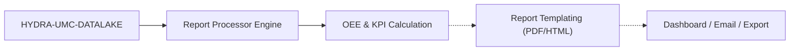

<!-- =============================================================================
HYDRA-UMC-PRODUCTION-REPORTS - KPI and OEE reports built from the datalake
Copyright (C) JuanenRac (Electro Hobby 3D) <electrohobby3d@gmail.com>
GPL-3.0-or-later - see LICENSE
============================================================================= -->

<p align="center">
  
</p>

# 📑 HYDRA-UMC-PRODUCTION-REPORTS

<p align="center">🇺🇸 <b>English</b> | <a href="README_spa.md">🇪🇸 Español</a> | <a href="README_fra.md">🇫🇷 Français</a> | <a href="README_ita.md">🇮🇹 Italiano</a> | <a href="README_deu.md">🇩🇪 Deutsch</a> | <a href="README_zho.md">🇨🇳 简体中文</a> | <a href="README_jpn.md">🇯🇵 日本語</a> | <a href="README_por.md">🇵🇹 Português</a></p>

### 📑 Automated KPI & OEE Reporting Engine for Plant Managers

<p align="center">
  
  
  
  
  
  
</p>

---

**Honesty check - what actually runs today:** the real OEE formula (`oee.py`), the real telemetry-gap availability calculation (`availability.py`), the real HTTP client to HYDRA-UMC-DATALAKE's own `GET /query` (`datalake_client.py`), the shift/day-boundary source of truth including a real night shift crossing midnight (`shift.py`), the byte-for-byte reproducible CSV export (`export.py`), and the real HTTP API exposing all of it (`api.py`: `GET /reports/oee`, `/reports/availability`, `/reports/{oee,availability}/export`, `/stats`) are real and tested (126 tests, `pytest`). What is NOT implemented, despite being listed under "Key Features" below as if it already ran: there is no PDF export anywhere in this codebase (`export.py` only writes CSV and a self-contained HTML page), no scheduling of daily/weekly/monthly reports, and no email/delivery mechanism to "send" anything to a manager - every report is computed live, on request, exactly once per HTTP call. There is also no real `production_event` data source yet (nothing in this ecosystem writes that schema today, see ARCHITECTURE below), so OEE has never been exercised against a live HYDRA-UMC-JOB-DISPATCHER in production - only against a fake DATALAKE in tests and hand-constructed scenarios. See `CHANGELOG.md` for exactly what has shipped so far, and the ROADMAP below for what remains open.

---

> **Safety and security status:** this ecosystem is not a certified safety system. There is no hardware E-STOP path, no firmware-enforced limits or interlocks and no verified motion command yet; firmware images are checked with CRC32 and a shared-key HMAC-SHA256, not with an asymmetric signature; TLS and mutual TLS are optional and off by default; no custom board has been populated or tested yet. Read the [security baseline](https://github.com/JuanenRac/HYDRA-UMC-DOCS/blob/main/docs/SECURITY_BASELINE.md) and the [threat model](https://github.com/JuanenRac/HYDRA-UMC-DOCS/blob/main/docs/THREAT_MODEL.md) before relying on any statement here for the safety of a person.

---

## 📋 At a glance

| | |
|---|---|
| Version | `0.1.6` |
| Maturity | Functional |
| Tests | 126 (`python -m pytest -q tests`) |
| Stack | Python / real OEE formula / http.server |
| Target | The Raspberry Pi CM5 of a HYDRA-UMC cell |
| On real hardware | Not yet: no run on real hardware is recorded for this version |

**Jump to:** [Overview](#-overview) · [Architecture](#-architecture) · [Configuration](#-configuration) · [Quick start](#-quick-start) · [Testing](#-testing) · [Troubleshooting](#-troubleshooting) · [Repository Structure](#-repository-structure) · [Related Projects](#-related-projects)

## 🚦 Project status

Each line is one part of this repository and the light says how far it is today. It is written from what the repository can show (tests, builds, runs), not from what is planned.

🟢 Done and verified · 🟡 Works, with known limits · 🟠 Partly done or not verified yet · 🔴 Not done or not working

| Area | State | What it means here |
|---|---|---|
| Software | 🟡 | Works for its main purpose; the honesty check above lists what is still missing |
| Tests | 🟢 | 126 automated tests, run on every change |
| Real hardware | 🔴 | Not yet: no run on real hardware is recorded for this version |
| Documentation | 🟢 | README in eight languages, checked against the manifest on every change |

## 🎯 Overview

**HYDRA-UMC-PRODUCTION-REPORTS** is the analytical brain for factory management. It processes raw data from the Datalake to generate automated, high-level reports on production efficiency, quality, and machine availability.

It calculates the **OEE (Overall Equipment Effectiveness)** of the entire swarm, identifying bottlenecks in the production line and providing traceability for every component manufactured, from thermal solder profiles to Pick-and-Place accuracy.

### Key Features:
* 📈 **OEE Calculation (implemented):** Availability x Performance x Quality, computed live from DATALAKE telemetry on every request via `GET /reports/oee`.
* 📤 **On-Demand CSV/JSON Reports (implemented):** `GET /reports/{oee,availability}` returns JSON; `GET /reports/{oee,availability}/export` returns byte-for-byte reproducible CSV. There is no PDF export, no scheduled daily/weekly/monthly generation, and no email/delivery mechanism - see ROADMAP below.
* 🛠️ **Bottleneck Analysis (planned):** identifying which robots or tools are causing delays in the mission queue needs the real `production_event` data source below - not implemented yet.
* 🌡️ **Quality Traceability (planned):** linking a final product to its specific assembly logs (thermal, visual, mechanical) is future work, once more than one project writes production data into DATALAKE.
* 🕐 **Shift/Day Boundaries:** `shift.py` gives every report a single, real source of truth for where a shift or calendar day starts/ends - including a real night shift crossing midnight. *(implemented)*
* 🧾 **Versioned Formulas + Traceability:** Every report carries its real `formula_version` and a sha256 `input_fingerprint` over the exact data that produced it. *(implemented)*
* 📤 **Reproducible CSV Export:** `GET /reports/{oee,availability}/export` - byte-for-byte identical output for identical inputs, not just "close enough". *(implemented)* A free-text cell (source id, filter value) that starts with `=`, `+`, `-` or `@` gets a leading apostrophe, so a spreadsheet does not run it as a formula.
* 🧱 **Safe to expose, and honest about its inputs (v0):** the API listens on `127.0.0.1` unless told otherwise, and another address needs a bearer token (`--token` / `PRODUCTION_REPORTS_TOKEN`) or `--allow-anonymous`; only a few reports are built at once (`503` beyond that); non-finite numbers are refused with `400`; windows are half open `[start, end)`, so a sample on a boundary counts in one report only; `day=` and `shift=` derive the window from the shift schedule; `format=html` on an export returns a self-contained HTML page; a report says when its input is inconsistent (`inconsistent_input`) and how many readings it discarded (`unmatched_count`, also in the exports). *(implemented)*
* 🔑 **Reads the data lake with its token:** when HYDRA-UMC-DATALAKE asks for a bearer token, the client sends `HYDRA_UMC_DATALAKE_READ_TOKEN`, else `HYDRA_UMC_DATALAKE_TOKEN` (each also as a file, `..._FILE`, whose first line is the token). With none set it sends no header, as before, and a refusal (401) is reported as the data lake's own answer. *(implemented)*

## 🧩 Role in HYDRA-UMC

**HYDRA-UMC-PRODUCTION-REPORTS** builds OEE and availability reports for plant managers from the history that `HYDRA-UMC-DATALAKE` holds. It keeps no store of its own: every request queries a running datalake, and the same range and filters always give the same bytes, with the sources, the window and the formula version recorded next to the numbers.

## 🏛️ Architecture

<p align="center">
  
</p>

<details>
<summary>Text version of the diagram (Mermaid)</summary>



</details>

### REPORTING FLOW

> Dotted arrows are planned, not implemented: there is no PDF, no report templating, no dashboard or e-mail delivery. Exports are CSV and a self-contained HTML page.

### ARCHITECTURE & DESIGN DECISIONS

* **Why this is a sibling, not a submodule, of HYDRA-UMC-DATALAKE.** Report generation is a periodic, read-only query+compute job against already-stored telemetry - keeping it separate means a report run never competes with HYDRA-UMC-TELEMETRY-COLLECTOR's own real-time writes for the same store's resources. This project holds no database of its own.
* **Real HTTP integration, not a shared library.** `datalake_client.py` talks to a running HYDRA-UMC-DATALAKE instance over plain HTTP (`GET /query`), and deliberately does **not** import DATALAKE's Python package directly even though both currently live in the same dev environment - real HTTP is the real, decoupled integration seam that matches how separate repos/services would actually talk to each other in production.
* **The `production_event` schema is this project's own v0 convention, not an ecosystem standard.** OEE needs to know, per completed cycle, whether the part was good and how long the cycle took. This project defines that as one DATALAKE `Sample` per cycle, `kind="production_event"`, with two fields written together at the same timestamp: `"good"` (1.0/0.0) and `"cycleTimeS"`. No other project writes this kind yet - The natural producer is whatever knows when a cycle starts and ends (the orchestrator, or the robot itself): HYDRA-UMC-JOB-DISPATCHER keeps no timestamps and cannot compute a cycle time.
* **Availability works against ANY existing telemetry stream, on purpose.** Unlike OEE, `availability.py` doesn't need the `production_event` convention at all - it takes any series of timestamps already sitting in DATALAKE (e.g. `motor_temp` samples HYDRA-UMC-TELEMETRY-COLLECTOR already writes) and flags a gap between consecutive samples larger than `expected_interval_ms x gap_factor` as real downtime. This is what actually lets this project "speak" with its telemetry siblings today, before any project writes `production_event` data for real.
* **Performance and Availability are clamped to `[0, 1]`.** A real cycle can run faster than a conservative "ideal" figure, or operating time can exceed a mis-set planned window; reporting >100% would be arithmetically defensible but practically misleading, so both are capped.
* **Unmatched `production_event` fields are counted and reported, never silently defaulted.** If a `"good"` reading has no matching `"cycleTimeS"` at the exact same timestamp (a partial/malformed write), it is excluded and the count of how many were excluded is included in the error/response rather than assuming a 0s cycle time, which would corrupt the Performance figure.
* **Why `shift.py` is a separate module, not inline math in `oee.py`/`availability.py`.** Two reports that quietly disagree about where a shift or calendar day cuts off produce two different, both-defensible numbers for the same real window - the exact contradiction flagged in review. Making shift/day boundaries their own real, tested module (with a real night shift crossing midnight, and a real inverse timestamp-to-shift lookup) gives every report the same source of truth instead of each caller re-deriving its own.
* **Why `formula_version` and `input_fingerprint` are on the report, not just in the CSV.** A report consumed as JSON (by a dashboard, another service) deserves the same traceability as one exported to a file - both fields are additive on the existing `GET /reports/oee`/`GET /reports/availability` responses, not something only visible in `export.py`'s output.
* **Why the CSV export is a new endpoint, not a `?format=csv` flag on the existing routes.** Keeping `GET /reports/oee`/`GET /reports/availability` untouched (still real, still JSON, still exactly what `tests/test_api.py` already asserted) meant the export feature could be added and proven reproducible without touching a single already-tested response.

## ⚙️ Configuration

| Variable | Default | What it sets |
|---|---|---|
| `--addr` | `127.0.0.1` | address the API binds to; another address needs a token or `--allow-anonymous` |
| `--port` | `8099` | port of the API |
| `--datalake-url` | `http://localhost:8095` | datalake that every request queries |
| `--token` / `PRODUCTION_REPORTS_TOKEN` | none | bearer token that every route except `GET /health` requires |
| `--max-concurrent-reports` | `4` | reports built at the same time; beyond that a request gets 503 |

## 🚀 Quick start

Requires Python 3.10 or newer.

```bash
./build.sh  # Linux, macOS (build.bat on Windows)
./run.sh --datalake-url http://localhost:8095
curl http://127.0.0.1:8099/reports/oee?...
```

## 🧪 Testing

126 automated tests run with `python -m pytest -q tests`. They need no hardware and nothing outside this machine.

The CI runs `HYDRA_UMC_CI=1 python tools/ci_validate.py`, which checks the manifest, the documents, the eight READMEs and the pictures.

## 🏗️ Build & Release

Requires Python >= 3.10.

```bash
# Linux/macOS
./build.sh && ./run.sh --datalake-url http://localhost:8095

# Windows
build.bat
run.bat --datalake-url http://localhost:8095
```

`build` creates/activates a local `.venv`, installs the package in editable mode with dev extras, verifies the import, and runs the real `pytest` suite. `run` starts the real HTTP API (default port `8099`) against a HYDRA-UMC-DATALAKE instance at `--datalake-url` (default `http://localhost:8095`).

```bash
# Real OEE report for source "robot-1" over a 5-second window
curl "http://localhost:8099/reports/oee?sourceId=robot-1&start=0&end=5000&plannedTimeS=10.0&idealCycleTimeS=2.0"

# Real availability report for the same source's motor_temp stream
curl "http://localhost:8099/reports/availability?sourceId=robot-1&kind=motor_temp&field=value&start=0&end=10000&expectedIntervalMs=1000"
```

## 🩺 Troubleshooting

| You see | Because | Do |
|---|---|---|
| HTTP 503 | Four reports are already being built (each can bring up to two queries of 200,000 points into memory) | Retry shortly, or raise `--max-concurrent-reports` if the machine has the memory |
| exit status 2 at start | The address is not loopback and there is neither a token nor `--allow-anonymous` | Set `PRODUCTION_REPORTS_TOKEN` (or `--token`), or use `--allow-anonymous` in a lab |

## 📂 Repository Structure

<p align="center">
  
</p>

<details>
<summary>Text version of the tree</summary>

```text
HYDRA-UMC-PRODUCTION-REPORTS/
├── src/hydra_umc_production_reports/   source code
│   ├── __init__.py                     Package version
│   ├── datalake_client.py              Real HTTP client for HYDRA-UMC-DATALAKE's GET /query API
│   ├── oee.py                          Real OEE formula (Availability x Performance x Quality)
│   ├── availability.py                 Real downtime-from-telemetry-gaps calculation
│   ├── reports.py                      Orchestration: DatalakeClient -> oee.py / availability.py
│   ├── shift.py                        Real shift/day-boundary computation (source of truth)
│   ├── export.py                       Real, byte-for-byte reproducible CSV export
│   ├── api.py                          Real HTTP API (GET /reports/oee, /reports/availability, /stats, /export)
│   ├── main.py                         Entry point - starts the real HTTP server
│   └── provenance.py                   Where a report's numbers came from: source, series, time window, samples and program version
├── tests/                              Real tests: OEE/availability/shift/export math, fake-DATALAKE round-trips
├── docs/                               documents of the project
├── images/                             Media and diagrams
├── systemd/                            service unit
├── tools/                              project tools and CI checks
├── .github/                            CI workflow and issue templates
├── mejoras_futuras.txt                 The complete, honest list of what's deliberately deferred and why
├── pyproject.toml                      Package metadata + [dev] extras (pytest)
├── bump_version.py                     explicit version bump
├── bump_manifest_version.py            Syncs hydra-umc.project.json's version to the native one (--sync)
├── build.sh / build.bat                Real build: venv + editable install + real test suite
├── run.sh / run.bat                    Real run: starts the HTTP API
├── CHANGELOG.md                        what changed in each version
├── build-test.sh                       non-mutating build check
├── hydra-umc.project.json              manifest: version, maturity, family
└── test.sh                             runs the tests
```

</details>

## 🗺️ Roadmap & Known limits

**Known limits today**

* **Done (v0):** real OEE and availability calculation, real HTTP integration with HYDRA-UMC-DATALAKE, real HTTP API, real shift/day boundaries, versioned formulas + input fingerprinting, byte-for-byte reproducible CSV export.
* **Next:** a real `production_event` data source - having the orchestrator (or the robot) report cycle completions in this schema.
* **Next:** persistent/scheduled reports (currently every report is computed live, on request).
* **Later:** PDF export, an email/delivery mechanism, and a dashboard.
* AI-driven ROI analysis for tool upgrades, ties into the same OEE data once historical trends are stored.

## 🌍 Languages

This README and the documents of the repository exist in eight languages: English, Spanish, German, French, Italian, Japanese, Chinese and Portuguese (Portugal). They are written together and checked in the CI so that the eight files have the same sections and the same links. This repository has no screen or message catalogue of its own, so there are no interface strings to translate.

## 🔗 Related Projects

This project is part of the HYDRA-UMC robotics ecosystem by the same author (JuanenRac / Electro Hobby 3D). Worth knowing about, since a request might actually be about one of these rather than this repository.

**Parent Project**
- **[HYDRA-UMC-DATALAKE](https://github.com/JuanenRac/HYDRA-UMC-DATALAKE)** — real sqlite3-backed time-series store with a real ingest/query HTTP API; the parent this repo is one specific analytics service of, within its own data-and-analytics layer.

**Sibling Projects** — the other analytics services of HYDRA-UMC-DATALAKE's own data-and-analytics layer
- **[HYDRA-UMC-TELEMETRY-COLLECTOR](https://github.com/JuanenRac/HYDRA-UMC-TELEMETRY-COLLECTOR)** — real CAN/WebSocket ingestion pipeline into DATALAKE, with sequence deduplication — also a real data source today: this report's own `availability.py` reads its `motor_temp` samples (and any other series it writes) straight out of Datalake, no `production_event` convention needed for that report.
- **[HYDRA-UMC-ANOMALY-DETECTOR](https://github.com/JuanenRac/HYDRA-UMC-ANOMALY-DETECTOR)** — real FFT + statistical baseline anomaly detector with drift monitoring.

**Directly Related**
- **[HYDRA-UMC-JOB-DISPATCHER](https://github.com/JuanenRac/HYDRA-UMC-JOB-DISPATCHER)** — real priority-based job queue with deduplication, over a real HTTP API — the intended real source of `production_event` samples (OEE's own good/cycle-time convention) once mission completions are wired to write them; nothing writes that kind yet, tracked honestly as future work rather than claimed as done.

**Also Part of the Ecosystem**

*Core Hardware & Platform*
- **[HYDRA-UMC](https://github.com/JuanenRac/HYDRA-UMC)** — the robot-arm motherboard design: CM5 host + dual-core STM32H745, meant to orchestrate up to 8 tool arms over CAN-OTA/SPI-OTA (firmware at an early stage; no populated board yet).
- **[HYDRA-UMC-OS](https://github.com/JuanenRac/HYDRA-UMC-OS)** — reproducible Raspberry Pi OS product layer for the CM5: read-only agent, validated config/profiles, WiFi first-contact provisioning.
- **[HYDRA-UMC-SDK](https://github.com/JuanenRac/HYDRA-UMC-SDK)** — the shared JSON-Schema contract and software job-gate boundary every bridge validates its commands against (not a certified safety function).
- **[HYDRA-UMC-CONNECTOR-HUB](https://github.com/JuanenRac/HYDRA-UMC-CONNECTOR-HUB)** — declarative adapter-manifest registry and validator for external-machine connectors; extends the SDK's own contract idea to external machines without replacing the industrial-gateway projects.

*Core Backend & Clients*
- **[HYDRA-UMC-SERVER](https://github.com/JuanenRac/HYDRA-UMC-SERVER)** — the real headless backend (REST/WebSocket) every control client actually talks to.
- **[HYDRA-UMC-STUDIO](https://github.com/JuanenRac/HYDRA-UMC-STUDIO)** — web control dashboard with real-time multi-robot 3D visualization.
- **[HYDRA-UMC-SUITE](https://github.com/JuanenRac/HYDRA-UMC-SUITE)** — desktop (PySide6) swarm command center for multiple servers at once, packaged as a standalone executable.
- **[HYDRA-UMC-ANDROID-CONTROL](https://github.com/JuanenRac/HYDRA-UMC-ANDROID-CONTROL)** — native Android control app with biometric login and a paired Wear OS companion.
- **[HYDRA-UMC-IOS-CONTROL](https://github.com/JuanenRac/HYDRA-UMC-IOS-CONTROL)** — iOS/iPadOS control app (Flutter) with real-time WebSocket sync.
- **[HYDRA-UMC-DSI](https://github.com/JuanenRac/HYDRA-UMC-DSI)** — native touch UI for the onboard 7" DSI touchscreen, embedded on the CM5 itself.
- **[HYDRA-UMC-EDITOR-URDF](https://github.com/JuanenRac/HYDRA-UMC-EDITOR-URDF)** — desktop graphical URDF creator/editor that pushes finished models into STUDIO's own catalog.
- **[HYDRA-UMC-EDITOR-STL](https://github.com/JuanenRac/HYDRA-UMC-EDITOR-STL)** — desktop STL model editor, transforming/replacing/removing/adding real parts in the same model catalog HYDRA-UMC-EDITOR-URDF also edits.
- **[HYDRA-UMC-BRIDGE-AMR](https://github.com/JuanenRac/HYDRA-UMC-BRIDGE-AMR)** — coordination boundary for AGV/AMR fleets via a VDA 5050 MQTT publisher (tested against an emulated fleet only).
- **[HYDRA-UMC-BRIDGE-CNC](https://github.com/JuanenRac/HYDRA-UMC-BRIDGE-CNC)** — high-level CNC-cell coordinator with GRBL status/control-byte access (tested against an emulator only).
- **[HYDRA-UMC-BRIDGE-DROIDS](https://github.com/JuanenRac/HYDRA-UMC-BRIDGE-DROIDS)** — coordination boundary for legged/humanoid droids, with a Boston Dynamics Spot command sender (tested against an emulator only).
- **[HYDRA-UMC-BRIDGE-LASER](https://github.com/JuanenRac/HYDRA-UMC-BRIDGE-LASER)** — laser-cell coordinator reading 3 key/enclosure/interlock GPIO signals (tested against a fake chip only; it cannot arm or fire a laser).
- **[HYDRA-UMC-BRIDGE-OPENPNP](https://github.com/JuanenRac/HYDRA-UMC-BRIDGE-OPENPNP)** — safe high-level board-flow coordinator for OpenPnP pick-and-place.
- **[HYDRA-UMC-BRIDGE-PRINTER3D](https://github.com/JuanenRac/HYDRA-UMC-BRIDGE-PRINTER3D)** — safe coordination boundary for Moonraker/Klipper 3D printers, with real gated job commands.
- **[HYDRA-UMC-BRIDGE-ROS2](https://github.com/JuanenRac/HYDRA-UMC-BRIDGE-ROS2)** — coordinator with a lazily imported rclpy ROS 2 transport (not yet run against a ROS 2 installation).
- **[HYDRA-UMC-BRIDGE-UAV](https://github.com/JuanenRac/HYDRA-UMC-BRIDGE-UAV)** — coordination boundary for camera-equipped UAVs, with a MAVLink command sender (tested against an emulator only).

*URTC Tool Platform*
- **[URTC](https://github.com/JuanenRac/URTC)** — firmware for the physical Universal Robot Tool Controller PCB, 25+ tool profiles over CAN bus.
- **[URTC-FLASHER](https://github.com/JuanenRac/URTC-FLASHER)** — desktop GUI flashing tool for URTC boards, CAN-OTA plus full-chip SWD/JTAG.
- **[URTC-TESTER](https://github.com/JuanenRac/URTC-TESTER)** — desktop live CAN-bus diagnostic tool for URTC boards, one panel per tool profile.
- **[URTC-WEB-STUDIO](https://github.com/JuanenRac/URTC-WEB-STUDIO)** — browser-based alternative to URTC-TESTER via the Web Serial API, no local install needed.
- **[URTC-GATEWAY](https://github.com/JuanenRac/URTC-GATEWAY)** — gateway in front of the URTC CAN bus: an allowed list of identifiers, a rate limit and a session key; software tested on a computer, not yet on a real bus.

*Vision AI Node (Hailo-8)*
- **[HYDRA-UMC-VISION-NODE](https://github.com/JuanenRac/HYDRA-UMC-VISION-NODE)** — integration hub for the Hailo-8 vision pipeline, with a real per-stage hardware-readiness check.
- **[HYDRA-UMC-DETECTION-HEF](https://github.com/JuanenRac/HYDRA-UMC-DETECTION-HEF)** — real compiled-model registry with Hailo-architecture/checksum safe-load verification.
- **[HYDRA-UMC-VISION-STREAMER](https://github.com/JuanenRac/HYDRA-UMC-VISION-STREAMER)** — real GStreamer pipeline + MediaMTX config generator with a real HailoRT integration boundary.
- **[HYDRA-UMC-VISUAL-SERVOING-API](https://github.com/JuanenRac/HYDRA-UMC-VISUAL-SERVOING-API)** — Position-Based Visual Servoing correction law with authorisation gated on the zone state; no camera pose estimation yet.
- **[HYDRA-UMC-SAFETY-ZONES](https://github.com/JuanenRac/HYDRA-UMC-SAFETY-ZONES)** — v0 zone-breach, calibration-freshness and E-STOP-request logic that takes object positions from a file; no detector feeds it and no physical E-STOP is wired to it yet.

*Cognitive AI Node (Hailo-10)*
- **[HYDRA-UMC-COGNITIVE-NODE](https://github.com/JuanenRac/HYDRA-UMC-COGNITIVE-NODE)** — integration hub for the Hailo-10 cognitive pipeline (LLM/VLA/voice orchestration).
- **[HYDRA-UMC-VLA-ENGINE](https://github.com/JuanenRac/HYDRA-UMC-VLA-ENGINE)** — real action-token encoding/decoding and trajectory generation for a Vision-Language-Action model.
- **[HYDRA-UMC-VOICE-UI](https://github.com/JuanenRac/HYDRA-UMC-VOICE-UI)** — real voice front-end (VAD + intent parser) with a bounded, confirmation-gated Watch relay.
- **[HYDRA-UMC-SEMANTIC-PLANNER](https://github.com/JuanenRac/HYDRA-UMC-SEMANTIC-PLANNER)** — real rule-based task decomposition and semantic error recovery over MCU error codes.
- **[HYDRA-UMC-DOCS-QA](https://github.com/JuanenRac/HYDRA-UMC-DOCS-QA)** — real stdlib-only TF-IDF document search over this ecosystem's own Markdown docs.
- **[HYDRA-UMC-LOCAL-TECHNICIAN](https://github.com/JuanenRac/HYDRA-UMC-LOCAL-TECHNICIAN)** — local, policy-gated AI maintenance technician for the ecosystem itself - observes, diagnoses and proposes fixes; the two highest risk levels are deliberately not implemented yet.

*Orchestration & Swarm*
- **[HYDRA-UMC-ORCHESTRATOR](https://github.com/JuanenRac/HYDRA-UMC-ORCHESTRATOR)** — integration hub with a real gRPC/Protobuf health-report contract and mission state machine.
- **[HYDRA-UMC-NODE-HEALING](https://github.com/JuanenRac/HYDRA-UMC-NODE-HEALING)** — real gRPC-based fleet health watchdog with retry/backoff and identity-mismatch detection.
- **[HYDRA-UMC-PATH-PLANNER-3D](https://github.com/JuanenRac/HYDRA-UMC-PATH-PLANNER-3D)** — real RRT-based 3D path planner with real obstacle/workspace collision validation.
- **[HYDRA-UMC-SWARM-SYNC](https://github.com/JuanenRac/HYDRA-UMC-SWARM-SYNC)** — real CRDT LWW-Element-Map state sync, property-tested for multi-cell convergence.

*Digital Twin & Simulation*
- **[HYDRA-UMC-TWIN](https://github.com/JuanenRac/HYDRA-UMC-TWIN)** — integration hub for the digital-twin engine, with a real version-compatibility sync contract.
- **[HYDRA-UMC-HIL-BRIDGE](https://github.com/JuanenRac/HYDRA-UMC-HIL-BRIDGE)** — hardware-in-the-loop router with a software collision interlock between simulation and real hardware (tested without real hardware).
- **[HYDRA-UMC-PHYSICS-REPLICA](https://github.com/JuanenRac/HYDRA-UMC-PHYSICS-REPLICA)** — real forward kinematics and joint-limit validation over a real URDF subset.
- **[HYDRA-UMC-SYNTHETIC-DATA-GEN](https://github.com/JuanenRac/HYDRA-UMC-SYNTHETIC-DATA-GEN)** — real procedural 2D scene generator with YOLO/COCO annotation export.

*Industrial Gateway*
- **[HYDRA-UMC-GATEWAY-INDUSTRIAL](https://github.com/JuanenRac/HYDRA-UMC-GATEWAY-INDUSTRIAL)** — integration hub relaying to industrial protocols, with a real command allowlist/backpressure layer.
- **[HYDRA-UMC-OPCUA-SERVER](https://github.com/JuanenRac/HYDRA-UMC-OPCUA-SERVER)** — real OPC-UA address space, verified with a real binary-protocol client session.
- **[HYDRA-UMC-MQTT-BROKER](https://github.com/JuanenRac/HYDRA-UMC-MQTT-BROKER)** — real MQTT broker with optional per-client authentication and topic ACLs.
- **[HYDRA-UMC-MTCONNECT-ADAPTER](https://github.com/JuanenRac/HYDRA-UMC-MTCONNECT-ADAPTER)** — real MTConnect `/probe` and `/current` XML endpoints with degraded-mode output.

*Complementary Tools & Ecosystem Operations*
- **[HYDRA-UMC-DASHBOARD-AI](https://github.com/JuanenRac/HYDRA-UMC-DASHBOARD-AI)** — Smart Summaries and Anomaly Highlighting panels over DATALAKE/ANOMALY-DETECTOR, with an honest statistical fallback.
- **[HYDRA-UMC-TOOL-CLI](https://github.com/JuanenRac/HYDRA-UMC-TOOL-CLI)** — fleet CLI with a real, stable exit-code contract, a genuine live client of HYDRA-UMC-SERVER's own API.
- **[HYDRA-UMC-WATCH](https://github.com/JuanenRac/HYDRA-UMC-WATCH)** — WearOS companion app with haptic alert patterns and a paired-phone voice relay (not yet run on a physical watch).
- **[URTC-SMART-RACK](https://github.com/JuanenRac/URTC-SMART-RACK)** — firmware for a board-mounting rack with real tool-ID decoding and Smart Idle pre-heating logic.
- **[URTC-VISION-TOOL](https://github.com/JuanenRac/URTC-VISION-TOOL)** — firmware plus a real Python vision companion for a thermal/RGB inspection tool head.
- **[HYDRA-UMC-UPDATER](https://github.com/JuanenRac/HYDRA-UMC-UPDATER)** — administrative desktop tool that discovers, clones and updates every repo in this ecosystem.
- **[HYDRA-UMC-OS-REBUILDER](https://github.com/JuanenRac/HYDRA-UMC-OS-REBUILDER)** — Windows/Linux desktop tool that builds a ready-to-flash CM5 image pre-loaded with the ecosystem's most current versions, with Raspberry-Pi-Imager-style first-boot Wi-Fi/user/SSH configuration.
- **[HYDRA-UMC-OPS-AGENT](https://github.com/JuanenRac/HYDRA-UMC-OPS-AGENT)** — maintenance-incident coordinator: a low-privilege edge role collects a sanitized inventory/health snapshot, a control-plane role renders it read-only and asks an AI provider to suggest a diagnosis - never applies a patch or deploys anything.
- **[HYDRA-UMC-DEV-SERVER](https://github.com/JuanenRac/HYDRA-UMC-DEV-SERVER)** — reproducible development host (Raspberry Pi 5 / CM5) that stores the ecosystem's source and runs bounded build/test tasks under a durable queue; a dedicated dev role, explicitly not an operational CM5.

## 📚 Documentation

Where to read more:

* [Security baseline of the ecosystem](https://github.com/JuanenRac/HYDRA-UMC-DOCS/blob/main/docs/SECURITY_BASELINE.md)
* [Threat model of the ecosystem](https://github.com/JuanenRac/HYDRA-UMC-DOCS/blob/main/docs/THREAT_MODEL.md)
* [Changelog of this repository](CHANGELOG.md)
* [License of this repository](LICENSE.md)

## 🤝 Contributing & Community

* Before a pull request run `HYDRA_UMC_CI=1 py -3 tools/ci_validate.py` (or `HYDRA_UMC_CI=1 python3 tools/ci_validate.py`): it must print `CI_VALIDATION=PASS`. Do not run `build.sh` or `build.bat` for this check; building is not a check.
* The eight READMEs are written from one source in HYDRA-UMC-DOCS; do not edit them by hand. Change the source and write them again with `tools/make_readmes.py`.
* Do not state in a README what has not run: say "simulated" or "not tried on hardware" where that is the truth.
* See [CONTRIBUTING.md](CONTRIBUTING.md), the [code of conduct](CODE_OF_CONDUCT.md), [SECURITY.md](SECURITY.md) and [SUPPORT.md](SUPPORT.md).

## 👤 AUTHOR

**JuanenRac (Electro Hobby 3D)** · electrohobby3d@gmail.com

## 📜 LICENSE

GPL-3.0-or-later - [LICENSE](LICENSE).
