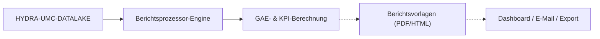

<!-- =============================================================================
HYDRA-UMC-PRODUCTION-REPORTS - KPI and OEE reports built from the datalake
Copyright (C) JuanenRac (Electro Hobby 3D) <electrohobby3d@gmail.com>
GPL-3.0-or-later - see LICENSE
============================================================================= -->

<p align="center">
  
</p>

# 📑 HYDRA-UMC-PRODUCTION-REPORTS

<p align="center"><a href="README.md">🇺🇸 English</a> | <a href="README_spa.md">🇪🇸 Español</a> | <a href="README_fra.md">🇫🇷 Français</a> | <a href="README_ita.md">🇮🇹 Italiano</a> | 🇩🇪 <b>Deutsch</b> | <a href="README_zho.md">🇨🇳 简体中文</a> | <a href="README_jpn.md">🇯🇵 日本語</a> | <a href="README_por.md">🇵🇹 Português</a></p>

### 📑 Automatisierte KPI- & GAE-Berichts-Engine für Betriebsleiter

<p align="center">
  
  
  
  
  
  
</p>

---

**Ehrlichkeitscheck - was heute wirklich läuft:** die echte GAE-Formel (`oee.py`), die echte Verfügbarkeitsberechnung aus Telemetrielücken (`availability.py`), der echte HTTP-Client zum eigenen `GET /query` von HYDRA-UMC-DATALAKE (`datalake_client.py`), die einzige Quelle der Wahrheit für Schicht-/Tagesgrenzen einschließlich einer echten Nachtschicht über Mitternacht hinaus (`shift.py`), der byteidentisch reproduzierbare CSV-Export (`export.py`) und die echte HTTP-API, die all das bereitstellt (`api.py`: `GET /reports/oee`, `/reports/availability`, `/reports/{oee,availability}/export`, `/stats`), sind real und getestet (133 Tests, `pytest`). Was NICHT implementiert ist, obwohl es weiter unten unter "Hauptmerkmale" so aufgeführt ist, als liefe es bereits: Es gibt nirgendwo in diesem Code einen PDF-Export (`export.py` schreibt ausschließlich CSV und eine eigenständige HTML-Seite), keine Planung von täglichen/wöchentlichen/monatlichen Berichten und keinen E-Mail-/Zustellmechanismus, um irgendetwas an einen Manager zu "senden" - jeder Bericht wird live, auf Anfrage, genau einmal pro HTTP-Aufruf berechnet. Es gibt auch noch keine echte `production_event`-Datenquelle (nichts in diesem Ökosystem schreibt dieses Schema heute, siehe ARCHITEKTUR weiter unten), sodass die GAE noch nie gegen einen echten, produktiven HYDRA-UMC-JOB-DISPATCHER getestet wurde - nur gegen ein simuliertes DATALAKE in Tests und von Hand konstruierte Szenarien. Siehe `CHANGELOG.md` für genau das, was bisher ausgeliefert wurde, und die ROADMAP weiter unten für das, was noch offen ist.

---

> **Stand von Sicherheit (Safety) und Security:** Dieses Ökosystem ist kein zertifiziertes Sicherheitssystem. Es gibt noch keinen Hardware-E-STOP-Pfad, keine von der Firmware durchgesetzten Grenzen oder Verriegelungen und keinen verifizierten Bewegungsbefehl; Firmware-Images werden mit CRC-32 und einer Ed25519-Signatur geprüft, und ein Release-Build verweigert die veröffentlichten Entwicklungsschlüssel (die Werkzeugköpfe und Erweiterungsplatinen hinter dem Relais laufen noch mit URTC-Bootloadern, die statt einer Signatur ein HMAC-SHA256 mit gemeinsamem Schlüssel verwenden); TLS und gegenseitiges TLS sind optional und standardmäßig aus; noch keine eigene Platine wurde bestückt oder getestet. Lesen Sie die [Sicherheitsbasis](https://github.com/JuanenRac/HYDRA-UMC-DOCS/blob/main/docs/SECURITY_BASELINE.md) und das [Bedrohungsmodell](https://github.com/JuanenRac/HYDRA-UMC-DOCS/blob/main/docs/THREAT_MODEL.md), bevor Sie sich für die Sicherheit einer Person auf eine Aussage hier verlassen.

---

## 📋 Auf einen Blick

| | |
|---|---|
| Version | `0.1.6` |
| Reifegrad | Funktionsfähig |
| Tests | 133 (`python -m pytest -q tests`) |
| Technik | Python / real OEE formula / http.server |
| Ziel | Der Raspberry Pi CM5 einer HYDRA-UMC-Zelle |
| Auf echter Hardware | Noch nicht: für diese Version ist kein Lauf auf echter Hardware vermerkt |

**Springe zu:** [Überblick](#-überblick) · [Architektur](#-architektur) · [Konfiguration](#-konfiguration) · [Schnellstart](#-schnellstart) · [Tests](#-tests) · [Fehlerbehebung](#-fehlerbehebung) · [Struktur des Repositorys](#-struktur-des-repositorys) · [Verwandte Projekte](#-verwandte-projekte)

## 🚦 Projektstatus

Jede Zeile ist ein Teil dieses Repositorys, und die Ampel sagt, wie weit er heute ist. Sie beruht auf dem, was das Repository zeigen kann (Tests, Builds, Läufe), nicht auf dem, was geplant ist.

🟢 Fertig und überprüft · 🟡 Funktioniert, mit bekannten Grenzen · 🟠 Teilweise fertig oder noch nicht überprüft · 🔴 Nicht gemacht oder funktioniert nicht

| Bereich | Stand | Was das hier bedeutet |
|---|---|---|
| Software | 🟡 | Funktioniert für seinen Hauptzweck; die Ehrlichkeitsprüfung oben nennt, was noch fehlt |
| Tests | 🟢 | 133 automatische Tests, bei jeder Änderung ausgeführt |
| Echte Hardware | 🔴 | Noch nicht: für diese Version ist kein Lauf auf echter Hardware vermerkt |
| Dokumentation | 🟢 | README in acht Sprachen, bei jeder Änderung gegen das Manifest geprüft |

## 🎯 Überblick

**HYDRA-UMC-PRODUCTION-REPORTS** ist das analytische Gehirn für das Fabrikmanagement. Es verarbeitet Rohdaten aus dem Datalake, um automatisierte High-Level-Berichte über Produktionseffizienz, Qualität und Maschinenverfügbarkeit zu erstellen.

Es berechnet die **GAE (Gesamtanlageneffektivität / OEE)** des gesamten Schwarms, identifiziert Engpässe in der Produktionslinie und bietet Rückverfolgbarkeit für jede hergestellte Komponente, von thermischen Lötprofilen bis hin zur Pick-and-Place-Genauigkeit.

### Hauptmerkmale:
* 📈 **GAE-Berechnung (implementiert):** Verfügbarkeit x Leistung x Qualität, live aus DATALAKE-Telemetrie bei jeder Anfrage über `GET /reports/oee` berechnet.
* 📤 **CSV/JSON-Berichte auf Abruf (implementiert):** `GET /reports/{oee,availability}` liefert JSON; `GET /reports/{oee,availability}/export` liefert byteidentisch reproduzierbares CSV. Es gibt keinen PDF-Export, keine geplante tägliche/wöchentliche/monatliche Erzeugung und keinen E-Mail-/Zustellmechanismus - siehe ROADMAP weiter unten.
* 🛠️ **Engpassanalyse (geplant):** die Identifizierung, welche Roboter oder Werkzeuge Verzögerungen in der Missionswarteschlange verursachen, benötigt die echte `production_event`-Datenquelle weiter unten - noch nicht implementiert.
* 🌡️ **Qualitätsrückverfolgbarkeit (geplant):** die Verknüpfung eines Endprodukts mit seinen spezifischen Montageprotokollen (thermisch, visuell, mechanisch) ist zukünftige Arbeit, sobald mehr als ein Projekt Produktionsdaten in DATALAKE schreibt.
* 🕐 **Schicht-/Tagesgrenzen:** `shift.py` gibt jedem Bericht eine einzige, echte Quelle der Wahrheit dafür, wo eine Schicht oder ein Kalendertag beginnt/endet - einschließlich einer echten Nachtschicht, die über Mitternacht hinausgeht. *(implementiert)*
* 🧾 **Versionierte Formeln + Rückverfolgbarkeit:** Jeder Bericht trägt seine echte `formula_version` und einen sha256-`input_fingerprint` über die exakten Daten, die ihn erzeugt haben. *(implementiert)*
* 📤 **Reproduzierbarer CSV-Export:** `GET /reports/{oee,availability}/export` - byteidentische Ausgabe für identische Eingaben, nicht nur "nah genug". *(implementiert)* Eine Freitextzelle (Quell-ID, Filterwert), die mit `=`, `+`, `-` oder `@` beginnt, erhält ein führendes Apostroph, damit eine Tabellenkalkulation sie nicht als Formel ausführt.
* 🧱 **Sicher exponierbar und ehrlich zu seinen Eingaben (v0):** Die API lauscht auf `127.0.0.1`, sofern nichts anderes angegeben ist; eine andere Adresse verlangt ein Bearer-Token (`--token` / `PRODUCTION_REPORTS_TOKEN`) oder `--allow-anonymous`; es werden nur wenige Berichte gleichzeitig erstellt (darüber `503`); nicht endliche Zahlen werden mit `400` abgelehnt; Fenster sind halboffen `[start, end)`, ein Messwert auf der Grenze zählt also nur in einem Bericht; `day=` und `shift=` leiten das Fenster aus dem Schichtplan ab; `format=html` bei einem Export liefert eine eigenständige HTML-Seite; ein Bericht sagt, wenn seine Eingabe inkonsistent ist (`inconsistent_input`) und wie viele Messwerte er verworfen hat (`unmatched_count`, auch in den Exporten). *(implementiert)*
* 🔑 **Liest den Data Lake mit seinem Token:** Verlangt HYDRA-UMC-DATALAKE ein Bearer-Token, sendet der Client `HYDRA_UMC_DATALAKE_READ_TOKEN`, sonst `HYDRA_UMC_DATALAKE_TOKEN` (jeweils auch als Datei, `..._FILE`, deren erste Zeile das Token ist). Ohne eines sendet er keinen Header, wie bisher, und eine Ablehnung (401) wird als Antwort des Data Lakes selbst gemeldet. *(implementiert)*
* 🏭 **OEE der ganzen Flotte:** `GET /reports/oee/fleet` berechnet den OEE mehrerer Quellen über ein Zeitfenster, mit dem Bericht jeder Quelle, den zusammengefassten Zahlen der Gruppe (alle Betriebszeit über alle geplante Zeit, alle guten Teile über alle Teile) und dem Engpass, also der Quelle mit dem niedrigsten OEE und dem Faktor, der ihn drückt. Eine Quelle ohne Daten wird mit ihrem Grund aufgeführt und verdeckt die anderen nicht.

## 🧩 Rolle in HYDRA-UMC

**HYDRA-UMC-PRODUCTION-REPORTS** erstellt OEE- und Verfügbarkeitsberichte für Werksleiter aus der Historie, die `HYDRA-UMC-DATALAKE` hält. Er hat keinen eigenen Speicher: Jede Anfrage fragt einen laufenden Datalake ab, und derselbe Bereich und dieselben Filter ergeben immer dieselben Bytes, mit Quellen, Zeitfenster und Formelversion neben den Zahlen.

## 🏛️ Architektur

<p align="center">
  
</p>

<details>
<summary>Textversion des Diagramms (Mermaid)</summary>



</details>

### BERICHTSABLAUF

> Gepunktete Pfeile sind geplant, nicht umgesetzt: Es gibt kein PDF, keine Berichtsvorlagen, kein Dashboard und keinen E-Mail-Versand. Exporte sind CSV und eine eigenständige HTML-Seite.

### ARCHITEKTUR & DESIGNENTSCHEIDUNGEN

* **Warum es Geschwister, kein Submodul, von HYDRA-UMC-DATALAKE ist.** Berichtserstellung ist ein periodischer Abfrage+Berechnungs-Job über bereits gespeicherte Telemetrie - sie getrennt zu halten bedeutet, dass ein Berichtslauf nie mit den eigenen Echtzeit-Schreibvorgängen von HYDRA-UMC-TELEMETRY-COLLECTOR um die Ressourcen desselben Speichers konkurriert. Dieses Projekt besitzt keine eigene Datenbank.
* **Echte HTTP-Integration statt einer gemeinsamen Bibliothek.** `datalake_client.py` spricht über einfaches HTTP (`GET /query`) mit einer laufenden HYDRA-UMC-DATALAKE-Instanz und importiert bewusst NICHT das Python-Paket von DATALAKE direkt, obwohl beide heute in derselben Dev-Umgebung liegen - echtes HTTP ist die echte, entkoppelte Integrationsnaht, die dem entspricht, wie getrennte Repos/Dienste in der Produktion tatsächlich miteinander sprechen würden.
* **Das `production_event`-Schema ist die eigene v0-Konvention dieses Projekts, kein Ökosystem-Standard.** Für OEE muss für jeden abgeschlossenen Zyklus bekannt sein, ob das Teil gut war und wie lange der Zyklus dauerte. Dieses Projekt definiert das als ein DATALAKE-`Sample` pro Zyklus, `kind="production_event"`, mit zwei gemeinsam zum selben Zeitstempel geschriebenen Feldern: `"good"` (1.0/0.0) und `"cycleTimeS"`. Noch kein anderes Projekt schreibt diesen kind - Der natürliche Erzeuger ist, was weiß, wann ein Zyklus beginnt und endet (der Orchestrator oder der Roboter selbst): HYDRA-UMC-JOB-DISPATCHER speichert keine Zeitstempel und kann keine Zykluszeit berechnen.
* **Verfügbarkeit funktioniert absichtlich gegen JEDEN vorhandenen Telemetrie-Stream.** Anders als OEE benötigt `availability.py` überhaupt nicht die `production_event`-Konvention - es nimmt jede bereits in DATALAKE vorhandene Zeitstempel-Serie (z. B. `motor_temp`-Samples, die HYDRA-UMC-TELEMETRY-COLLECTOR bereits schreibt) und markiert eine Lücke zwischen aufeinanderfolgenden Samples, die größer als `expected_interval_ms x gap_factor` ist, als echte Ausfallzeit. Genau das erlaubt es diesem Projekt schon heute, mit seinen Telemetrie-Geschwistern zu "sprechen", noch bevor irgendein Projekt echte `production_event`-Daten schreibt.
* **Performance und Availability sind auf `[0, 1]` begrenzt.** Ein echter Zyklus kann schneller laufen als eine vorsichtige "Ideal"-Zahl, oder die Betriebszeit kann ein falsch eingestelltes Planfenster überschreiten; eine Meldung von >100% wäre rechnerisch vertretbar, aber praktisch irreführend, daher werden beide begrenzt.
* **Nicht zugeordnete `production_event`-Felder werden gezählt und gemeldet, niemals still auf einen Standardwert gesetzt.** Wenn ein `"good"`-Wert keinen passenden `"cycleTimeS"`-Wert zum exakt gleichen Zeitstempel hat (ein partieller/fehlerhafter Schreibvorgang), wird er ausgeschlossen, und die Anzahl der ausgeschlossenen Werte wird im Fehler/in der Antwort angegeben, statt eine Zykluszeit von 0s anzunehmen, was die Performance-Zahl verfälschen würde.
* **Warum `shift.py` ein eigenständiges Modul ist, keine Inline-Mathematik in `oee.py`/`availability.py`.** Zwei Berichte, die sich still darüber uneinig sind, wo eine Schicht oder ein Kalendertag endet, erzeugen zwei unterschiedliche, beide vertretbare Zahlen für dasselbe reale Zeitfenster - genau der Widerspruch, der in der Prüfung bemängelt wurde. Schicht-/Tagesgrenzen zu einem eigenen, echten, getesteten Modul zu machen (mit einer echten Nachtschicht über Mitternacht hinweg und einer echten inversen Zeitstempel-zu-Schicht-Suche) gibt jedem Bericht dieselbe Quelle der Wahrheit, statt dass jeder Aufrufer sie sich selbst neu herleitet.
* **Warum `formula_version` und `input_fingerprint` im Bericht stehen, nicht nur in der CSV.** Ein als JSON konsumierter Bericht (von einem Dashboard, einem anderen Dienst) verdient dieselbe Rückverfolgbarkeit wie einer, der in eine Datei exportiert wird - beide Felder sind additiv zu den bestehenden Antworten von `GET /reports/oee`/`GET /reports/availability`, nicht etwas, das nur in der Ausgabe von `export.py` sichtbar ist.
* **Warum der CSV-Export ein neuer Endpunkt ist, kein `?format=csv`-Flag auf den bestehenden Routen.** `GET /reports/oee`/`GET /reports/availability` unangetastet zu lassen (weiterhin echt, weiterhin JSON, weiterhin genau das, was `tests/test_api.py` bereits geprüft hat) bedeutete, dass die Export-Funktion hinzugefügt und als reproduzierbar nachgewiesen werden konnte, ohne eine einzige bereits getestete Antwort zu berühren.

## ⚙️ Konfiguration

| Variable | Standard | Was sie festlegt |
|---|---|---|
| `--addr` | `127.0.0.1` | Adresse, an die sich die API bindet; eine andere Adresse braucht ein Token oder `--allow-anonymous` |
| `--port` | `8099` | Port der API |
| `--datalake-url` | `http://localhost:8095` | Datalake, den jede Anfrage abfragt |
| `--token` / `PRODUCTION_REPORTS_TOKEN` | keiner | Bearer-Token, das jede Route außer `GET /health` verlangt |
| `--max-concurrent-reports` | `4` | gleichzeitig erstellte Berichte; darüber hinaus erhält eine Anfrage 503 |

## 🚀 Schnellstart

Benötigt Python 3.10 oder neuer.

```bash
./build.sh  # Linux, macOS (build.bat on Windows)
./run.sh --datalake-url http://localhost:8095
curl http://127.0.0.1:8099/reports/oee?...
```

## 🧪 Tests

133 automatische Tests laufen mit `python -m pytest -q tests`. Sie brauchen weder Hardware noch etwas außerhalb dieses Rechners.

Die CI führt `HYDRA_UMC_CI=1 python tools/ci_validate.py` aus; das prüft das Manifest, die Dokumente, die acht READMEs und die Bilder.

## 🏗️ Build und Veröffentlichung

Erfordert Python >= 3.10.

```bash
# Linux/macOS
./build.sh && ./run.sh --datalake-url http://localhost:8095

# Windows
build.bat
run.bat --datalake-url http://localhost:8095
```

`build` erstellt/aktiviert eine lokale `.venv`, installiert das Paket im editierbaren Modus mit Dev-Extras, prüft den Import und führt die echte `pytest`-Test-Suite aus. `run` startet die echte HTTP-API (Standardport `8099`) gegen eine HYDRA-UMC-DATALAKE-Instanz unter `--datalake-url` (Standard `http://localhost:8095`).

```bash
# Echter OEE-Bericht für Quelle "robot-1" über ein 5-Sekunden-Fenster
curl "http://localhost:8099/reports/oee?sourceId=robot-1&start=0&end=5000&plannedTimeS=10.0&idealCycleTimeS=2.0"

# Echter Verfügbarkeitsbericht für den motor_temp-Stream derselben Quelle
curl "http://localhost:8099/reports/availability?sourceId=robot-1&kind=motor_temp&field=value&start=0&end=10000&expectedIntervalMs=1000"
```

## 🩺 Fehlerbehebung

| Du siehst | Weil | Tu |
|---|---|---|
| HTTP 503 | Es werden schon vier Berichte erstellt (jeder kann bis zu zwei Abfragen mit 200 000 Punkten in den Speicher holen) | Kurz danach erneut versuchen oder `--max-concurrent-reports` erhöhen, wenn der Rechner genug Speicher hat |
| exit status 2 at start | Die Adresse ist nicht Loopback und es gibt weder Token noch `--allow-anonymous` | `PRODUCTION_REPORTS_TOKEN` (oder `--token`) setzen oder im Labor `--allow-anonymous` verwenden |

## 📂 Struktur des Repositorys

<p align="center">
  
</p>

<details>
<summary>Textversion des Baums</summary>

```text
HYDRA-UMC-PRODUCTION-REPORTS/
├── src/hydra_umc_production_reports/   Quellcode
│   ├── __init__.py                     Paketversion
│   ├── datalake_client.py              Echter HTTP-Client für die GET /query API von HYDRA-UMC-DATALAKE
│   ├── oee.py                          Echte OEE-Formel (Verfügbarkeit x Leistung x Qualität)
│   ├── availability.py                 Echte Downtime-Berechnung aus Telemetrie-Lücken
│   ├── reports.py                      Orchestrierung: DatalakeClient -> oee.py / availability.py
│   ├── shift.py                        Echte Schicht-/Tagesgrenzen-Berechnung (Quelle der Wahrheit)
│   ├── export.py                       Echter, byteidentisch reproduzierbarer CSV-Export
│   ├── api.py                          Echte HTTP-API (GET /reports/oee, /reports/availability, /stats, /export)
│   ├── main.py                         Einstiegspunkt - startet den echten HTTP-Server
│   └── provenance.py                   Woher die Zahlen eines Berichts stammen: Quelle, Reihe, Zeitfenster, Stichproben und Programmversion
├── tests/                              Echte Tests: OEE-/Verfügbarkeits-/Schicht-/Export-Berechnungen, Round-Trips gegen ein simuliertes DATALAKE
├── docs/                               Dokumente des Projekts
├── images/                             Medien und Diagramme
├── systemd/                            Dienst-Unit
├── tools/                              Projektwerkzeuge und CI-Prüfungen
├── .github/                            CI-Workflow und Issue-Vorlagen
├── mejoras_futuras.txt                 Die vollständige, ehrliche Liste dessen, was bewusst zurückgestellt wurde und warum
├── pyproject.toml                      Paketmetadaten + [dev]-Extras (pytest)
├── bump_version.py                     ausdrückliche Versionserhöhung
├── bump_manifest_version.py            Synchronisiert die Version von hydra-umc.project.json mit der nativen (--sync)
├── build.sh / build.bat                Echter Build: venv + editierbare Installation + echte Test-Suite
├── run.sh / run.bat                    Echte Ausführung: startet die HTTP-API
├── CHANGELOG.md                        was sich in jeder Version geändert hat
├── build-test.sh                       Build-Prüfung ohne Änderungen
├── hydra-umc.project.json              Manifest: Version, Reifegrad, Familie
└── test.sh                             führt die Tests aus
```

</details>

## 🗺️ Roadmap und bekannte Grenzen

**Bekannte Grenzen heute**

* **Erledigt (v0):** echte OEE- und Verfügbarkeitsberechnung, echte HTTP-Integration mit HYDRA-UMC-DATALAKE, echte HTTP-API, echte Schicht-/Tagesgrenzen, versionierte Formeln + Input-Fingerabdruck, byteidentisch reproduzierbarer CSV-Export.
* **Als Nächstes:** eine echte `production_event`-Datenquelle - der Orchestrator (oder der Roboter) soll Zyklusabschlüsse in diesem Schema melden.
* **Als Nächstes:** persistente/geplante Berichte (heute wird jeder Bericht live, auf Anfrage berechnet).
* **Später:** PDF-Export, ein E-Mail-/Zustellmechanismus, und ein Dashboard.
* KI-gestützte ROI-Analyse für Werkzeug-Upgrades, verknüpft mit denselben OEE-Daten, sobald historische Trends gespeichert werden.

## 🌍 Sprachen

Diese README und die Dokumente des Repositorys gibt es in acht Sprachen: Englisch, Spanisch, Deutsch, Französisch, Italienisch, Japanisch, Chinesisch und Portugiesisch (Portugal). Sie entstehen gemeinsam, und die CI prüft, dass die acht Dateien dieselben Abschnitte und dieselben Links haben. Dieses Repository hat weder eine eigene Oberfläche noch einen eigenen Meldungskatalog, es gibt also keine Oberflächentexte zu übersetzen.

## 🔗 Verwandte Projekte

Dieses Projekt ist Teil des HYDRA-UMC-Robotik-Ökosystems desselben Autors (JuanenRac / Electro Hobby 3D). Gut zu wissen, da eine Anfrage eigentlich eines dieser Projekte betreffen könnte statt dieses Repositorys.

**Übergeordnetes Projekt**
- **[HYDRA-UMC-DATALAKE](https://github.com/JuanenRac/HYDRA-UMC-DATALAKE)** — echter sqlite3-gestützter Zeitreihenspeicher mit einer echten Ingest-/Abfrage-HTTP-API; das übergeordnete Projekt, dessen spezifischer Analysedienst dieses Repository innerhalb seiner eigenen Daten- und Analytik-Schicht ist.

**Geschwisterprojekte** — die übrigen Analysedienste der eigenen Daten- und Analytik-Schicht von HYDRA-UMC-DATALAKE
- **[HYDRA-UMC-TELEMETRY-COLLECTOR](https://github.com/JuanenRac/HYDRA-UMC-TELEMETRY-COLLECTOR)** — echte CAN/WebSocket-Ingestion-Pipeline in DATALAKE, mit Sequenz-Deduplizierung — heute auch eine echte Datenquelle: das eigene `availability.py` dieses Reports liest dessen `motor_temp`-Samples (und jede andere Serie, die es schreibt) direkt aus Datalake, ohne dass für diesen Report die `production_event`-Konvention nötig wäre.
- **[HYDRA-UMC-ANOMALY-DETECTOR](https://github.com/JuanenRac/HYDRA-UMC-ANOMALY-DETECTOR)** — echter FFT- + statistischer Basislinien-Anomaliedetektor mit Drift-Überwachung.

**Direkt verwandt**
- **[HYDRA-UMC-JOB-DISPATCHER](https://github.com/JuanenRac/HYDRA-UMC-JOB-DISPATCHER)** — echte prioritätsbasierte Job-Queue mit Deduplizierung, über eine echte HTTP-API — die vorgesehene reale Quelle für `production_event`-Samples (OEEs eigene Gut-/Zykluszeit-Konvention), sobald Missionsabschlüsse zum Schreiben verdrahtet sind; bisher schreibt nichts diese Art, ehrlich als zukünftige Arbeit nachverfolgt statt als erledigt behauptet.

**Ebenfalls Teil des Ökosystems**

*Kern-Hardware & Plattform*
- **[HYDRA-UMC](https://github.com/JuanenRac/HYDRA-UMC)** — der Entwurf des Motherboards des Roboterarms: CM5-Host + Dual-Core-STM32H745, gedacht zur Koordination von bis zu 8 Werkzeugarmen über CAN-OTA/SPI-OTA (Firmware in einer frühen Phase; noch keine bestückte Platine).
- **[HYDRA-UMC-OS](https://github.com/JuanenRac/HYDRA-UMC-OS)** — reproduzierbare Raspberry-Pi-OS-Produktschicht für den CM5: schreibgeschützter Agent, validierte Konfiguration/Profile, WiFi-Ersteinrichtung.
- **[HYDRA-UMC-SDK](https://github.com/JuanenRac/HYDRA-UMC-SDK)** — der gemeinsame JSON-Schema-Vertrag und die Software-Auftragsschranke, gegen die jede Bridge ihre Befehle validiert (keine zertifizierte Sicherheitsfunktion).
- **[HYDRA-UMC-CONNECTOR-HUB](https://github.com/JuanenRac/HYDRA-UMC-CONNECTOR-HUB)** — deklaratives Adapter-Manifest-Register und Validator für Konnektoren externer Maschinen; erweitert die eigene Vertragsidee des SDK auf externe Maschinen, ohne die Industrie-Gateway-Projekte zu ersetzen.

*Kern-Backend & Clients*
- **[HYDRA-UMC-SERVER](https://github.com/JuanenRac/HYDRA-UMC-SERVER)** — das reale Headless-Backend (REST/WebSocket), mit dem jeder Steuerungsclient tatsächlich spricht.
- **[HYDRA-UMC-STUDIO](https://github.com/JuanenRac/HYDRA-UMC-STUDIO)** — Web-Steuerungs-Dashboard mit Echtzeit-3D-Visualisierung mehrerer Roboter.
- **[HYDRA-UMC-SUITE](https://github.com/JuanenRac/HYDRA-UMC-SUITE)** — Desktop-Schwarmleitstand (PySide6) für mehrere Server gleichzeitig, verpackt als eigenständige ausführbare Datei.
- **[HYDRA-UMC-ANDROID-CONTROL](https://github.com/JuanenRac/HYDRA-UMC-ANDROID-CONTROL)** — native Android-Steuerungs-App mit biometrischem Login und einer gekoppelten Wear-OS-Begleit-App.
- **[HYDRA-UMC-IOS-CONTROL](https://github.com/JuanenRac/HYDRA-UMC-IOS-CONTROL)** — iOS/iPadOS-Steuerungs-App (Flutter) mit Echtzeit-WebSocket-Synchronisierung.
- **[HYDRA-UMC-DSI](https://github.com/JuanenRac/HYDRA-UMC-DSI)** — native Touch-UI für das eingebaute 7"-DSI-Touchscreen, direkt auf dem CM5 eingebettet.
- **[HYDRA-UMC-EDITOR-URDF](https://github.com/JuanenRac/HYDRA-UMC-EDITOR-URDF)** — grafischer Desktop-URDF-Ersteller/-Editor, der fertige Modelle in STUDIOs eigenen Katalog überträgt.
- **[HYDRA-UMC-EDITOR-STL](https://github.com/JuanenRac/HYDRA-UMC-EDITOR-STL)** — Desktop-STL-Modelleditor, der echte Teile im selben Modellkatalog transformiert/ersetzt/entfernt/hinzufügt, den auch HYDRA-UMC-EDITOR-URDF bearbeitet.
- **[HYDRA-UMC-BRIDGE-AMR](https://github.com/JuanenRac/HYDRA-UMC-BRIDGE-AMR)** — Koordinationsschranke für AGV-/AMR-Flotten über einen VDA-5050-MQTT-Publisher (nur gegen eine emulierte Flotte getestet).
- **[HYDRA-UMC-BRIDGE-CNC](https://github.com/JuanenRac/HYDRA-UMC-BRIDGE-CNC)** — High-Level-Koordinator für CNC-Zellen mit GRBL-Status-/Steuerbyte-Zugriff (nur gegen einen Emulator getestet).
- **[HYDRA-UMC-BRIDGE-DROIDS](https://github.com/JuanenRac/HYDRA-UMC-BRIDGE-DROIDS)** — Koordinationsschranke für laufende/humanoide Droiden, mit einem Boston-Dynamics-Spot-Befehlssender (nur gegen einen Emulator getestet).
- **[HYDRA-UMC-BRIDGE-LASER](https://github.com/JuanenRac/HYDRA-UMC-BRIDGE-LASER)** — Koordinator für Laserzellen, liest 3 Schlüssel-/Gehäuse-/Verriegelungs-GPIO-Signale (nur gegen einen simulierten Chip getestet; kann keinen Laser scharfschalten oder auslösen).
- **[HYDRA-UMC-BRIDGE-OPENPNP](https://github.com/JuanenRac/HYDRA-UMC-BRIDGE-OPENPNP)** — sicherer High-Level-Koordinator für den Leiterplattenfluss von OpenPnP Pick-and-Place.
- **[HYDRA-UMC-BRIDGE-PRINTER3D](https://github.com/JuanenRac/HYDRA-UMC-BRIDGE-PRINTER3D)** — sichere Koordinationsschranke für Moonraker/Klipper-3D-Drucker, mit echten gesicherten Job-Befehlen.
- **[HYDRA-UMC-BRIDGE-ROS2](https://github.com/JuanenRac/HYDRA-UMC-BRIDGE-ROS2)** — Koordinator mit einem träge importierten rclpy-ROS-2-Transport (noch nicht gegen eine ROS-2-Installation ausgeführt).
- **[HYDRA-UMC-BRIDGE-UAV](https://github.com/JuanenRac/HYDRA-UMC-BRIDGE-UAV)** — Koordinationsschranke für kameraausgestattete UAVs, mit einem MAVLink-Befehlssender (nur gegen einen Emulator getestet).

*URTC-Werkzeugplattform*
- **[URTC](https://github.com/JuanenRac/URTC)** — Firmware für die physische Universal-Robot-Tool-Controller-Platine, 25+ Werkzeugprofile über CAN-Bus.
- **[URTC-FLASHER](https://github.com/JuanenRac/URTC-FLASHER)** — Desktop-GUI-Flash-Tool für URTC-Platinen, CAN-OTA plus Full-Chip-SWD/JTAG.
- **[URTC-TESTER](https://github.com/JuanenRac/URTC-TESTER)** — Desktop-Live-CAN-Bus-Diagnosetool für URTC-Platinen, ein Panel pro Werkzeugprofil.
- **[URTC-WEB-STUDIO](https://github.com/JuanenRac/URTC-WEB-STUDIO)** — browserbasierte Alternative zu URTC-TESTER über die Web-Serial-API, ohne lokale Installation.
- **[URTC-GATEWAY](https://github.com/JuanenRac/URTC-GATEWAY)** — Gateway vor dem CAN-Bus von URTC: Liste erlaubter Kennungen, Ratenbegrenzung und Sitzungsschlüssel; Software auf dem Computer getestet, noch nicht an einem echten Bus.

*Vision-KI-Knoten (Hailo-8)*
- **[HYDRA-UMC-VISION-NODE](https://github.com/JuanenRac/HYDRA-UMC-VISION-NODE)** — Integrationsknoten für die Hailo-8-Vision-Pipeline, mit einer echten stufenweisen Hardware-Bereitschaftsprüfung.
- **[HYDRA-UMC-DETECTION-HEF](https://github.com/JuanenRac/HYDRA-UMC-DETECTION-HEF)** — echte Registry für kompilierte Modelle mit Hailo-Architektur-/Prüfsummen-Safe-Load-Verifizierung.
- **[HYDRA-UMC-VISION-STREAMER](https://github.com/JuanenRac/HYDRA-UMC-VISION-STREAMER)** — echter GStreamer-Pipeline- + MediaMTX-Konfigurationsgenerator mit einer echten HailoRT-Integrationsschranke.
- **[HYDRA-UMC-VISUAL-SERVOING-API](https://github.com/JuanenRac/HYDRA-UMC-VISUAL-SERVOING-API)** — Position-Based-Visual-Servoing-Korrekturgesetz mit Freigabe abhängig vom Zonenstatus; noch keine Posenschätzung per Kamera.
- **[HYDRA-UMC-SAFETY-ZONES](https://github.com/JuanenRac/HYDRA-UMC-SAFETY-ZONES)** — v0-Logik für Zonenverletzung, Kalibrierungsaktualität und E-STOP-Anforderung, die Objektpositionen aus einer Datei nimmt; kein Detektor speist sie, und noch kein physischer E-STOP ist angeschlossen.

*Kognitiver KI-Knoten (Hailo-10)*
- **[HYDRA-UMC-COGNITIVE-NODE](https://github.com/JuanenRac/HYDRA-UMC-COGNITIVE-NODE)** — Integrationsknoten für die Hailo-10-Cognitive-Pipeline (LLM-/VLA-/Sprach-Orchestrierung).
- **[HYDRA-UMC-VLA-ENGINE](https://github.com/JuanenRac/HYDRA-UMC-VLA-ENGINE)** — echte Aktions-Token-Kodierung/-Dekodierung und Trajektoriengenerierung für ein Vision-Language-Action-Modell.
- **[HYDRA-UMC-VOICE-UI](https://github.com/JuanenRac/HYDRA-UMC-VOICE-UI)** — echtes Sprach-Frontend (VAD + Intent-Parser) mit einem begrenzten, bestätigungsgesicherten Watch-Relay.
- **[HYDRA-UMC-SEMANTIC-PLANNER](https://github.com/JuanenRac/HYDRA-UMC-SEMANTIC-PLANNER)** — echte regelbasierte Aufgabenzerlegung und semantische Fehlerbehebung über MCU-Fehlercodes.
- **[HYDRA-UMC-DOCS-QA](https://github.com/JuanenRac/HYDRA-UMC-DOCS-QA)** — echte, nur auf der Standardbibliothek basierende TF-IDF-Dokumentensuche über die eigenen Markdown-Dokumente dieses Ökosystems.
- **[HYDRA-UMC-LOCAL-TECHNICIAN](https://github.com/JuanenRac/HYDRA-UMC-LOCAL-TECHNICIAN)** — lokaler, richtlinien-gesteuerter KI-Wartungstechniker für das Ökosystem selbst - beobachtet, diagnostiziert und schlägt Korrekturen vor; die zwei höchsten Risikostufen sind absichtlich noch nicht implementiert.

*Orchestrierung & Schwarm*
- **[HYDRA-UMC-ORCHESTRATOR](https://github.com/JuanenRac/HYDRA-UMC-ORCHESTRATOR)** — Integrationsknoten mit einem echten gRPC/Protobuf-Health-Report-Vertrag und einer Missions-Zustandsmaschine.
- **[HYDRA-UMC-NODE-HEALING](https://github.com/JuanenRac/HYDRA-UMC-NODE-HEALING)** — echter gRPC-basierter Flotten-Health-Watchdog mit Retry/Backoff und Identitäts-Mismatch-Erkennung.
- **[HYDRA-UMC-PATH-PLANNER-3D](https://github.com/JuanenRac/HYDRA-UMC-PATH-PLANNER-3D)** — echter RRT-basierter 3D-Pfadplaner mit echter Hindernis-/Arbeitsraum-Kollisionsvalidierung.
- **[HYDRA-UMC-SWARM-SYNC](https://github.com/JuanenRac/HYDRA-UMC-SWARM-SYNC)** — echte CRDT-LWW-Element-Map-Zustandssynchronisation, eigenschaftsgetestet auf Multi-Zellen-Konvergenz.

*Digitaler Zwilling & Simulation*
- **[HYDRA-UMC-TWIN](https://github.com/JuanenRac/HYDRA-UMC-TWIN)** — Integrationsknoten für die Digital-Twin-Engine, mit einem echten Versionskompatibilitäts-Sync-Vertrag.
- **[HYDRA-UMC-HIL-BRIDGE](https://github.com/JuanenRac/HYDRA-UMC-HIL-BRIDGE)** — Hardware-in-the-Loop-Router mit einer Software-Kollisionsverriegelung zwischen Simulation und echter Hardware (ohne echte Hardware getestet).
- **[HYDRA-UMC-PHYSICS-REPLICA](https://github.com/JuanenRac/HYDRA-UMC-PHYSICS-REPLICA)** — echte Vorwärtskinematik und Gelenkgrenzenvalidierung über eine echte URDF-Teilmenge.
- **[HYDRA-UMC-SYNTHETIC-DATA-GEN](https://github.com/JuanenRac/HYDRA-UMC-SYNTHETIC-DATA-GEN)** — echter prozeduraler 2D-Szenengenerator mit YOLO/COCO-Annotationsexport.

*Industrie-Gateway*
- **[HYDRA-UMC-GATEWAY-INDUSTRIAL](https://github.com/JuanenRac/HYDRA-UMC-GATEWAY-INDUSTRIAL)** — Integrationsknoten, der zu Industrieprotokollen weiterleitet, mit einer echten Befehls-Allowlist-/Backpressure-Schicht.
- **[HYDRA-UMC-OPCUA-SERVER](https://github.com/JuanenRac/HYDRA-UMC-OPCUA-SERVER)** — echter OPC-UA-Adressraum, verifiziert mit einer echten Binärprotokoll-Client-Session.
- **[HYDRA-UMC-MQTT-BROKER](https://github.com/JuanenRac/HYDRA-UMC-MQTT-BROKER)** — echter MQTT-Broker mit optionaler Pro-Client-Authentifizierung und Topic-ACLs.
- **[HYDRA-UMC-MTCONNECT-ADAPTER](https://github.com/JuanenRac/HYDRA-UMC-MTCONNECT-ADAPTER)** — echte MTConnect-`/probe`- und `/current`-XML-Endpunkte mit Degraded-Mode-Ausgabe.

*Ergänzende Tools & Ökosystembetrieb*
- **[HYDRA-UMC-DASHBOARD-AI](https://github.com/JuanenRac/HYDRA-UMC-DASHBOARD-AI)** — Smart-Summaries- und Anomaly-Highlighting-Panels über DATALAKE/ANOMALY-DETECTOR, mit einem ehrlichen statistischen Fallback.
- **[HYDRA-UMC-TOOL-CLI](https://github.com/JuanenRac/HYDRA-UMC-TOOL-CLI)** — Flotten-CLI mit einem echten, stabilen Exit-Code-Vertrag, ein echter Live-Client der eigenen API von HYDRA-UMC-SERVER.
- **[HYDRA-UMC-WATCH](https://github.com/JuanenRac/HYDRA-UMC-WATCH)** — WearOS-Begleit-App mit haptischen Alarmmustern und einem Sprach-Relay zum gekoppelten Telefon (noch nicht auf einer physischen Uhr ausgeführt).
- **[URTC-SMART-RACK](https://github.com/JuanenRac/URTC-SMART-RACK)** — Firmware für ein Platinenmontagegestell mit echter Werkzeug-ID-Dekodierung und Smart-Idle-Vorheizlogik.
- **[URTC-VISION-TOOL](https://github.com/JuanenRac/URTC-VISION-TOOL)** — Firmware plus ein echter Python-Vision-Begleiter für einen Thermal-/RGB-Inspektionswerkzeugkopf.
- **[HYDRA-UMC-UPDATER](https://github.com/JuanenRac/HYDRA-UMC-UPDATER)** — administratives Desktop-Tool, das jedes Repository in diesem Ökosystem entdeckt, klont und aktualisiert.
- **[HYDRA-UMC-OS-REBUILDER](https://github.com/JuanenRac/HYDRA-UMC-OS-REBUILDER)** — Windows/Linux-Desktop-Tool, das ein flashbereites CM5-Image baut, vorgeladen mit den aktuellsten Versionen des Ökosystems, mit Ersteinrichtungs-Konfiguration für WLAN/Benutzer/SSH im Stil von Raspberry Pi Imager.
- **[HYDRA-UMC-OPS-AGENT](https://github.com/JuanenRac/HYDRA-UMC-OPS-AGENT)** — Wartungsvorfall-Koordinator: eine Edge-Rolle mit niedrigem Privileg sammelt einen bereinigten Inventar-/Gesundheits-Snapshot, eine Control-Plane-Rolle rendert ihn schreibgeschützt und bittet einen KI-Anbieter um einen Diagnosevorschlag - wendet nie einen Patch an und stellt nie etwas bereit.
- **[HYDRA-UMC-DEV-SERVER](https://github.com/JuanenRac/HYDRA-UMC-DEV-SERVER)** — reproduzierbarer Entwicklungshost (Raspberry Pi 5 / CM5), der den Quellcode des Ökosystems vorhält und begrenzte Build-/Test-Aufgaben über eine dauerhafte Warteschlange ausführt; eine dedizierte Entwicklerrolle, ausdrücklich kein operativer CM5.

## 📚 Dokumentation

Hier steht mehr:

* [Sicherheitsgrundlage des Ökosystems](https://github.com/JuanenRac/HYDRA-UMC-DOCS/blob/main/docs/SECURITY_BASELINE.md)
* [Bedrohungsmodell des Ökosystems](https://github.com/JuanenRac/HYDRA-UMC-DOCS/blob/main/docs/THREAT_MODEL.md)
* [Änderungsprotokoll dieses Repositorys](CHANGELOG.md)
* [Lizenz dieses Repositorys](LICENSE.md)

## 🤝 Mitwirken und Community

* Führe vor einem Pull Request `HYDRA_UMC_CI=1 py -3 tools/ci_validate.py` (oder `HYDRA_UMC_CI=1 python3 tools/ci_validate.py`) aus: Es muss `CI_VALIDATION=PASS` ausgeben. Führe dafür nicht `build.sh` oder `build.bat` aus; Bauen ist keine Prüfung.
* Die acht READMEs entstehen aus einer einzigen Quelle in HYDRA-UMC-DOCS; bearbeite sie nicht von Hand. Ändere die Quelle und schreibe sie mit `tools/make_readmes.py` neu.
* Behaupte in einer README nichts, was nicht gelaufen ist: Schreibe „simuliert“ oder „nicht auf Hardware erprobt“, wo das stimmt.
* Siehe [CONTRIBUTING.md](CONTRIBUTING.md), den [Verhaltenskodex](CODE_OF_CONDUCT.md), [SECURITY.md](SECURITY.md) und [SUPPORT.md](SUPPORT.md).

## 👤 AUTOR

**JuanenRac (Electro Hobby 3D)** · electrohobby3d@gmail.com

## 📜 LIZENZ

GPL-3.0-or-later - [LICENSE](LICENSE).
