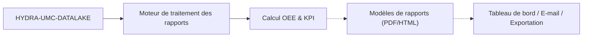

<!-- =============================================================================
HYDRA-UMC-PRODUCTION-REPORTS - KPI and OEE reports built from the datalake
Copyright (C) JuanenRac (Electro Hobby 3D) <electrohobby3d@gmail.com>
GPL-3.0-or-later - see LICENSE
============================================================================= -->

<p align="center">
  
</p>

# 📑 HYDRA-UMC-PRODUCTION-REPORTS

<p align="center"><a href="README.md">🇺🇸 English</a> | <a href="README_spa.md">🇪🇸 Español</a> | 🇫🇷 <b>Français</b> | <a href="README_ita.md">🇮🇹 Italiano</a> | <a href="README_deu.md">🇩🇪 Deutsch</a> | <a href="README_zho.md">🇨🇳 简体中文</a> | <a href="README_jpn.md">🇯🇵 日本語</a> | <a href="README_por.md">🇵🇹 Português</a></p>

### 📑 Moteur de rapports KPI et OEE automatisés pour les directeurs d'usine

<p align="center">
  
  
  
  
  
  
</p>

---

**Vérification d'honnêteté - ce qui fonctionne réellement aujourd'hui :** la vraie formule OEE (`oee.py`), le vrai calcul de disponibilité à partir des trous de télémétrie (`availability.py`), le vrai client HTTP vers le `GET /query` propre de HYDRA-UMC-DATALAKE (`datalake_client.py`), la source unique de vérité des limites d'équipe/journée, y compris une véritable équipe de nuit traversant minuit (`shift.py`), l'export CSV reproductible bit à bit (`export.py`), et la véritable API HTTP exposant tout cela (`api.py` : `GET /reports/oee`, `/reports/availability`, `/reports/{oee,availability}/export`, `/stats`) sont réels et testés (133 tests, `pytest`). Ce qui N'est PAS implémenté, bien que listé dans « Caractéristiques principales » ci-dessous comme si c'était déjà le cas : il n'y a aucun export PDF nulle part dans ce code (`export.py` n'écrit que du CSV et une page HTML autonome), aucune planification de rapports quotidiens/hebdomadaires/mensuels, et aucun mécanisme d'e-mail/de livraison pour « envoyer » quoi que ce soit à un gestionnaire - chaque rapport est calculé en direct, à la demande, exactement une fois par appel HTTP. Il n'existe pas non plus encore de véritable source de données `production_event` (rien dans cet écosystème n'écrit ce schéma aujourd'hui, voir ARCHITECTURE ci-dessous), donc l'OEE n'a jamais été testé contre un HYDRA-UMC-JOB-DISPATCHER réel en production - seulement contre un faux DATALAKE dans les tests et des scénarios construits à la main. Voir `CHANGELOG.md` pour ce qui a déjà été livré exactement, et la FEUILLE DE ROUTE ci-dessous pour ce qui reste ouvert.

---

> **État de la sûreté et de la cybersécurité :** cet écosystème n'est pas un système de sécurité certifié. Il n'existe pas encore de chaîne d'E-STOP matérielle, ni de limites ou de verrouillages imposés par le firmware, ni de commande de mouvement vérifiée ; les images de firmware sont contrôlées par CRC-32 et une signature Ed25519, et une compilation de version refuse les clés de développement publiées (les têtes d'outil et les cartes d'extension derrière le relais utilisent encore les chargeurs d'URTC, qui prennent un HMAC-SHA256 à clé partagée au lieu d'une signature) ; TLS et TLS mutuel sont optionnels et désactivés par défaut ; aucune carte propre n'a encore été assemblée ni testée. Lisez la [base de sécurité](https://github.com/JuanenRac/HYDRA-UMC-DOCS/blob/main/docs/SECURITY_BASELINE.md) et le [modèle de menaces](https://github.com/JuanenRac/HYDRA-UMC-DOCS/blob/main/docs/THREAT_MODEL.md) avant de vous fier à une affirmation d'ici pour la sécurité d'une personne.

---

## 📋 En un coup d'œil

| | |
|---|---|
| Version | `0.1.6` |
| Maturité | Fonctionnel |
| Tests | 133 (`python -m pytest -q tests`) |
| Technologie | Python / real OEE formula / http.server |
| Cible | Le Raspberry Pi CM5 d'une cellule HYDRA-UMC |
| Sur matériel réel | Pas encore : aucune exécution sur du matériel réel n'est consignée pour cette version |

**Aller à :** [Présentation](#-présentation) · [Architecture](#-architecture) · [Configuration](#-configuration) · [Démarrage rapide](#-démarrage-rapide) · [Tests](#-tests) · [Dépannage](#-dépannage) · [Structure du dépôt](#-structure-du-dépôt) · [Projets liés](#-projets-liés)

## 🚦 État du projet

Chaque ligne est une partie de ce dépôt et le feu dit où elle en est aujourd'hui. Elle est écrite d'après ce que le dépôt peut montrer (tests, compilations, exécutions), pas d'après ce qui est prévu.

🟢 Fait et vérifié · 🟡 Fonctionne, avec des limites connues · 🟠 À moitié fait ou pas encore vérifié · 🔴 Pas fait ou ne fonctionne pas

| Domaine | État | Ce que cela veut dire ici |
|---|---|---|
| Logiciel | 🟡 | Fonctionne pour son usage principal ; la vérification d'honnêteté ci-dessus liste ce qui manque encore |
| Tests | 🟢 | 133 tests automatiques, exécutés à chaque modification |
| Matériel réel | 🔴 | Pas encore : aucune exécution sur du matériel réel n'est consignée pour cette version |
| Documentation | 🟢 | README en huit langues, vérifié par rapport au manifeste à chaque modification |

## 🎯 Présentation

**HYDRA-UMC-PRODUCTION-REPORTS** est le cerveau analytique pour la gestion de l'usine. Il traite les données brutes du Datalake pour générer des rapports automatisés de haut niveau sur l'efficacité de la production, la qualité et la disponibilité des machines.

Il calcule l'**OEE (Overall Equipment Effectiveness - Taux de Rendement Global)** de l'ensemble de l'essaim, identifiant les goulots d'étranglement dans la ligne de production et assurant la traçabilité de chaque composant fabriqué, des profils de soudure thermique à la précision du Pick-and-Place.

### Caractéristiques principales :
* 📈 **Calcul de l'OEE (implémenté) :** Disponibilité x Performance x Qualité, calculé en direct à partir de la télémétrie DATALAKE à chaque requête via `GET /reports/oee`.
* 📤 **Rapports CSV/JSON à la demande (implémenté) :** `GET /reports/{oee,availability}` renvoie du JSON ; `GET /reports/{oee,availability}/export` renvoie du CSV reproductible bit à bit. Il n'y a aucun export PDF, aucune génération planifiée quotidienne/hebdomadaire/mensuelle, et aucun mécanisme d'e-mail/de livraison - voir la FEUILLE DE ROUTE ci-dessous.
* 🛠️ **Analyse des goulots d'étranglement (prévu) :** identifier les robots ou outils qui causent des retards dans la file d'attente des missions nécessite la véritable source de données `production_event` ci-dessous - pas encore implémenté.
* 🌡️ **Traçabilité de la qualité (prévu) :** lier un produit final à ses journaux d'assemblage spécifiques (thermiques, visuels, mécaniques) est un travail futur, une fois que plus d'un projet écrira des données de production dans DATALAKE.
* 🕐 **Limites Équipe/Jour :** `shift.py` donne à chaque rapport une seule et unique source de vérité réelle pour savoir où commence et finit une équipe ou une journée civile - y compris une véritable équipe de nuit traversant minuit. *(implémenté)*
* 🧾 **Formules Versionnées + Traçabilité :** Chaque rapport porte son vrai `formula_version` et une `input_fingerprint` sha256 calculée sur les données exactes qui l'ont produit. *(implémenté)*
* 📤 **Export CSV Reproductible :** `GET /reports/{oee,availability}/export` - une sortie identique bit à bit pour des entrées identiques, pas seulement « à peu près ». *(implémenté)* Une cellule de texte libre (identifiant de source, valeur de filtre) qui commence par `=`, `+`, `-` ou `@` reçoit une apostrophe initiale, pour qu'un tableur ne l'exécute pas comme une formule.
* 🧱 **Sûr à exposer et honnête sur ses entrées (v0) :** l'API écoute sur `127.0.0.1` sauf indication contraire, et une autre adresse exige un jeton bearer (`--token` / `PRODUCTION_REPORTS_TOKEN`) ou `--allow-anonymous` ; seuls quelques rapports sont construits à la fois (`503` au-delà) ; les nombres non finis sont refusés avec `400` ; les fenêtres sont semi-ouvertes `[start, end)`, donc un échantillon sur une frontière ne compte que dans un rapport ; `day=` et `shift=` déduisent la fenêtre du planning d'équipes ; `format=html` sur un export renvoie une page HTML autonome ; un rapport dit quand son entrée est incohérente (`inconsistent_input`) et combien de lectures il a écartées (`unmatched_count`, aussi dans les exports). *(implémenté)*
* 🔑 **Lit le data lake avec son jeton :** quand HYDRA-UMC-DATALAKE demande un jeton Bearer, le client envoie `HYDRA_UMC_DATALAKE_READ_TOKEN`, sinon `HYDRA_UMC_DATALAKE_TOKEN` (chacun aussi sous forme de fichier, `..._FILE`, dont la première ligne est le jeton). Sans aucun, il n'envoie aucun en-tête, comme avant, et un refus (401) est signalé comme la réponse du data lake lui-même. *(implémenté)*

## 🧩 Rôle dans HYDRA-UMC

**HYDRA-UMC-PRODUCTION-REPORTS** construit des rapports d'OEE et de disponibilité pour les responsables d'usine à partir de l'historique que garde `HYDRA-UMC-DATALAKE`. Il n'a pas de stockage propre : chaque requête interroge un datalake en marche, et la même plage et les mêmes filtres donnent toujours les mêmes octets, avec les sources, la fenêtre et la version de la formule notées à côté des chiffres.

## 🏛️ Architecture

<p align="center">
  
</p>

<details>
<summary>Version texte du diagramme (Mermaid)</summary>



</details>

### FLUX DE RAPPORTS

> Les flèches pointillées sont prévues, pas implémentées : il n'y a ni PDF, ni modèles de rapports, ni tableau de bord, ni envoi par e-mail. Les exports sont du CSV et une page HTML autonome.

### ARCHITECTURE & DÉCISIONS DE CONCEPTION

* **Pourquoi c'est un frère, pas un sous-module, de HYDRA-UMC-DATALAKE.** La génération de rapports est un travail de requête+calcul périodique et en lecture seule sur de la télémétrie déjà stockée - la garder séparée signifie qu'une génération de rapport ne concurrence jamais les propres écritures temps réel de HYDRA-UMC-TELEMETRY-COLLECTOR pour les ressources du même entrepôt. Ce projet ne possède aucune base de données propre.
* **Une vraie intégration HTTP, pas une bibliothèque partagée.** `datalake_client.py` parle à une instance réelle de HYDRA-UMC-DATALAKE via du HTTP simple (`GET /query`), et n'importe délibérément PAS le paquet Python de DATALAKE directement, même si les deux cohabitent aujourd'hui dans le même environnement de dev - le vrai HTTP est le vrai point d'intégration découplé, celui qui correspond à la façon dont des dépôts/services séparés se parleraient réellement en production.
* **Le schéma `production_event` est la propre convention v0 de ce projet, pas un standard de l'écosystème.** L'OEE a besoin de savoir, pour chaque cycle terminé, si la pièce était bonne et combien de temps le cycle a pris. Ce projet définit cela comme un `Sample` DATALAKE par cycle, `kind="production_event"`, avec deux champs écrits ensemble au même timestamp : `"good"` (1.0/0.0) et `"cycleTimeS"`. Aucun autre projet n'écrit encore ce kind - Le producteur naturel est ce qui sait quand un cycle commence et se termine (l'orchestrateur, ou le robot lui-même) : HYDRA-UMC-JOB-DISPATCHER ne conserve aucun horodatage et ne peut pas calculer un temps de cycle.
* **La disponibilité fonctionne contre N'IMPORTE QUEL flux de télémétrie existant, volontairement.** Contrairement à l'OEE, `availability.py` n'a pas du tout besoin de la convention `production_event` - il prend n'importe quelle série de timestamps déjà présente dans DATALAKE (par ex. des échantillons `motor_temp` que HYDRA-UMC-TELEMETRY-COLLECTOR écrit déjà) et signale comme véritable temps d'arrêt un écart entre échantillons consécutifs supérieur à `expected_interval_ms x gap_factor`. C'est précisément ce qui permet à ce projet de "parler" dès aujourd'hui avec ses frères de télémétrie, avant même qu'aucun projet n'écrive de vraies données `production_event`.
* **Performance et Availability sont plafonnés à `[0, 1]`.** Un vrai cycle peut aller plus vite qu'un chiffre "idéal" prudent, ou le temps opérationnel peut dépasser une fenêtre planifiée mal configurée ; rapporter >100% serait arithmétiquement défendable mais trompeur en pratique, donc les deux sont plafonnés.
* **Les champs `production_event` non appariés sont comptés et signalés, jamais silencieusement remplacés par défaut.** Si une lecture `"good"` n'a pas de `"cycleTimeS"` apparié au même timestamp exact (une écriture partielle/malformée), elle est exclue et le nombre de lectures exclues est inclus dans l'erreur/la réponse plutôt que de supposer un temps de cycle de 0s, ce qui corromprait le chiffre de Performance.
* **Pourquoi `shift.py` est un module séparé, pas des calculs en ligne dans `oee.py`/`availability.py`.** Deux rapports qui divergent silencieusement sur l'endroit où une équipe ou une journée civile se termine produisent deux chiffres différents, tous deux défendables, pour la même fenêtre réelle - exactement la contradiction relevée en revue. Faire des limites équipe/jour un module propre, réel et testé (avec une véritable équipe de nuit traversant minuit, et une véritable recherche inverse timestamp-vers-équipe) donne à chaque rapport la même source de vérité au lieu que chaque appelant la redérive de son côté.
* **Pourquoi `formula_version` et `input_fingerprint` sont sur le rapport, pas seulement dans le CSV.** Un rapport consommé en JSON (par un tableau de bord, un autre service) mérite la même traçabilité qu'un rapport exporté vers un fichier - les deux champs s'ajoutent aux réponses existantes de `GET /reports/oee`/`GET /reports/availability`, ce n'est pas quelque chose de visible uniquement dans la sortie de `export.py`.
* **Pourquoi l'export CSV est un nouvel endpoint, pas un flag `?format=csv` sur les routes existantes.** Garder `GET /reports/oee`/`GET /reports/availability` intacts (toujours réels, toujours en JSON, toujours exactement ce que `tests/test_api.py` vérifiait déjà) a permis d'ajouter la fonctionnalité d'export et de prouver sa reproductibilité sans toucher à une seule réponse déjà testée.

## ⚙️ Configuration

| Variable | Par défaut | Ce qu'elle définit |
|---|---|---|
| `--addr` | `127.0.0.1` | adresse sur laquelle l'API écoute ; une autre adresse exige un jeton ou `--allow-anonymous` |
| `--port` | `8099` | port de l'API |
| `--datalake-url` | `http://localhost:8095` | datalake interrogé par chaque requête |
| `--token` / `PRODUCTION_REPORTS_TOKEN` | aucun | jeton Bearer exigé par toute route sauf `GET /health` |
| `--max-concurrent-reports` | `4` | rapports construits en même temps ; au-delà une requête reçoit 503 |

## 🚀 Démarrage rapide

Nécessite Python 3.10 ou plus récent.

```bash
./build.sh  # Linux, macOS (build.bat on Windows)
./run.sh --datalake-url http://localhost:8095
curl http://127.0.0.1:8099/reports/oee?...
```

## 🧪 Tests

133 tests automatiques s'exécutent avec `python -m pytest -q tests`. Ils n'ont besoin ni de matériel ni de rien en dehors de cette machine.

La CI exécute `HYDRA_UMC_CI=1 python tools/ci_validate.py`, qui vérifie le manifeste, les documents, les huit README et les images.

## 🏗️ Compilation et publication

Nécessite Python >= 3.10.

```bash
# Linux/macOS
./build.sh && ./run.sh --datalake-url http://localhost:8095

# Windows
build.bat
run.bat --datalake-url http://localhost:8095
```

`build` crée/active un `.venv` local, installe le paquet en mode éditable avec les extras de dev, vérifie l'import et exécute la vraie suite de tests `pytest`. `run` démarre la vraie API HTTP (port par défaut `8099`) contre une instance HYDRA-UMC-DATALAKE à `--datalake-url` (par défaut `http://localhost:8095`).

```bash
# Vrai rapport OEE pour la source "robot-1" sur une fenêtre de 5 secondes
curl "http://localhost:8099/reports/oee?sourceId=robot-1&start=0&end=5000&plannedTimeS=10.0&idealCycleTimeS=2.0"

# Vrai rapport de disponibilité pour le flux motor_temp de la même source
curl "http://localhost:8099/reports/availability?sourceId=robot-1&kind=motor_temp&field=value&start=0&end=10000&expectedIntervalMs=1000"
```

## 🩺 Dépannage

| Vous voyez | Parce que | Faites |
|---|---|---|
| HTTP 503 | Quatre rapports sont déjà en cours (chacun peut charger en mémoire jusqu'à deux requêtes de 200 000 points) | Réessayez dans un instant, ou augmentez `--max-concurrent-reports` si la machine a la mémoire |
| exit status 2 at start | L'adresse n'est pas locale et il n'y a ni jeton ni `--allow-anonymous` | Définissez `PRODUCTION_REPORTS_TOKEN` (ou `--token`), ou utilisez `--allow-anonymous` en laboratoire |

## 📂 Structure du dépôt

<p align="center">
  
</p>

<details>
<summary>Version texte de l'arborescence</summary>

```text
HYDRA-UMC-PRODUCTION-REPORTS/
├── src/hydra_umc_production_reports/   code source
│   ├── __init__.py                     Version du paquet
│   ├── datalake_client.py              Client HTTP réel pour l'API GET /query de HYDRA-UMC-DATALAKE
│   ├── oee.py                          Vraie formule OEE (Disponibilité x Performance x Qualité)
│   ├── availability.py                 Vrai calcul de downtime à partir des écarts de télémétrie
│   ├── reports.py                      Orchestration : DatalakeClient -> oee.py / availability.py
│   ├── shift.py                        Vrai calcul des limites équipe/jour (source de vérité)
│   ├── export.py                       Vrai export CSV, reproductible bit à bit
│   ├── api.py                          API HTTP réelle (GET /reports/oee, /reports/availability, /stats, /export)
│   ├── main.py                         Point d'entrée - démarre le vrai serveur HTTP
│   └── provenance.py                   D'où viennent les chiffres d'un rapport : source, série, fenêtre de temps, échantillons et version du programme
├── tests/                              Vrais tests : calculs OEE/disponibilité/équipe/export, allers-retours contre un faux DATALAKE
├── docs/                               documents du projet
├── images/                             Médias et diagrammes
├── systemd/                            unité de service
├── tools/                              outils du projet et vérifications de la CI
├── .github/                            workflow de CI et modèles de tickets
├── mejoras_futuras.txt                 La liste complète et honnête de ce qui est délibérément reporté, et pourquoi
├── pyproject.toml                      Métadonnées du paquet + extras [dev] (pytest)
├── bump_version.py                     Incrément de version type compteur kilométrique (exécuté seulement par la commande `bump` explicite)
├── bump_manifest_version.py            Synchronise la version de hydra-umc.project.json avec la version native (--sync)
├── build.sh / build.bat                Build réel : venv + installation éditable + vraie suite de tests
├── run.sh / run.bat                    Exécution réelle : démarre l'API HTTP
├── CHANGELOG.md                        ce qui a changé à chaque version
├── build-test.sh                       vérification de build sans modification
├── hydra-umc.project.json              manifeste : version, maturité, famille
└── test.sh                             lance les tests
```

</details>

## 🗺️ Feuille de route et limites connues

**Limites connues aujourd'hui**

* **Fait (v0) :** vrai calcul d'OEE et de disponibilité, vraie intégration HTTP avec HYDRA-UMC-DATALAKE, vraie API HTTP, vraies limites d'équipe/journée, formules versionnées + empreinte d'entrée, export CSV reproductible bit à bit.
* **Ensuite :** une vraie source de données `production_event` - faire rapporter les fins de cycle selon ce schéma par l'orchestrateur (ou le robot).
* **Ensuite :** rapports persistants/planifiés (aujourd'hui chaque rapport est calculé en direct, à la demande).
* **Plus tard :** un export PDF, un mécanisme d'e-mail/de livraison, et un tableau de bord.
* Analyse du ROI pilotée par l'IA pour les mises à niveau d'outils, connectée à ces mêmes données OEE une fois les tendances historiques stockées.

## 🌍 Langues

Ce README et les documents du dépôt existent en huit langues : anglais, espagnol, allemand, français, italien, japonais, chinois et portugais (Portugal). Ils sont écrits ensemble et la CI vérifie que les huit fichiers ont les mêmes sections et les mêmes liens. Ce dépôt n'a ni écran ni catalogue de messages propre, il n'y a donc aucune chaîne d'interface à traduire.

## 🔗 Projets liés

Ce projet fait partie de l'écosystème robotique HYDRA-UMC du même auteur (JuanenRac / Electro Hobby 3D). Bon à savoir, car une demande pourrait en réalité concerner l'un de ceux-ci plutôt que ce dépôt.

**Projet Parent**
- **[HYDRA-UMC-DATALAKE](https://github.com/JuanenRac/HYDRA-UMC-DATALAKE)** — vrai magasin de séries temporelles basé sur sqlite3, avec une vraie API HTTP d'ingestion/requête ; le parent dont ce dépôt est un service d'analytique spécifique, au sein de sa propre couche de données et analytique.

**Projets Frères** — les autres services d'analytique de la propre couche de données et analytique de HYDRA-UMC-DATALAKE
- **[HYDRA-UMC-TELEMETRY-COLLECTOR](https://github.com/JuanenRac/HYDRA-UMC-TELEMETRY-COLLECTOR)** — vrai pipeline d'ingestion CAN/WebSocket vers DATALAKE, avec déduplication par séquence — aussi une vraie source de données aujourd'hui : le propre `availability.py` de ce rapport lit ses échantillons `motor_temp` (et toute autre série qu'il écrit) directement depuis Datalake, sans avoir besoin de la convention `production_event` pour ce rapport.
- **[HYDRA-UMC-ANOMALY-DETECTOR](https://github.com/JuanenRac/HYDRA-UMC-ANOMALY-DETECTOR)** — vrai détecteur d'anomalies FFT + ligne de base statistique, avec surveillance de dérive.

**Directement Liés**
- **[HYDRA-UMC-JOB-DISPATCHER](https://github.com/JuanenRac/HYDRA-UMC-JOB-DISPATCHER)** — vraie file de tâches basée sur la priorité avec déduplication, via une vraie API HTTP — la source réelle prévue des échantillons `production_event` (la propre convention bon/temps de cycle d'OEE) une fois les achèvements de mission câblés pour les écrire ; rien n'écrit encore ce type, suivi honnêtement comme travail futur plutôt que revendiqué comme terminé.

**Fait Également Partie de l'Écosystème**

*Matériel & Plateforme de Base*
- **[HYDRA-UMC](https://github.com/JuanenRac/HYDRA-UMC)** — la conception de la carte mère du bras robotique : hôte CM5 + coprocesseur STM32H745 double cœur, destinée à coordonner jusqu'à 8 bras-outils via CAN-OTA/SPI-OTA (firmware à un stade précoce ; aucune carte assemblée pour l'instant).
- **[HYDRA-UMC-OS](https://github.com/JuanenRac/HYDRA-UMC-OS)** — couche produit reproductible sur Raspberry Pi OS pour le CM5 : agent en lecture seule, config/profils validés, provisionnement WiFi de premier contact.
- **[HYDRA-UMC-SDK](https://github.com/JuanenRac/HYDRA-UMC-SDK)** — le contrat JSON-Schema partagé et la barrière logicielle de contrôle des jobs contre laquelle chaque bridge valide ses commandes (pas une fonction de sécurité certifiée).
- **[HYDRA-UMC-CONNECTOR-HUB](https://github.com/JuanenRac/HYDRA-UMC-CONNECTOR-HUB)** — registre déclaratif et validateur de manifestes d'adaptateur pour les connecteurs de machines externes ; étend la propre idée de contrat du SDK aux machines externes sans remplacer les projets de passerelle industrielle.

*Backend Central & Clients*
- **[HYDRA-UMC-SERVER](https://github.com/JuanenRac/HYDRA-UMC-SERVER)** — le vrai backend headless (REST/WebSocket) auquel parle réellement chaque client de contrôle.
- **[HYDRA-UMC-STUDIO](https://github.com/JuanenRac/HYDRA-UMC-STUDIO)** — tableau de bord de contrôle web avec visualisation 3D multi-robot en temps réel.
- **[HYDRA-UMC-SUITE](https://github.com/JuanenRac/HYDRA-UMC-SUITE)** — centre de commande d'essaim de bureau (PySide6) pour plusieurs serveurs à la fois, empaqueté en exécutable autonome.
- **[HYDRA-UMC-ANDROID-CONTROL](https://github.com/JuanenRac/HYDRA-UMC-ANDROID-CONTROL)** — application de contrôle Android native avec connexion biométrique et un compagnon Wear OS jumelé.
- **[HYDRA-UMC-IOS-CONTROL](https://github.com/JuanenRac/HYDRA-UMC-IOS-CONTROL)** — application de contrôle iOS/iPadOS (Flutter) avec synchronisation WebSocket en temps réel.
- **[HYDRA-UMC-DSI](https://github.com/JuanenRac/HYDRA-UMC-DSI)** — interface tactile native pour l'écran tactile DSI 7" embarqué, intégrée directement sur le CM5.
- **[HYDRA-UMC-EDITOR-URDF](https://github.com/JuanenRac/HYDRA-UMC-EDITOR-URDF)** — créateur/éditeur graphique de bureau pour URDF qui envoie les modèles terminés vers le propre catalogue de STUDIO.
- **[HYDRA-UMC-EDITOR-STL](https://github.com/JuanenRac/HYDRA-UMC-EDITOR-STL)** — éditeur de bureau de modèles STL, transformant/remplaçant/retirant/ajoutant de vraies pièces dans le même catalogue de modèles qu'édite aussi HYDRA-UMC-EDITOR-URDF.
- **[HYDRA-UMC-BRIDGE-AMR](https://github.com/JuanenRac/HYDRA-UMC-BRIDGE-AMR)** — frontière de coordination pour les flottes AGV/AMR via un éditeur MQTT VDA 5050 (testé uniquement contre une flotte émulée).
- **[HYDRA-UMC-BRIDGE-CNC](https://github.com/JuanenRac/HYDRA-UMC-BRIDGE-CNC)** — coordinateur haut niveau pour cellules CNC avec accès au statut/octets de contrôle GRBL (testé uniquement contre un émulateur).
- **[HYDRA-UMC-BRIDGE-DROIDS](https://github.com/JuanenRac/HYDRA-UMC-BRIDGE-DROIDS)** — frontière de coordination pour droïdes à pattes/humanoïdes, avec un émetteur de commandes Boston Dynamics Spot (testé uniquement contre un émulateur).
- **[HYDRA-UMC-BRIDGE-LASER](https://github.com/JuanenRac/HYDRA-UMC-BRIDGE-LASER)** — coordinateur de cellules laser lisant 3 signaux GPIO de clé/enceinte/verrouillage (testé uniquement contre une puce simulée ; il ne peut ni armer ni tirer un laser).
- **[HYDRA-UMC-BRIDGE-OPENPNP](https://github.com/JuanenRac/HYDRA-UMC-BRIDGE-OPENPNP)** — coordinateur haut niveau sûr pour le flux de cartes du pick-and-place OpenPnP.
- **[HYDRA-UMC-BRIDGE-PRINTER3D](https://github.com/JuanenRac/HYDRA-UMC-BRIDGE-PRINTER3D)** — frontière de coordination sûre pour imprimantes 3D Moonraker/Klipper, avec de vraies commandes de tâche contrôlées.
- **[HYDRA-UMC-BRIDGE-ROS2](https://github.com/JuanenRac/HYDRA-UMC-BRIDGE-ROS2)** — coordinateur avec un transport ROS 2 rclpy à importation paresseuse (pas encore exécuté contre une installation ROS 2).
- **[HYDRA-UMC-BRIDGE-UAV](https://github.com/JuanenRac/HYDRA-UMC-BRIDGE-UAV)** — frontière de coordination pour UAV équipés de caméra, avec un émetteur de commandes MAVLink (testé uniquement contre un émulateur).

*Plateforme d'Outils URTC*
- **[URTC](https://github.com/JuanenRac/URTC)** — firmware pour la carte physique Universal Robot Tool Controller, plus de 25 profils d'outil sur bus CAN.
- **[URTC-FLASHER](https://github.com/JuanenRac/URTC-FLASHER)** — outil de bureau à interface graphique pour flasher les cartes URTC, CAN-OTA plus SWD/JTAG puce complète.
- **[URTC-TESTER](https://github.com/JuanenRac/URTC-TESTER)** — outil de bureau de diagnostic CAN-bus en direct pour cartes URTC, un panneau par profil d'outil.
- **[URTC-WEB-STUDIO](https://github.com/JuanenRac/URTC-WEB-STUDIO)** — alternative basée navigateur à URTC-TESTER via la Web Serial API, sans installation locale.
- **[URTC-GATEWAY](https://github.com/JuanenRac/URTC-GATEWAY)** — passerelle devant le bus CAN d'URTC : liste d'identifiants autorisés, limite de débit et clé de session ; logiciel testé sur ordinateur, pas encore sur un bus réel.

*Nœud IA de Vision (Hailo-8)*
- **[HYDRA-UMC-VISION-NODE](https://github.com/JuanenRac/HYDRA-UMC-VISION-NODE)** — hub d'intégration pour le pipeline de vision Hailo-8, avec une vraie vérification de disponibilité matérielle par étape.
- **[HYDRA-UMC-DETECTION-HEF](https://github.com/JuanenRac/HYDRA-UMC-DETECTION-HEF)** — registre réel de modèles compilés avec vérification de chargement sécurisé par architecture Hailo/checksum.
- **[HYDRA-UMC-VISION-STREAMER](https://github.com/JuanenRac/HYDRA-UMC-VISION-STREAMER)** — générateur réel de pipeline GStreamer + config MediaMTX, avec une vraie frontière d'intégration HailoRT.
- **[HYDRA-UMC-VISUAL-SERVOING-API](https://github.com/JuanenRac/HYDRA-UMC-VISUAL-SERVOING-API)** — loi de correction Position-Based Visual Servoing avec autorisation conditionnée à l'état de zone ; pas encore d'estimation de pose par caméra.
- **[HYDRA-UMC-SAFETY-ZONES](https://github.com/JuanenRac/HYDRA-UMC-SAFETY-ZONES)** — logique v0 de violation de zone, de fraîcheur de calibration et de demande d'E-STOP qui lit les positions d'objets dans un fichier ; aucun détecteur ne l'alimente et aucun E-STOP physique n'y est encore relié.

*Nœud IA Cognitif (Hailo-10)*
- **[HYDRA-UMC-COGNITIVE-NODE](https://github.com/JuanenRac/HYDRA-UMC-COGNITIVE-NODE)** — hub d'intégration pour le pipeline cognitif Hailo-10 (orchestration LLM/VLA/voix).
- **[HYDRA-UMC-VLA-ENGINE](https://github.com/JuanenRac/HYDRA-UMC-VLA-ENGINE)** — vrai encodage/décodage de jetons d'action et génération de trajectoire pour un modèle Vision-Language-Action.
- **[HYDRA-UMC-VOICE-UI](https://github.com/JuanenRac/HYDRA-UMC-VOICE-UI)** — vrai front-end vocal (VAD + analyseur d'intention) avec un relais Watch borné et soumis à confirmation.
- **[HYDRA-UMC-SEMANTIC-PLANNER](https://github.com/JuanenRac/HYDRA-UMC-SEMANTIC-PLANNER)** — vraie décomposition de tâches basée sur des règles et récupération sémantique d'erreurs sur les codes d'erreur MCU.
- **[HYDRA-UMC-DOCS-QA](https://github.com/JuanenRac/HYDRA-UMC-DOCS-QA)** — vraie recherche documentaire TF-IDF (bibliothèque standard uniquement) sur les propres documents Markdown de cet écosystème.
- **[HYDRA-UMC-LOCAL-TECHNICIAN](https://github.com/JuanenRac/HYDRA-UMC-LOCAL-TECHNICIAN)** — technicien de maintenance IA local et à portes de politique pour l'écosystème lui-même - observe, diagnostique et propose des corrections ; les deux niveaux de risque les plus élevés ne sont délibérément pas encore implémentés.

*Orchestration & Essaim*
- **[HYDRA-UMC-ORCHESTRATOR](https://github.com/JuanenRac/HYDRA-UMC-ORCHESTRATOR)** — hub d'intégration avec un vrai contrat de rapport de santé gRPC/Protobuf et une machine à états de mission.
- **[HYDRA-UMC-NODE-HEALING](https://github.com/JuanenRac/HYDRA-UMC-NODE-HEALING)** — vrai chien de garde de santé de flotte basé sur gRPC, avec retry/backoff et détection d'incohérence d'identité.
- **[HYDRA-UMC-PATH-PLANNER-3D](https://github.com/JuanenRac/HYDRA-UMC-PATH-PLANNER-3D)** — vrai planificateur de trajectoire 3D basé sur RRT, avec vraie validation des collisions obstacle/espace de travail.
- **[HYDRA-UMC-SWARM-SYNC](https://github.com/JuanenRac/HYDRA-UMC-SWARM-SYNC)** — vraie synchronisation d'état CRDT LWW-Element-Map, testée par propriétés pour la convergence multi-cellule.

*Jumeau Numérique & Simulation*
- **[HYDRA-UMC-TWIN](https://github.com/JuanenRac/HYDRA-UMC-TWIN)** — hub d'intégration pour le moteur de jumeau numérique, avec un vrai contrat de synchronisation par compatibilité de version.
- **[HYDRA-UMC-HIL-BRIDGE](https://github.com/JuanenRac/HYDRA-UMC-HIL-BRIDGE)** — routeur hardware-in-the-loop avec un verrouillage logiciel de collision entre simulation et matériel réel (testé sans matériel réel).
- **[HYDRA-UMC-PHYSICS-REPLICA](https://github.com/JuanenRac/HYDRA-UMC-PHYSICS-REPLICA)** — vraie cinématique directe et validation des limites articulaires sur un vrai sous-ensemble URDF.
- **[HYDRA-UMC-SYNTHETIC-DATA-GEN](https://github.com/JuanenRac/HYDRA-UMC-SYNTHETIC-DATA-GEN)** — vrai générateur procédural de scènes 2D avec export d'annotations YOLO/COCO.

*Passerelle Industrielle*
- **[HYDRA-UMC-GATEWAY-INDUSTRIAL](https://github.com/JuanenRac/HYDRA-UMC-GATEWAY-INDUSTRIAL)** — hub d'intégration relayant vers les protocoles industriels, avec une vraie couche de liste blanche de commandes/contre-pression.
- **[HYDRA-UMC-OPCUA-SERVER](https://github.com/JuanenRac/HYDRA-UMC-OPCUA-SERVER)** — vrai espace d'adressage OPC-UA, vérifié avec une vraie session client du protocole binaire.
- **[HYDRA-UMC-MQTT-BROKER](https://github.com/JuanenRac/HYDRA-UMC-MQTT-BROKER)** — vrai broker MQTT avec authentification par client optionnelle et ACL de sujets.
- **[HYDRA-UMC-MTCONNECT-ADAPTER](https://github.com/JuanenRac/HYDRA-UMC-MTCONNECT-ADAPTER)** — vrais points de terminaison XML MTConnect `/probe` et `/current`, avec sortie en mode dégradé.

*Outils Complémentaires & Opérations de l'Écosystème*
- **[HYDRA-UMC-DASHBOARD-AI](https://github.com/JuanenRac/HYDRA-UMC-DASHBOARD-AI)** — panneaux Smart Summaries et Anomaly Highlighting sur DATALAKE/ANOMALY-DETECTOR, avec un repli statistique honnête.
- **[HYDRA-UMC-TOOL-CLI](https://github.com/JuanenRac/HYDRA-UMC-TOOL-CLI)** — CLI de flotte avec un vrai contrat de codes de sortie stable, un vrai client en direct de la propre API de HYDRA-UMC-SERVER.
- **[HYDRA-UMC-WATCH](https://github.com/JuanenRac/HYDRA-UMC-WATCH)** — application compagnon WearOS avec des motifs d'alerte haptique et un relais vocal vers le téléphone jumelé (pas encore exécutée sur une montre physique).
- **[URTC-SMART-RACK](https://github.com/JuanenRac/URTC-SMART-RACK)** — firmware pour un rack de montage de cartes avec décodage réel d'ID d'outil et logique de préchauffage Smart Idle.
- **[URTC-VISION-TOOL](https://github.com/JuanenRac/URTC-VISION-TOOL)** — firmware plus un vrai compagnon de vision Python pour une tête d'outil d'inspection thermique/RGB.
- **[HYDRA-UMC-UPDATER](https://github.com/JuanenRac/HYDRA-UMC-UPDATER)** — outil administratif de bureau qui découvre, clone et met à jour chaque dépôt de cet écosystème.
- **[HYDRA-UMC-OS-REBUILDER](https://github.com/JuanenRac/HYDRA-UMC-OS-REBUILDER)** — outil de bureau Windows/Linux qui construit une image de la CM5 prête à graver, préchargée avec les versions les plus actuelles de l'écosystème, avec une configuration de premier démarrage Wi-Fi/utilisateur/SSH façon Raspberry Pi Imager.
- **[HYDRA-UMC-OPS-AGENT](https://github.com/JuanenRac/HYDRA-UMC-OPS-AGENT)** — coordinateur d'incidents de maintenance : un rôle edge à faible privilège collecte un instantané d'inventaire/santé assaini, un rôle control-plane le rend en lecture seule et demande à un fournisseur d'IA de suggérer un diagnostic - n'applique jamais de correctif ni ne déploie rien.
- **[HYDRA-UMC-DEV-SERVER](https://github.com/JuanenRac/HYDRA-UMC-DEV-SERVER)** — hôte de développement reproductible (Raspberry Pi 5 / CM5) qui héberge le code source de l'écosystème et exécute des tâches de compilation/test délimitées via une file d'attente durable ; un rôle de développement dédié, explicitement distinct d'un CM5 opérationnel.

## 📚 Documentation

Où lire la suite :

* [Base de sécurité de l'écosystème](https://github.com/JuanenRac/HYDRA-UMC-DOCS/blob/main/docs/SECURITY_BASELINE.md)
* [Modèle de menaces de l'écosystème](https://github.com/JuanenRac/HYDRA-UMC-DOCS/blob/main/docs/THREAT_MODEL.md)
* [Journal des modifications de ce dépôt](CHANGELOG.md)
* [Licence de ce dépôt](LICENSE.md)

## 🤝 Contribuer et communauté

* Avant une pull request, exécutez `HYDRA_UMC_CI=1 py -3 tools/ci_validate.py` (ou `HYDRA_UMC_CI=1 python3 tools/ci_validate.py`) : il doit afficher `CI_VALIDATION=PASS`. N'exécutez pas `build.sh` ni `build.bat` pour cette vérification ; compiler n'est pas vérifier.
* Les huit README sont écrits à partir d'une source unique dans HYDRA-UMC-DOCS ; ne les modifiez pas à la main. Changez la source et réécrivez-les avec `tools/make_readmes.py`.
* N'affirmez pas dans un README ce qui n'a pas tourné : écrivez « simulé » ou « non essayé sur matériel » quand c'est la vérité.
* Voir [CONTRIBUTING.md](CONTRIBUTING.md), le [code de conduite](CODE_OF_CONDUCT.md), [SECURITY.md](SECURITY.md) et [SUPPORT.md](SUPPORT.md).

## 👤 AUTEUR

**JuanenRac (Electro Hobby 3D)** · electrohobby3d@gmail.com

## 📜 LICENCE

GPL-3.0-or-later - [LICENSE](LICENSE).
