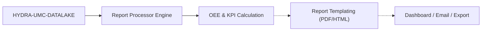

<!-- =============================================================================
HYDRA-UMC-PRODUCTION-REPORTS - KPI and OEE reports built from the datalake
Copyright (C) JuanenRac (Electro Hobby 3D) <electrohobby3d@gmail.com>
GPL-3.0-or-later - see LICENSE
============================================================================= -->

<p align="center">
  
</p>

# 📑 HYDRA-UMC-PRODUCTION-REPORTS

<p align="center"><a href="README.md">🇺🇸 English</a> | <a href="README_spa.md">🇪🇸 Español</a> | <a href="README_fra.md">🇫🇷 Français</a> | <a href="README_ita.md">🇮🇹 Italiano</a> | <a href="README_deu.md">🇩🇪 Deutsch</a> | <a href="README_zho.md">🇨🇳 简体中文</a> | 🇯🇵 <b>日本語</b> | <a href="README_por.md">🇵🇹 Português</a></p>

### 📑 工場管理者向けの自動化された KPI・OEE レポートエンジン

<p align="center">
  
  
  
  
  
  
</p>

---

**正直な現状確認 - 実際に今動くもの:** 本物のOEE計算式（`oee.py`）、テレメトリの欠落から算出する本物の稼働率計算（`availability.py`）、HYDRA-UMC-DATALAKE自身の `GET /query` への本物のHTTPクライアント（`datalake_client.py`）、シフト/日境界に関する唯一の信頼できる情報源で、真夜中をまたぐ実際の夜勤も含む（`shift.py`）、バイト単位で再現可能なCSVエクスポート（`export.py`)、そしてこれらすべてを公開する本物のHTTP API（`api.py`: `GET /reports/oee`、`/reports/availability`、`/reports/{oee,availability}/export`、`/stats`）は本物であり、テスト済みです（122件のテスト、`pytest`）。以下の「主な機能」にあたかもすでに動いているかのように記載されているものの、実際には実装されていないもの: このコードのどこにもPDFエクスポートは存在せず（`export.py` が書き出すのはCSVと自己完結型のHTMLページだけです）、日次/週次/月次レポートのスケジューリングもなく、管理者に何かを「送信」するメール/配信の仕組みもありません - すべてのレポートはリクエストごとに、HTTP呼び出し1回につき正確に1回だけ、その場でライブに計算されます。また、本物の `production_event` データソースもまだ存在しません（この環境の生態系内で今日その形式を書き込んでいるものは何もありません。下記のARCHITECTUREを参照）。そのため、OEEは本番環境で実際に稼働しているHYDRA-UMC-JOB-DISPATCHERに対して一度も検証されたことがなく、テスト内の偽のDATALAKEと手作業で構築したシナリオに対してのみ検証されています。これまでに実際に出荷されたものの詳細は `CHANGELOG.md` を、残っている未完了事項は下記のROADMAPを参照してください。

---

> **安全性とセキュリティの現状:** このエコシステムは認証された安全システムではありません。ハードウェアの E-STOP 経路、ファームウェアが強制する制限やインターロック、検証済みの動作コマンドはまだありません。ファームウェアイメージは CRC-32 と Ed25519 署名で検査し、リリースビルドは公開済みの開発用鍵を拒否します(リレーの先のツールヘッドと拡張ボードは引き続き URTC のブートローダーを使い、署名ではなく共有鍵の HMAC-SHA256 を使います)。TLS と相互 TLS は任意で、既定では無効です。独自基板はまだ実装も試験もされていません。ここに書かれた内容を人の安全のために頼る前に、[セキュリティベースライン](https://github.com/JuanenRac/HYDRA-UMC-DOCS/blob/main/docs/SECURITY_BASELINE.md)と[脅威モデル](https://github.com/JuanenRac/HYDRA-UMC-DOCS/blob/main/docs/THREAT_MODEL.md)をお読みください。

---

## 📋 ひと目で

| | |
|---|---|
| バージョン | `0.1.7` |
| 成熟度 | 機能する |
| テスト | 133 (`python -m pytest -q tests`) |
| 技術 | Python / real OEE formula / http.server |
| 対象 | HYDRA-UMC セルの Raspberry Pi CM5 |
| 実機での確認 | まだです：このバージョンについて実機での動作記録はありません |

**移動：** [概要](#-概要) · [アーキテクチャ](#-アーキテクチャ) · [設定](#-設定) · [クイックスタート](#-クイックスタート) · [テスト](#-テスト) · [トラブルシューティング](#-トラブルシューティング) · [リポジトリの構成](#-リポジトリの構成) · [関連プロジェクト](#-関連プロジェクト)

## 🚦 プロジェクトの状況

各行はこのリポジトリの一部分で、信号は今日どこまで進んでいるかを示します。計画ではなく、リポジトリが示せるもの（テスト、ビルド、実行）に基づいて書かれています。

🟢 完了・検証済み · 🟡 動作する（既知の制限あり） · 🟠 一部のみ、または未検証 · 🔴 未実装または動作しない

| 領域 | 状態 | ここでの意味 |
|---|---|---|
| ソフトウェア | 🟡 | 主な目的では動作します。足りない点は上の正直さの確認に書かれています |
| テスト | 🟢 | 自動テスト 133 件。変更のたびに実行されます |
| 実機 | 🔴 | まだです：このバージョンについて実機での動作記録はありません |
| ドキュメント | 🟢 | 8 言語の README。変更のたびにマニフェストと照合されます |

## 🎯 概要

**HYDRA-UMC-PRODUCTION-REPORTS** は、工場管理のための分析頭脳です。
データレイクからの生データを処理し、生産効率、品質、機械の稼働率に
関する自動化された高レベルのレポートを生成します。

スウォーム全体の **OEE（総合設備効率）** を計算し、生産ラインの
ボトルネックを特定し、はんだの熱プロファイルからピック＆プレースの
精度に至るまで、製造されたすべての部品のトレーサビリティを提供します。

### 主な機能：
* 📈 **OEE 計算（今日実際に動く）：** 可用性 x パフォーマンス x 品質を、`GET /reports/oee` へのリクエストごとにDATALAKEのテレメトリからライブで計算します。
* 📤 **オンデマンドのCSV/JSONレポート（今日実際に動く）：** `GET /reports/{oee,availability}` はJSONを返し、`GET /reports/{oee,availability}/export` はバイト単位で再現可能なCSVを返します。PDFエクスポート、日次/週次/月次の定期生成、メール/配信の仕組みは存在しません - 下記のROADMAPを参照してください。
* 🛠️ **ボトルネック分析（計画中）：** ミッションキューの遅延を引き起こしているロボットやツールを特定するには、下記の本物の `production_event` データソースが必要です - まだ実装されていません。
* 🌡️ **品質トレーサビリティ（計画中）：** 最終製品をその特定の組立ログ（熱、視覚、機械）に関連付けることは、複数のプロジェクトがDATALAKEに生産データを書き込むようになって初めて実現する将来の作業です。
* 🕐 **シフト/日境界：** `shift.py` は、シフトや暦日がどこで始まりどこで終わるかについて、すべてのレポートに単一の実在する信頼できる情報源を提供します——真夜中をまたぐ実際の夜勤も含みます。*（実装済み）*
* 🧾 **バージョン管理された計算式 + トレーサビリティ：** すべてのレポートは、実際の `formula_version` と、それを生成した正確なデータに対する sha256 の `input_fingerprint` を保持します。*（実装済み）*
* 📤 **再現可能な CSV エクスポート：** `GET /reports/{oee,availability}/export` —— 同一の入力に対してバイト単位で完全に同一の出力を生成します。単なる「近い値」ではありません。*（実装済み）* `=`、`+`、`-`、`@` で始まる自由テキストのセル（ソースID、フィルター値）には先頭にアポストロフィが付くため、表計算ソフトが数式として実行することはありません。
* 🧱 **公開しても安全で、入力に誠実（v0）：** API は指定がなければ `127.0.0.1` で待ち受け、それ以外のアドレスには bearer トークン（`--token` / `PRODUCTION_REPORTS_TOKEN`）または `--allow-anonymous` が必要です。同時に作成されるレポートは少数に限られ（超えると `503`）、有限でない数値は `400` で拒否され、ウィンドウは半開区間 `[start, end)` なので境界上のサンプルは 1 つのレポートにだけ数えられます。`day=` と `shift=` はシフトスケジュールからウィンドウを導き、エクスポートの `format=html` は自己完結型の HTML ページを返します。レポートは入力が矛盾しているとき（`inconsistent_input`）と、破棄した読み取りの数（`unmatched_count`、エクスポートにも含まれる）を示します。*（実装済み）*
* 🔑 **トークンを使ってデータレイクを読み取ります：** HYDRA-UMC-DATALAKE が Bearer トークンを求める場合、クライアントは `HYDRA_UMC_DATALAKE_READ_TOKEN`、なければ `HYDRA_UMC_DATALAKE_TOKEN` を送ります（どちらもファイル `..._FILE` として指定でき、1 行目がトークンです）。どちらもなければ従来どおりヘッダーを送らず、拒否（401）はデータレイク自身の応答として報告されます。*（実装済み）*
* 🏭 **フリート全体の OEE:** `GET /reports/oee/fleet` は、複数のソースの OEE を一つの期間で計算し、各ソースのレポート、グループ全体の合算値(全稼働時間÷全計画時間、全良品数÷全生産数)、そしてボトルネック(OEE が最も低いソースと、それを押し下げている要因)を返します。データのないソースは理由付きで一覧に載り、他のソースを隠しません。

## 🧩 HYDRA-UMC での役割

**HYDRA-UMC-PRODUCTION-REPORTS** は、`HYDRA-UMC-DATALAKE` が保持する履歴から、工場管理者向けの OEE と稼働率のレポートを作ります。独自のストアは持たず、リクエストのたびに稼働中のデータレイクへ問い合わせます。同じ範囲とフィルターなら常に同じバイト列になり、数値の隣にソース、期間、計算式のバージョンが記録されます。

## 🏛️ アーキテクチャ

<p align="center">
  
</p>

<details>
<summary>図のテキスト版（Mermaid）</summary>



</details>

### レポーティングフロー

> 点線の矢印は計画中で、未実装です。PDF、レポートのテンプレート、ダッシュボード、メール配信はありません。エクスポートは CSV と自己完結型の HTML ページです。

### アーキテクチャと設計上の決定

* **HYDRA-UMC-DATALAKE のサブモジュールではなく兄弟プロジェクトである理由。** レポート生成は、既に保存されたテレメトリに対する定期的な読み取り専用の「クエリ＋計算」処理です——独立させておくことで、レポート生成が、HYDRA-UMC-TELEMETRY-COLLECTOR 自身の同じストアのリソースに対するリアルタイム書き込みと競合することは決してありません。本プロジェクトは自身のデータベースを持ちません。
* **共有ライブラリではなく、実際の HTTP 連携。** `datalake_client.py` はプレーンな HTTP（`GET /query`）を介して実際に稼働中の HYDRA-UMC-DATALAKE インスタンスと通信し、両者が現在同じ開発環境に存在していても、DATALAKE の Python パッケージを直接インポートすることは意図的に避けています——実際の HTTP こそが、本番環境で別々のリポジトリ/サービスが実際にどのように通信するかに一致する、真に疎結合な連携経路です。
* **`production_event` スキーマは本プロジェクト独自の v0 の取り決めであり、エコシステム標準ではありません。** OEE を計算するには、完了した各サイクルについて、良品だったかどうかとサイクル時間を知る必要があります。本プロジェクトはこれを、サイクルごとに1つの DATALAKE `Sample`、`kind="production_event"`、同一タイムスタンプで一緒に書き込まれる2つのフィールド——`"good"`（1.0/0.0）と `"cycleTimeS"`——として定義します。この kind をまだ書き込んでいる他のプロジェクトはありません——自然な生産者は、サイクルの開始と終了を知っているもの（オーケストレーター、またはロボット自身）です。HYDRA-UMC-JOB-DISPATCHER はタイムスタンプを保持せず、サイクル時間を計算できません。
* **可用性の計算は、意図的に既存の任意のテレメトリストリームに対して機能します。** OEE とは異なり、`availability.py` は `production_event` の取り決めを一切必要としません——DATALAKE に既に存在する任意のタイムスタンプ列（例えば HYDRA-UMC-TELEMETRY-COLLECTOR が既に書き込んでいる `motor_temp` サンプル）を受け取り、連続するサンプル間の間隔が `expected_interval_ms x gap_factor` を超える場合、それを実際のダウンタイムとして扱います。これこそが、どのプロジェクトも実際の `production_event` データを書き込む前から、本プロジェクトがテレメトリの「兄弟プロジェクト」と実際に「対話」できる理由です。
* **Performance と Availability は `[0, 1]` にクランプされています。** 実際のサイクルは、控えめな「理想」値よりも速く進むことがあり、また稼働時間が誤って設定された計画ウィンドウを超えることもあります。>100% を報告することは算術的には正しくても、実際には誤解を招くため、両方ともクランプされています。
* **一致しない `production_event` フィールドはカウントされ報告されます。決して黙ってデフォルト値に置き換えられることはありません。** `"good"` の値に、まったく同じタイムスタンプで対応する `"cycleTimeS"` がない場合（部分的な/不正な書き込み）、それは除外され、除外された件数はエラー/レスポンスに含まれます。サイクル時間を 0 秒と仮定することは、Performance の数値を損なうため行いません。
* **`shift.py` が `oee.py`/`availability.py` 内のインライン計算ではなく、独立したモジュールである理由。** シフトや暦日の区切りについて静かに食い違う 2 つのレポートは、同じ実際の時間ウィンドウに対して、どちらも一見正当に見える異なる数値を生み出します——これはまさに昇格監査が指摘した矛盾です。シフト/日境界を独立した、実際に動作する、テスト済みのモジュールにすること（真夜中をまたぐ実際の夜勤や、タイムスタンプからシフトへの実際の逆引きを含む）によって、各呼び出し元が個別に再導出するのではなく、すべてのレポートが同じ信頼できる情報源を共有できます。
* **`formula_version` と `input_fingerprint` が CSV だけでなくレポート自体に含まれる理由。** JSON として消費されるレポート（ダッシュボードや他のサービスによって）も、ファイルにエクスポートされるレポートと同じトレーサビリティを持つべきです——この 2 つのフィールドは、既存の `GET /reports/oee`/`GET /reports/availability` のレスポンスに追加されるものであり、`export.py` の出力だけに現れるものではありません。
* **CSV エクスポートが既存ルートへの `?format=csv` フラグではなく、新しいエンドポイントである理由。** `GET /reports/oee`/`GET /reports/availability` に手を加えない（引き続き実際に動作し、引き続き JSON であり、`tests/test_api.py` が既にアサートしている内容とまったく同じ）ことで、既にテスト済みのレスポンスに一切触れることなく、エクスポート機能を追加し、その再現性を証明できました。

**1 回のクエリには大きすぎる期間。** レポートはまず、期間に含まれる点の数をデータレイクに尋ねます（`GET /aggregate`）。20 万点の上限を超える期間も拒否されなくなりました。OEE はデータレイク自身が合計した値（`method` は `aggregate`）から、可用性は点を含む区間から 1 区間の精度で作られます。`/aggregate` の応答は、ソース・種類・フィールド・集計方法・区間・期間・系列のフィンガープリントをキーにメモリへ保持され、`--cache-ttl-seconds`（既定 30、または `HYDRA_UMC_PRODUCTION_REPORTS_CACHE_TTL_SECONDS`）の間は再利用され、その後は系列が変化した場合にのみ更新されます。`--no-cache` は何も保持しません。

## ⚙️ 設定

| 変数 | 既定値 | 設定する内容 |
|---|---|---|
| `--addr` | `127.0.0.1` | API が待ち受けるアドレス。それ以外にはトークンか `--allow-anonymous` が必要 |
| `--port` | `8099` | API のポート |
| `--datalake-url` | `http://localhost:8095` | 各リクエストが問い合わせるデータレイク |
| `--token` / `PRODUCTION_REPORTS_TOKEN` | なし | `GET /health` 以外のすべてのルートが要求する Bearer トークン |
| `--max-concurrent-reports` | `4` | 同時に作るレポート数。超えると 503 になる |

## 🚀 クイックスタート

Python 3.10 以上が必要です。

```bash
./build.sh  # Linux, macOS (build.bat on Windows)
./run.sh --datalake-url http://localhost:8095
curl http://127.0.0.1:8099/reports/oee?...
```

## 🧪 テスト

`python -m pytest -q tests` で自動テスト 133 件を実行します。 ハードウェアも、このマシンの外にあるものも必要ありません。

CI は `HYDRA_UMC_CI=1 python tools/ci_validate.py` を実行し、マニフェスト、文書、8 つの README、図を検査します。

## 🏗️ ビルドとリリース

Python >= 3.10 が必要です。

```bash
# Linux/macOS
./build.sh && ./run.sh --datalake-url http://localhost:8095

# Windows
build.bat
run.bat --datalake-url http://localhost:8095
```

`build` はローカルの `.venv` を作成/アクティブ化し、開発用 extras 込みで
パッケージを editable モードでインストールし、インポートを検証した後、
実際の `pytest` テストスイートを実行します。`run` は実際の HTTP API
（デフォルトポート `8099`）を起動し、`--datalake-url`（デフォルト
`http://localhost:8095`）で指定した HYDRA-UMC-DATALAKE インスタンスに
接続します。

```bash
# ソース "robot-1" の 5 秒間ウィンドウにおける実際の OEE レポート
curl "http://localhost:8099/reports/oee?sourceId=robot-1&start=0&end=5000&plannedTimeS=10.0&idealCycleTimeS=2.0"

# 同じソースの motor_temp ストリームに対する実際の可用性レポート
curl "http://localhost:8099/reports/availability?sourceId=robot-1&kind=motor_temp&field=value&start=0&end=10000&expectedIntervalMs=1000"
```

## 🩺 トラブルシューティング

| 表示 | 原因 | 対処 |
|---|---|---|
| HTTP 503 | すでに 4 件のレポートを作成中（それぞれ最大 2 回、200,000 点のクエリをメモリに読み込む） | 少し待って再試行するか、メモリに余裕があれば `--max-concurrent-reports` を増やします |
| exit status 2 at start | ループバック以外のアドレスで、トークンも `--allow-anonymous` も無い | `PRODUCTION_REPORTS_TOKEN`（または `--token`）を設定するか、実験環境では `--allow-anonymous` を使います |

## 📂 リポジトリの構成

<p align="center">
  
</p>

<details>
<summary>ツリーのテキスト版</summary>

```text
HYDRA-UMC-PRODUCTION-REPORTS/
├── src/hydra_umc_production_reports/   ソースコード
│   ├── __init__.py                     パッケージバージョン
│   ├── datalake_client.py              HYDRA-UMC-DATALAKE の GET /query API 向けの実際の HTTP クライアント
│   ├── oee.py                          実際の OEE 計算式（可用性 x パフォーマンス x 品質）
│   ├── availability.py                 テレメトリの間隔から算出する実際のダウンタイム計算
│   ├── reports.py                      オーケストレーション: DatalakeClient -> oee.py / availability.py
│   ├── shift.py                        実際のシフト/日境界計算（信頼できる情報源）
│   ├── export.py                       実際の、バイト単位で再現可能な CSV エクスポート
│   ├── api.py                          実際の HTTP API（GET /reports/oee、/reports/availability、/stats、/export）
│   ├── main.py                         エントリポイント - 実際の HTTP サーバーを起動
│   └── provenance.py                   レポートの数値の出どころ: ソース、系列、時間窓、サンプル数、プログラムのバージョン
├── tests/                              実際のテスト：OEE/可用性/シフト/エクスポートの計算、偽の DATALAKE に対する往復テスト
├── docs/                               プロジェクトの文書
├── images/                             メディアと図版
├── systemd/                            サービスユニット
├── tools/                              プロジェクトのツールと CI の検査
├── .github/                            CI ワークフローと Issue テンプレート
├── mejoras_futuras.txt                 意図的に後回しにした内容とその理由を完全にまとめた正直なリスト
├── pyproject.toml                      パッケージメタデータ + [dev] extras（pytest）
├── bump_version.py                     明示的なバージョン更新
├── bump_manifest_version.py            hydra-umc.project.json のバージョンをネイティブ側と同期（--sync）
├── build.sh / build.bat                実際のビルド：venv + editable インストール + 実際のテストスイート
├── run.sh / run.bat                    実際の実行：HTTP API を起動
├── CHANGELOG.md                        各バージョンの変更点
├── build-test.sh                       変更を伴わないビルド確認
├── hydra-umc.project.json              マニフェスト：バージョン、成熟度、ファミリー
└── test.sh                             テストを実行
```

</details>

## 🗺️ ロードマップと既知の制限

**現時点の既知の制限**

* **完了（v0）：** 実際の OEE と可用性の計算、HYDRA-UMC-DATALAKE との実際の HTTP 連携、実際の HTTP API、実際のシフト/日境界、バージョン管理された計算式 + 入力フィンガープリント、バイト単位で再現可能な CSV エクスポート。
* **次のステップ：** 実際の `production_event` データソース - オーケストレーター（またはロボット）にこのスキーマでサイクル完了を報告させる。
* **次のステップ：** 永続化/スケジュールされたレポート（現在、各レポートはオンデマンドでライブ計算されています）。
* **さらに先：** PDF エクスポート、メール/配信の仕組み、そしてダッシュボード。
* 工具アップグレードのための AI 駆動 ROI 分析。履歴トレンドが保存され次第、これらと同じ OEE データに接続されます。

## 🌍 言語

この README とリポジトリの文書は、英語・スペイン語・ドイツ語・フランス語・イタリア語・日本語・中国語・ポルトガル語（ポルトガル）の 8 言語で提供されています。8 つのファイルは同時に書かれ、同じ節と同じリンクを持つことを CI が確認します。 このリポジトリには独自の画面もメッセージカタログもないため、翻訳すべきインターフェース文字列はありません。

## 🔗 関連プロジェクト

本プロジェクトは、同じ作者(JuanenRac / Electro Hobby 3D)による HYDRA-UMC ロボティクスエコシステムの一部です。リクエストが実はこの中のどれかについてのものである可能性があるため、知っておく価値があります。

**親プロジェクト**
- **[HYDRA-UMC-DATALAKE](https://github.com/JuanenRac/HYDRA-UMC-DATALAKE)** — 実際の取り込み/クエリ HTTP API を備えた、実際の sqlite3 ベースの時系列ストア。本リポジトリは、その自身のデータ&分析レイヤー内における特定の分析サービスとして、この親の一部を成す。

**兄弟プロジェクト** —— HYDRA-UMC-DATALAKE 自身のデータ&分析レイヤーにおける他の分析サービス
- **[HYDRA-UMC-TELEMETRY-COLLECTOR](https://github.com/JuanenRac/HYDRA-UMC-TELEMETRY-COLLECTOR)** — シーケンス重複排除機能を備えた、DATALAKE への実際の CAN/WebSocket 取り込みパイプライン ——今日では実際のデータソースでもある。本レポート自身の `availability.py` は、その `motor_temp` サンプル(および書き込む他の系列)を Datalake から直接読み取り、そのレポートには `production_event` 規約を必要としない。
- **[HYDRA-UMC-ANOMALY-DETECTOR](https://github.com/JuanenRac/HYDRA-UMC-ANOMALY-DETECTOR)** — ドリフト監視を備えた、実際の FFT + 統計ベースラインによる異常検知器。

**直接関連**
- **[HYDRA-UMC-JOB-DISPATCHER](https://github.com/JuanenRac/HYDRA-UMC-JOB-DISPATCHER)** — 実際の HTTP API 上に構築された、優先度ベースの実際のジョブキュー(重複排除付き) ——ミッション完了処理が書き込みに接続されれば、`production_event` サンプル(OEE 自身の良品/サイクルタイム規約)の実際の情報源になる予定。現時点ではまだ何もこの種類を書き込んでおらず、完了済みと主張せず、将来の作業として正直に追跡されている。

**エコシステムの他のプロジェクト**

*コアハードウェア&プラットフォーム*
- **[HYDRA-UMC](https://github.com/JuanenRac/HYDRA-UMC)** — ロボットアームのマザーボードの設計——CM5 ホスト + デュアルコア STM32H745、CAN-OTA/SPI-OTA 経由で最大 8 本のツールアームを統括することを目指す(ファームウェアは初期段階で、実装済みの基板はまだない)。
- **[HYDRA-UMC-OS](https://github.com/JuanenRac/HYDRA-UMC-OS)** — CM5 向けの再現可能な Raspberry Pi OS プロダクト層——読み取り専用エージェント、検証済み設定/プロファイル、WiFi 初回接続プロビジョニング。
- **[HYDRA-UMC-SDK](https://github.com/JuanenRac/HYDRA-UMC-SDK)** — すべてのブリッジが自身のコマンドを検証する共有 JSON-Schema 契約とソフトウェアのジョブゲート境界(認証済みの安全機能ではない)。
- **[HYDRA-UMC-CONNECTOR-HUB](https://github.com/JuanenRac/HYDRA-UMC-CONNECTOR-HUB)** — 外部マシン用コネクタのための宣言的アダプターマニフェストのレジストリとバリデーター。SDK 自身の契約という発想を外部マシンにまで拡張し、産業用ゲートウェイ系のプロジェクトを置き換えることはありません。

*コアバックエンド&クライアント*
- **[HYDRA-UMC-SERVER](https://github.com/JuanenRac/HYDRA-UMC-SERVER)** — すべての制御クライアントが実際に通信する、本物のヘッドレスバックエンド(REST/WebSocket)。
- **[HYDRA-UMC-STUDIO](https://github.com/JuanenRac/HYDRA-UMC-STUDIO)** — リアルタイムのマルチロボット 3D 可視化を備えたウェブ制御ダッシュボード。
- **[HYDRA-UMC-SUITE](https://github.com/JuanenRac/HYDRA-UMC-SUITE)** — 複数のサーバーを同時に扱えるデスクトップ(PySide6)スウォームコマンドセンター、スタンドアロン実行ファイルとしてパッケージ化。
- **[HYDRA-UMC-ANDROID-CONTROL](https://github.com/JuanenRac/HYDRA-UMC-ANDROID-CONTROL)** — 生体認証ログインとペアリングされた Wear OS コンパニオンを備えたネイティブ Android 制御アプリ。
- **[HYDRA-UMC-IOS-CONTROL](https://github.com/JuanenRac/HYDRA-UMC-IOS-CONTROL)** — リアルタイム WebSocket 同期を備えた iOS/iPadOS 制御アプリ(Flutter)。
- **[HYDRA-UMC-DSI](https://github.com/JuanenRac/HYDRA-UMC-DSI)** — 本体搭載の 7 インチ DSI タッチスクリーン向けネイティブタッチ UI、CM5 自体に組み込み。
- **[HYDRA-UMC-EDITOR-URDF](https://github.com/JuanenRac/HYDRA-UMC-EDITOR-URDF)** — 完成したモデルを STUDIO 自身のカタログへ送信するデスクトップ用グラフィカル URDF 作成/編集ツール。
- **[HYDRA-UMC-EDITOR-STL](https://github.com/JuanenRac/HYDRA-UMC-EDITOR-STL)** — HYDRA-UMC-EDITOR-URDF も編集する同じモデルカタログ内で、実在するパーツを変換/置換/削除/追加するデスクトップ STL モデルエディタ。
- **[HYDRA-UMC-BRIDGE-AMR](https://github.com/JuanenRac/HYDRA-UMC-BRIDGE-AMR)** — VDA 5050 MQTT パブリッシャーによる AGV/AMR フリートの調整境界(エミュレートしたフリートに対してのみテスト済み)。
- **[HYDRA-UMC-BRIDGE-CNC](https://github.com/JuanenRac/HYDRA-UMC-BRIDGE-CNC)** — GRBL ステータス/制御バイトへのアクセスを持つ、CNC セルの高レベルコーディネーター(エミュレーターに対してのみテスト済み)。
- **[HYDRA-UMC-BRIDGE-DROIDS](https://github.com/JuanenRac/HYDRA-UMC-BRIDGE-DROIDS)** — Boston Dynamics Spot コマンド送信機能を持つ、脚型/ヒューマノイドドロイドの調整境界(エミュレーターに対してのみテスト済み)。
- **[HYDRA-UMC-BRIDGE-LASER](https://github.com/JuanenRac/HYDRA-UMC-BRIDGE-LASER)** — キー/筐体/インターロックの GPIO 信号 3 系統を読み取るレーザーセルのコーディネーター(模擬チップに対してのみテスト済み。レーザーの武装や発射はできない)。
- **[HYDRA-UMC-BRIDGE-OPENPNP](https://github.com/JuanenRac/HYDRA-UMC-BRIDGE-OPENPNP)** — OpenPnP ピックアンドプレースの基板フローを安全に統括する高レベルコーディネーター。
- **[HYDRA-UMC-BRIDGE-PRINTER3D](https://github.com/JuanenRac/HYDRA-UMC-BRIDGE-PRINTER3D)** — 実際にゲート制御されたジョブコマンドを持つ、Moonraker/Klipper 3D プリンター向けの安全な調整境界。
- **[HYDRA-UMC-BRIDGE-ROS2](https://github.com/JuanenRac/HYDRA-UMC-BRIDGE-ROS2)** — 遅延インポートの rclpy ROS 2 トランスポートを持つコーディネーター(ROS 2 環境ではまだ実行していない)。
- **[HYDRA-UMC-BRIDGE-UAV](https://github.com/JuanenRac/HYDRA-UMC-BRIDGE-UAV)** — MAVLink コマンド送信機能を持つ、カメラ搭載 UAV の調整境界(エミュレーターに対してのみテスト済み)。

*URTC ツールプラットフォーム*
- **[URTC](https://github.com/JuanenRac/URTC)** — 物理的な Universal Robot Tool Controller 基板向けファームウェア、CAN バス経由の 25 以上のツールプロファイル。
- **[URTC-FLASHER](https://github.com/JuanenRac/URTC-FLASHER)** — URTC 基板用のデスクトップ GUI 書き込みツール、CAN-OTA およびフルチップ SWD/JTAG。
- **[URTC-TESTER](https://github.com/JuanenRac/URTC-TESTER)** — URTC 基板向けのデスクトップ CAN バスライブ診断ツール、ツールプロファイルごとに 1 パネル。
- **[URTC-WEB-STUDIO](https://github.com/JuanenRac/URTC-WEB-STUDIO)** — Web Serial API を使ったブラウザベースの URTC-TESTER の代替、ローカルインストール不要。
- **[URTC-GATEWAY](https://github.com/JuanenRac/URTC-GATEWAY)** — URTC の CAN バスの前に置くゲートウェイ：許可する識別子のリスト、レート制限、セッション鍵。コンピューター上でテスト済みで、実際のバスではまだ試していません。

*ビジョン AI ノード(Hailo-8)*
- **[HYDRA-UMC-VISION-NODE](https://github.com/JuanenRac/HYDRA-UMC-VISION-NODE)** — Hailo-8 ビジョンパイプラインの統合ハブ、段階ごとの実際のハードウェア準備状況チェック付き。
- **[HYDRA-UMC-DETECTION-HEF](https://github.com/JuanenRac/HYDRA-UMC-DETECTION-HEF)** — Hailo アーキテクチャ/チェックサムによる安全読み込み検証を備えた、実際のコンパイル済みモデルレジストリ。
- **[HYDRA-UMC-VISION-STREAMER](https://github.com/JuanenRac/HYDRA-UMC-VISION-STREAMER)** — 実際の HailoRT 統合境界を持つ、実際の GStreamer パイプライン + MediaMTX 設定生成器。
- **[HYDRA-UMC-VISUAL-SERVOING-API](https://github.com/JuanenRac/HYDRA-UMC-VISUAL-SERVOING-API)** — ゾーン状態を条件に承認する Position-Based Visual Servoing 補正則。カメラによる姿勢推定はまだない。
- **[HYDRA-UMC-SAFETY-ZONES](https://github.com/JuanenRac/HYDRA-UMC-SAFETY-ZONES)** — ファイルから物体位置を受け取る、ゾーン侵入・キャリブレーション鮮度・E-STOP 要求の v0 ロジック。検出器は接続されておらず、物理 E-STOP もまだ配線されていない。

*コグニティブ AI ノード(Hailo-10)*
- **[HYDRA-UMC-COGNITIVE-NODE](https://github.com/JuanenRac/HYDRA-UMC-COGNITIVE-NODE)** — Hailo-10 コグニティブパイプライン(LLM/VLA/音声オーケストレーション)の統合ハブ。
- **[HYDRA-UMC-VLA-ENGINE](https://github.com/JuanenRac/HYDRA-UMC-VLA-ENGINE)** — Vision-Language-Action モデル向けの、実際のアクショントークンのエンコード/デコードと軌道生成。
- **[HYDRA-UMC-VOICE-UI](https://github.com/JuanenRac/HYDRA-UMC-VOICE-UI)** — 確認ゲート付きの限定的な Watch リレーを備えた、実際の音声フロントエンド(VAD + 意図解析)。
- **[HYDRA-UMC-SEMANTIC-PLANNER](https://github.com/JuanenRac/HYDRA-UMC-SEMANTIC-PLANNER)** — MCU エラーコードに対する、実際のルールベースのタスク分解と意味的エラー復旧。
- **[HYDRA-UMC-DOCS-QA](https://github.com/JuanenRac/HYDRA-UMC-DOCS-QA)** — このエコシステム自身の Markdown ドキュメントに対する、標準ライブラリのみの実際の TF-IDF 文書検索。
- **[HYDRA-UMC-LOCAL-TECHNICIAN](https://github.com/JuanenRac/HYDRA-UMC-LOCAL-TECHNICIAN)** — エコシステム自身のための、ローカルでポリシーゲート付きのAIメンテナンス技術者 — 観察、診断し、修正を提案する;最上位の2つのリスクレベルは意図的にまだ実装されていない。

*オーケストレーション&スウォーム*
- **[HYDRA-UMC-ORCHESTRATOR](https://github.com/JuanenRac/HYDRA-UMC-ORCHESTRATOR)** — 実際の gRPC/Protobuf ヘルスレポート契約とミッションステートマシンを持つ統合ハブ。
- **[HYDRA-UMC-NODE-HEALING](https://github.com/JuanenRac/HYDRA-UMC-NODE-HEALING)** — リトライ/バックオフとアイデンティティ不一致検出を備えた、実際の gRPC ベースのフリートヘルスウォッチドッグ。
- **[HYDRA-UMC-PATH-PLANNER-3D](https://github.com/JuanenRac/HYDRA-UMC-PATH-PLANNER-3D)** — 実際の障害物/ワークスペース衝突検証を備えた、実際の RRT ベースの 3D 経路プランナー。
- **[HYDRA-UMC-SWARM-SYNC](https://github.com/JuanenRac/HYDRA-UMC-SWARM-SYNC)** — 複数セルの収束についてプロパティテストされた、実際の CRDT LWW-Element-Map 状態同期。

*デジタルツイン&シミュレーション*
- **[HYDRA-UMC-TWIN](https://github.com/JuanenRac/HYDRA-UMC-TWIN)** — 実際のバージョン互換性同期契約を持つ、デジタルツインエンジンの統合ハブ。
- **[HYDRA-UMC-HIL-BRIDGE](https://github.com/JuanenRac/HYDRA-UMC-HIL-BRIDGE)** — シミュレーションと実機の間にソフトウェアの衝突インターロックを備えたハードウェア・イン・ザ・ループのルーター(実機なしでテスト済み)。
- **[HYDRA-UMC-PHYSICS-REPLICA](https://github.com/JuanenRac/HYDRA-UMC-PHYSICS-REPLICA)** — 実際の URDF サブセットに対する、実際の順運動学と関節限界検証。
- **[HYDRA-UMC-SYNTHETIC-DATA-GEN](https://github.com/JuanenRac/HYDRA-UMC-SYNTHETIC-DATA-GEN)** — YOLO/COCO アノテーションのエクスポート機能を持つ、実際のプロシージャル 2D シーンジェネレーター。

*産業用ゲートウェイ*
- **[HYDRA-UMC-GATEWAY-INDUSTRIAL](https://github.com/JuanenRac/HYDRA-UMC-GATEWAY-INDUSTRIAL)** — 実際のコマンド許可リスト/バックプレッシャー層を持つ、産業用プロトコルへ中継する統合ハブ。
- **[HYDRA-UMC-OPCUA-SERVER](https://github.com/JuanenRac/HYDRA-UMC-OPCUA-SERVER)** — 実際のバイナリプロトコルクライアントセッションで検証された、実際の OPC-UA アドレス空間。
- **[HYDRA-UMC-MQTT-BROKER](https://github.com/JuanenRac/HYDRA-UMC-MQTT-BROKER)** — クライアント単位のオプション認証とトピック ACL を備えた、実際の MQTT ブローカー。
- **[HYDRA-UMC-MTCONNECT-ADAPTER](https://github.com/JuanenRac/HYDRA-UMC-MTCONNECT-ADAPTER)** — 縮退モード出力を備えた、実際の MTConnect `/probe` および `/current` XML エンドポイント。

*補完ツール&エコシステム運用*
- **[HYDRA-UMC-DASHBOARD-AI](https://github.com/JuanenRac/HYDRA-UMC-DASHBOARD-AI)** — 誠実な統計フォールバックを備えた、DATALAKE/ANOMALY-DETECTOR 上のスマートサマリーと異常ハイライトパネル。
- **[HYDRA-UMC-TOOL-CLI](https://github.com/JuanenRac/HYDRA-UMC-TOOL-CLI)** — 実際の安定した終了コード契約を持つフリート CLI、HYDRA-UMC-SERVER 自身の API の本物のライブクライアント。
- **[HYDRA-UMC-WATCH](https://github.com/JuanenRac/HYDRA-UMC-WATCH)** — 触覚アラートのパターンとペアリング済みスマートフォンへの音声リレーを備えた WearOS コンパニオンアプリ(物理的なウォッチではまだ実行していない)。
- **[URTC-SMART-RACK](https://github.com/JuanenRac/URTC-SMART-RACK)** — 実際の工具 ID デコードと Smart Idle 予熱ロジックを備えた、基板搭載ラック用ファームウェア。
- **[URTC-VISION-TOOL](https://github.com/JuanenRac/URTC-VISION-TOOL)** — サーマル/RGB 検査ツールヘッド向けの、ファームウェアと実際の Python ビジョンコンパニオン。
- **[HYDRA-UMC-UPDATER](https://github.com/JuanenRac/HYDRA-UMC-UPDATER)** — このエコシステム内のすべてのリポジトリを検出・クローン・更新する、管理用デスクトップツール。
- **[HYDRA-UMC-OS-REBUILDER](https://github.com/JuanenRac/HYDRA-UMC-OS-REBUILDER)** — エコシステムの最新バージョンをプリロードした、書き込み可能なCM5イメージを構築するWindows/Linuxデスクトップツール。Raspberry Pi Imager方式の初回起動Wi-Fi/ユーザー/SSH設定を備える。
- **[HYDRA-UMC-OPS-AGENT](https://github.com/JuanenRac/HYDRA-UMC-OPS-AGENT)** — 保守インシデントコーディネーター: 低権限のエッジ役割がサニタイズされたインベントリ/ヘルスのスナップショットを収集し、コントロールプレーン役割がそれを読み取り専用でレンダリングして AI プロバイダーに診断の提案を依頼します - パッチを適用することも、何かをデプロイすることも決してありません。
- **[HYDRA-UMC-DEV-SERVER](https://github.com/JuanenRac/HYDRA-UMC-DEV-SERVER)** — 再現可能な開発ホスト（Raspberry Pi 5 / CM5）。エコシステムのソースコードを保管し、永続キューのもとで境界の明確なビルド/テストタスクを実行する。運用中の CM5 とは明確に異なる、開発専用の役割。

## 📚 ドキュメント

さらに読むには：

* [エコシステムのセキュリティ基準](https://github.com/JuanenRac/HYDRA-UMC-DOCS/blob/main/docs/SECURITY_BASELINE.md)
* [エコシステムの脅威モデル](https://github.com/JuanenRac/HYDRA-UMC-DOCS/blob/main/docs/THREAT_MODEL.md)
* [このリポジトリの変更履歴](CHANGELOG.md)
* [このリポジトリのライセンス](LICENSE.md)

## 🤝 コントリビュートとコミュニティ

* プルリクエストの前に `HYDRA_UMC_CI=1 py -3 tools/ci_validate.py`（または `HYDRA_UMC_CI=1 python3 tools/ci_validate.py`）を実行してください。`CI_VALIDATION=PASS` と表示される必要があります。この確認に `build.sh` や `build.bat` は使わないでください。ビルドは検査ではありません。
* 8 つの README は HYDRA-UMC-DOCS の 1 つのソースから書かれます。手で編集しないでください。ソースを変更し、`tools/make_readmes.py` で書き直します。
* 実行していないことを README に書かないでください。事実であれば「シミュレーションのみ」「実機では未確認」と書きます。
* [CONTRIBUTING.md](CONTRIBUTING.md)、[行動規範](CODE_OF_CONDUCT.md)、[SECURITY.md](SECURITY.md)、[SUPPORT.md](SUPPORT.md) を参照してください。

## 👤 作者

**JuanenRac (Electro Hobby 3D)** · electrohobby3d@gmail.com

## 📜 ライセンス

GPL-3.0-or-later - [LICENSE](LICENSE).
