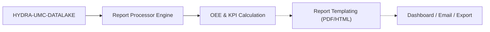

<!-- =============================================================================
HYDRA-UMC-PRODUCTION-REPORTS - KPI and OEE reports built from the datalake
Copyright (C) JuanenRac (Electro Hobby 3D) <electrohobby3d@gmail.com>
GPL-3.0-or-later - see LICENSE
============================================================================= -->

<p align="center">
  
</p>

# 📑 HYDRA-UMC-PRODUCTION-REPORTS

<p align="center"><a href="README.md">🇺🇸 English</a> | <a href="README_spa.md">🇪🇸 Español</a> | <a href="README_fra.md">🇫🇷 Français</a> | <a href="README_ita.md">🇮🇹 Italiano</a> | <a href="README_deu.md">🇩🇪 Deutsch</a> | <a href="README_zho.md">🇨🇳 简体中文</a> | <a href="README_jpn.md">🇯🇵 日本語</a> | 🇵🇹 <b>Português</b></p>

### 📑 Motor automatizado de relatórios de KPI e OEE para gestores de fábrica

<p align="center">
  
  
  
  
  
  
</p>

---

**Verificação de honestidade - o que realmente funciona hoje:** a fórmula real do OEE (`oee.py`), o cálculo real de disponibilidade por lacunas de telemetria (`availability.py`), o cliente HTTP real para o `GET /query` do próprio HYDRA-UMC-DATALAKE (`datalake_client.py`), a fonte de verdade dos limites de turno/dia, incluindo um turno noturno real que atravessa a meia-noite (`shift.py`), a exportação CSV reproduzível byte a byte (`export.py`) e a API HTTP real que expõe tudo isso (`api.py`: `GET /reports/oee`, `/reports/availability`, `/reports/{oee,availability}/export`, `/stats`) são reais e testados (161 testes, `pytest`). O que NÃO está implementado, apesar de constar nas "Funcionalidades principais" abaixo como se já funcionasse: não existe nenhuma exportação para PDF em todo este código (o `export.py` só escreve CSV e uma página HTML autónoma), nenhuma programação de relatórios diários/semanais/mensais, nem qualquer mecanismo de e-mail/entrega para "enviar" algo a um gestor - cada relatório é calculado em direto, a pedido, exatamente uma vez por chamada HTTP. Também não existe ainda uma fonte real de dados `production_event` (nada neste ecossistema escreve hoje esse esquema, veja a ARQUITETURA abaixo), pelo que o OEE nunca foi exercitado contra um HYDRA-UMC-JOB-DISPATCHER real em produção - apenas contra um DATALAKE simulado em testes e cenários construídos à mão. Veja o `CHANGELOG.md` para saber exatamente o que foi entregue até agora e o ROTEIRO abaixo para o que continua em aberto.

---

> **Estado de segurança (safety e security):** este ecossistema não é um sistema de segurança certificado. Ainda não existe um caminho de E-STOP por hardware, nem limites ou interlocks impostos pelo firmware, nem um comando de movimento verificado; as imagens de firmware são verificadas com CRC-32 e uma assinatura Ed25519, e uma compilação de versão recusa as chaves de desenvolvimento publicadas (as cabeças de ferramenta e as placas de expansão atrás do relé ainda usam os bootloaders do URTC, que aceitam um HMAC-SHA256 de chave partilhada em vez de uma assinatura); TLS e TLS mútuo são opcionais e estão desativados por defeito; nenhuma placa própria foi ainda montada ou testada. Leia a [base de segurança](https://github.com/JuanenRac/HYDRA-UMC-DOCS/blob/main/docs/SECURITY_BASELINE.md) e o [modelo de ameaças](https://github.com/JuanenRac/HYDRA-UMC-DOCS/blob/main/docs/THREAT_MODEL.md) antes de confiar em qualquer afirmação aqui para a segurança de uma pessoa.

---

## 📋 Num relance

| | |
|---|---|
| Versão | `0.1.7` |
| Maturidade | Funcional |
| Testes | 161 (`python -m pytest -q tests`) |
| Tecnologia | Python / real OEE formula / http.server |
| Destino | O Raspberry Pi CM5 de uma célula HYDRA-UMC |
| Em hardware real | Ainda não: não há registo de execução em hardware real para esta versão |

**Ir para:** [Visão geral](#-visão-geral) · [Arquitetura](#-arquitetura) · [Configuração](#-configuração) · [Início rápido](#-início-rápido) · [Testes](#-testes) · [Resolução de problemas](#-resolução-de-problemas) · [Estrutura do repositório](#-estrutura-do-repositório) · [Projetos relacionados](#-projetos-relacionados)

## 🚦 Estado do projeto

Cada linha é uma parte deste repositório e a luz diz até onde chega hoje. É escrita com o que o repositório consegue demonstrar (testes, compilações, execuções), não com o que está previsto.

🟢 Feito e verificado · 🟡 Funciona, com limites conhecidos · 🟠 Feito a meio ou ainda por verificar · 🔴 Por fazer ou a não funcionar

| Área | Estado | O que significa aqui |
|---|---|---|
| Software | 🟡 | Funciona para o seu propósito principal; a verificação de honestidade acima lista o que ainda falta |
| Testes | 🟢 | 161 testes automáticos, executados a cada alteração |
| Hardware real | 🔴 | Ainda não: não há registo de execução em hardware real para esta versão |
| Documentação | 🟢 | README em oito idiomas, verificado contra o manifesto a cada alteração |

## 🎯 Visão geral

O **HYDRA-UMC-PRODUCTION-REPORTS** é o cérebro analítico da gestão da fábrica. Processa os dados em bruto do Datalake para gerar relatórios automáticos, de alto nível, sobre a eficiência de produção, a qualidade e a disponibilidade das máquinas.

Calcula o **OEE (Overall Equipment Effectiveness)** de todo o enxame, identificando estrangulamentos na linha de produção e dando rastreabilidade a cada componente fabricado, desde os perfis térmicos de soldadura até à precisão do Pick-and-Place.

### Funcionalidades principais:
* 📈 **Cálculo do OEE (implementado):** Disponibilidade x Desempenho x Qualidade, calculado em direto a partir da telemetria do DATALAKE em cada pedido através do `GET /reports/oee`.
* 📤 **Relatórios CSV/JSON a pedido (implementado):** o `GET /reports/{oee,availability}` devolve JSON; o `GET /reports/{oee,availability}/export` devolve CSV reproduzível byte a byte. Não existe exportação para PDF, nem geração programada diária/semanal/mensal, nem mecanismo de e-mail/entrega - veja o ROTEIRO abaixo.
* 🛠️ **Análise de estrangulamentos (planeado):** identificar que robôs ou ferramentas estão a causar atrasos na fila de missões precisa da fonte real de dados `production_event` abaixo - ainda não implementado.
* 🌡️ **Rastreabilidade de qualidade (planeado):** ligar um produto final aos seus registos específicos de montagem (térmicos, visuais, mecânicos) é trabalho futuro, quando mais do que um projeto escrever dados de produção no DATALAKE.
* 🕐 **Limites de turno/dia:** o `shift.py` dá a cada relatório uma única fonte de verdade real sobre onde começa/termina um turno ou dia civil - incluindo um turno noturno real que atravessa a meia-noite. *(implementado)*
* 🧾 **Fórmulas versionadas e rastreabilidade:** cada relatório transporta a sua `formula_version` real e um `input_fingerprint` sha256 sobre os dados exatos que o produziram. *(implementado)*
* 📤 **Exportação CSV reproduzível:** `GET /reports/{oee,availability}/export` - saída idêntica byte a byte para entradas idênticas, e não apenas "suficientemente próxima". *(implementado)* Uma célula de texto livre (id da fonte, valor de filtro) que comece por `=`, `+`, `-` ou `@` recebe um apóstrofo inicial, para que uma folha de cálculo não a execute como fórmula.
* 🧱 **Seguro de expor e honesto com as suas entradas (v0):** a API escuta em `127.0.0.1` salvo indicação em contrário, e outro endereço exige um token bearer (`--token` / `PRODUCTION_REPORTS_TOKEN`) ou `--allow-anonymous`; só alguns relatórios são construídos de cada vez (`503` além disso); números não finitos são recusados com `400`; as janelas são semiabertas `[start, end)`, pelo que uma amostra na fronteira conta num só relatório; `day=` e `shift=` derivam a janela do horário de turnos; `format=html` numa exportação devolve uma página HTML autónoma; um relatório diz quando a sua entrada é incoerente (`inconsistent_input`) e quantas leituras descartou (`unmatched_count`, também nas exportações). *(implementado)*
* 🔑 **Lê o data lake com o seu token:** quando o HYDRA-UMC-DATALAKE pede um token Bearer, o cliente envia `HYDRA_UMC_DATALAKE_READ_TOKEN`, ou então `HYDRA_UMC_DATALAKE_TOKEN` (cada um também como ficheiro, `..._FILE`, cuja primeira linha é o token). Sem nenhum não envia cabeçalho, como antes, e uma recusa (401) é comunicada como resposta do próprio data lake. *(implementado)*
* 🏭 **OEE de toda a frota:** `GET /reports/oee/fleet` calcula o OEE de várias origens numa mesma janela, com o relatório de cada uma, os números combinados do grupo (todo o tempo de funcionamento sobre todo o tempo planeado, todas as peças boas sobre todas as peças) e o estrangulamento, que é a origem com o OEE mais baixo e o fator que o puxa para baixo. Uma origem sem dados é listada com o seu motivo e não esconde as outras.
* ✅ **Eventos de produção do contrato partilhado:** `contract_events.py` valida os ciclos terminados publicados como `ProductionEvent` com o contrato do HYDRA-UMC-SDK (esquema fechado, uma data e hora reais, um tempo de ciclo superior a 0 e de, no máximo, uma semana) e calcula o OEE a partir deles; um evento recusado recusa o relatório todo. Precisa do extra opcional `[contract]`. *(implementado)*

## 🧩 Papel no HYDRA-UMC

O **HYDRA-UMC-PRODUCTION-REPORTS** constrói relatórios de OEE e de disponibilidade para os responsáveis de fábrica a partir do histórico que o `HYDRA-UMC-DATALAKE` guarda. Não tem armazenamento próprio: cada pedido consulta um datalake em funcionamento, e o mesmo intervalo e os mesmos filtros dão sempre os mesmos bytes, com as fontes, a janela e a versão da fórmula registadas junto dos números.

## 🏛️ Arquitetura

<p align="center">
  
</p>

<details>
<summary>Versão em texto do diagrama (Mermaid)</summary>



</details>

### FLUXO DE RELATÓRIOS

> As setas a tracejado estão planeadas, não implementadas: não há PDF, modelos de relatório, painel nem envio por e-mail. As exportações são CSV e uma página HTML autónoma.

### ARQUITETURA E DECISÕES DE DESENHO

* **Porque é um irmão, e não um submódulo, do HYDRA-UMC-DATALAKE.** A geração de relatórios é uma tarefa periódica, só de leitura, de consulta e cálculo sobre telemetria já armazenada - mantê-la separada significa que uma execução de relatórios nunca compete pelos recursos do mesmo armazém com as escritas em tempo real do próprio HYDRA-UMC-TELEMETRY-COLLECTOR. Este projeto não tem base de dados própria.
* **Integração HTTP real, não uma biblioteca partilhada.** O `datalake_client.py` fala com uma instância em execução do HYDRA-UMC-DATALAKE por HTTP simples (`GET /query`) e deliberadamente **não** importa diretamente o pacote Python do DATALAKE, mesmo que ambos vivam hoje no mesmo ambiente de desenvolvimento - o HTTP real é a fronteira de integração real e desacoplada, que corresponde à forma como repositórios/serviços separados falariam de facto entre si em produção.
* **O esquema `production_event` é a convenção v0 deste projeto, não um padrão do ecossistema.** O OEE precisa de saber, por ciclo concluído, se a peça foi boa e quanto durou o ciclo. Este projeto define isso como uma `Sample` do DATALAKE por ciclo, `kind="production_event"`, com dois campos escritos em conjunto na mesma marca temporal: `"good"` (1,0/0,0) e `"cycleTimeS"`. Nenhum outro projeto escreve ainda este tipo - O produtor natural é o que sabe quando um ciclo começa e termina (o orquestrador, ou o próprio robô): o HYDRA-UMC-JOB-DISPATCHER não guarda marcas de tempo e não consegue calcular um tempo de ciclo.
* **A disponibilidade funciona contra QUALQUER fluxo de telemetria existente, de propósito.** Ao contrário do OEE, o `availability.py` não precisa da convenção `production_event` - recebe qualquer série de marcas temporais que já esteja no DATALAKE (por exemplo, amostras `motor_temp` que o HYDRA-UMC-TELEMETRY-COLLECTOR já escreve) e assinala como tempo de paragem real uma lacuna entre amostras consecutivas superior a `expected_interval_ms x gap_factor`. É isto que permite realmente a este projeto "falar" hoje com os seus irmãos de telemetria, antes de qualquer projeto escrever dados `production_event` a sério.
* **Desempenho e Disponibilidade são limitados a `[0, 1]`.** Um ciclo real pode correr mais depressa do que uma cifra "ideal" conservadora, ou o tempo de operação pode exceder uma janela planeada mal definida; reportar >100 % seria aritmeticamente defensável mas praticamente enganador, pelo que ambos são limitados.
* **Os campos `production_event` sem correspondência são contados e reportados, nunca preenchidos em silêncio com um valor por omissão.** Se uma leitura `"good"` não tem um `"cycleTimeS"` correspondente exatamente na mesma marca temporal (uma escrita parcial/malformada), é excluída e a contagem das excluídas é incluída no erro/resposta, em vez de assumir um tempo de ciclo de 0 s, o que corromperia o valor de Desempenho.
* **Porque o `shift.py` é um módulo separado e não matemática embutida no `oee.py`/`availability.py`.** Dois relatórios que discordam discretamente sobre onde um turno ou dia civil termina produzem dois números diferentes, ambos defensáveis, para a mesma janela real - a mesma contradição assinalada na revisão. Fazer dos limites de turno/dia o seu próprio módulo real e testado (com um turno noturno real que atravessa a meia-noite e uma consulta inversa real de marca temporal para turno) dá a todos os relatórios a mesma fonte de verdade, em vez de cada chamador voltar a derivar a sua.
* **Porque `formula_version` e `input_fingerprint` estão no relatório e não apenas no CSV.** Um relatório consumido como JSON (por um painel, outro serviço) merece a mesma rastreabilidade que um exportado para ficheiro - ambos os campos são aditivos nas respostas existentes de `GET /reports/oee`/`GET /reports/availability`, e não algo visível só na saída do `export.py`.
* **Porque a exportação CSV é um endpoint novo e não uma opção `?format=csv` nas rotas existentes.** Manter o `GET /reports/oee`/`GET /reports/availability` intocados (ainda reais, ainda JSON, ainda exatamente o que o `tests/test_api.py` já afirmava) permitiu acrescentar a funcionalidade de exportação e provar a sua reprodutibilidade sem tocar numa única resposta já testada.

**Janelas demasiado grandes para uma consulta.** Um relatório pergunta primeiro ao data lake quantos pontos tem a janela (`GET /aggregate`). Uma janela acima do limite de 200 000 pontos já não é recusada: o OEE é construído com os totais que o próprio data lake soma (`method` é `aggregate`) e a disponibilidade com os intervalos que contêm pontos, com a exatidão de um intervalo. As respostas de `/aggregate` ficam em memória por fonte, tipo, campo, redutor, intervalo, janela e impressão digital da série; são reutilizadas durante `--cache-ttl-seconds` (30 por predefinição, ou `HYDRA_UMC_PRODUCTION_REPORTS_CACHE_TTL_SECONDS`) e depois só são renovadas se a série mudou. `--no-cache` não guarda nada.

## ⚙️ Configuração

| Variável | Predefinição | O que define |
|---|---|---|
| `--addr` | `127.0.0.1` | endereço onde a API escuta; outro endereço exige um token ou `--allow-anonymous` |
| `--port` | `8099` | porta da API |
| `--datalake-url` | `http://localhost:8095` | datalake consultado por cada pedido |
| `--token` / `PRODUCTION_REPORTS_TOKEN` | nenhum | token Bearer exigido por todas as rotas exceto `GET /health` |
| `--max-concurrent-reports` | `4` | relatórios construídos ao mesmo tempo; além disso um pedido recebe 503 |

## 🚀 Início rápido

Requer Python 3.10 ou superior.

```bash
./build.sh  # Linux, macOS (build.bat on Windows)
./run.sh --datalake-url http://localhost:8095
curl http://127.0.0.1:8099/reports/oee?...
```

## 🧪 Testes

161 testes automáticos correm com `python -m pytest -q tests`. Não precisam de hardware nem de nada fora desta máquina.

A CI executa `HYDRA_UMC_CI=1 python tools/ci_validate.py`, que verifica o manifesto, os documentos, os oito README e as imagens.

## 🏗️ Compilação e publicação

Requer o Python >= 3.10.

```bash
# Linux/macOS
./build.sh && ./run.sh --datalake-url http://localhost:8095

# Windows
build.bat
run.bat --datalake-url http://localhost:8095
```

O `build` cria/ativa um `.venv` local, instala o pacote em modo editável com os extras de desenvolvimento, verifica a importação e executa a suite `pytest` real. O `run` arranca a API HTTP real (porta por omissão `8099`) contra uma instância do HYDRA-UMC-DATALAKE em `--datalake-url` (por omissão `http://localhost:8095`).

```bash
# Relatório OEE real para a fonte "robot-1" numa janela de 5 segundos
curl "http://localhost:8099/reports/oee?sourceId=robot-1&start=0&end=5000&plannedTimeS=10.0&idealCycleTimeS=2.0"

# Relatório de disponibilidade real para o fluxo motor_temp da mesma fonte
curl "http://localhost:8099/reports/availability?sourceId=robot-1&kind=motor_temp&field=value&start=0&end=10000&expectedIntervalMs=1000"
```

## 🩺 Resolução de problemas

| Vê | Porque | Faça |
|---|---|---|
| HTTP 503 | Já estão a ser construídos quatro relatórios (cada um pode trazer para a memória até duas consultas de 200 000 pontos) | Tente de novo daqui a pouco, ou aumente `--max-concurrent-reports` se a máquina tiver memória |
| exit status 2 at start | O endereço não é de loopback e não há token nem `--allow-anonymous` | Defina `PRODUCTION_REPORTS_TOKEN` (ou `--token`), ou use `--allow-anonymous` num laboratório |

## 📂 Estrutura do repositório

<p align="center">
  
</p>

<details>
<summary>Versão em texto da árvore</summary>

```text
HYDRA-UMC-PRODUCTION-REPORTS/
├── src/hydra_umc_production_reports/   código-fonte
│   ├── __init__.py                     Versão do pacote
│   ├── datalake_client.py              Cliente HTTP real para a API GET /query do HYDRA-UMC-DATALAKE
│   ├── oee.py                          Fórmula real do OEE (Disponibilidade x Desempenho x Qualidade)
│   ├── availability.py                 Cálculo real do tempo de paragem a partir de lacunas de telemetria
│   ├── reports.py                      Orquestração: DatalakeClient -> oee.py / availability.py
│   ├── shift.py                        Cálculo real dos limites de turno/dia (fonte de verdade)
│   ├── export.py                       Exportação CSV real e reproduzível byte a byte
│   ├── api.py                          API HTTP real (GET /reports/oee, /reports/availability, /stats, /export)
│   ├── main.py                         Ponto de entrada - arranca o servidor HTTP real
│   └── provenance.py                   De onde vêm os números de um relatório: fonte, série, janela de tempo, amostras e versão do programa
├── tests/                              Testes reais: matemática de OEE/disponibilidade/turno/exportação, idas e voltas com um DATALAKE simulado
├── docs/                               documentos do projeto
├── images/                             Multimédia e diagramas
├── systemd/                            unidade de serviço
├── tools/                              ferramentas do projeto e verificações da CI
├── .github/                            fluxo de CI e modelos de problemas
├── mejoras_futuras.txt                 A lista completa e honesta do que está deliberadamente adiado e porquê
├── pyproject.toml                      Metadados do pacote + extras [dev] (pytest)
├── bump_version.py                     Subida de versão ao estilo conta-quilómetros (executada só pelo comando `bump` explícito)
├── bump_manifest_version.py            Sincroniza a versão do hydra-umc.project.json com a nativa (--sync)
├── build.sh / build.bat                Compilação real: venv + instalação editável + suite de testes real
├── run.sh / run.bat                    Execução real: arranca a API HTTP
├── CHANGELOG.md                        o que mudou em cada versão
├── build-test.sh                       verificação de compilação sem alterações
├── hydra-umc.project.json              manifesto: versão, maturidade, família
└── test.sh                             executa os testes
```

</details>

## 🗺️ Roteiro e limites conhecidos

**Limites conhecidos hoje**

* **Concluído (v0):** cálculo real de OEE e de disponibilidade, integração HTTP real com o HYDRA-UMC-DATALAKE, API HTTP real, limites reais de turno/dia, fórmulas versionadas + impressão digital das entradas, exportação CSV reproduzível byte a byte.
* **A seguir:** uma fonte real de dados `production_event` - fazer o orquestrador (ou o robô) reportar conclusões de ciclo neste esquema.
* **A seguir:** relatórios persistentes/programados (hoje cada relatório é calculado em direto, a pedido).
* **Mais tarde:** exportação para PDF, um mecanismo de e-mail/entrega e um painel.
* Análise de ROI orientada por IA para atualizações de ferramentas, ligada aos mesmos dados de OEE quando houver tendências históricas guardadas.

## 🌍 Idiomas

Este README e os documentos do repositório existem em oito idiomas: inglês, espanhol, alemão, francês, italiano, japonês, chinês e português (Portugal). São escritos em conjunto e a CI verifica que os oito ficheiros têm as mesmas secções e as mesmas ligações. Este repositório não tem ecrã nem catálogo de mensagens próprios, por isso não há textos de interface para traduzir.

## 🔗 Projetos relacionados

Este projeto faz parte do ecossistema de robótica HYDRA-UMC do mesmo autor (JuanenRac / Electro Hobby 3D). Vale a pena conhecê-los, porque um pedido pode ser, na verdade, sobre um destes e não sobre este repositório.

**Projeto-mãe**
- **[HYDRA-UMC-DATALAKE](https://github.com/JuanenRac/HYDRA-UMC-DATALAKE)** — armazém real de séries temporais sobre sqlite3 com uma API HTTP real de ingestão/consulta; o projeto-mãe de que este repositório é um serviço de análise específico, dentro da sua própria camada de dados e análise.

**Projetos irmãos** — os outros serviços de análise da própria camada de dados e análise do HYDRA-UMC-DATALAKE
- **[HYDRA-UMC-TELEMETRY-COLLECTOR](https://github.com/JuanenRac/HYDRA-UMC-TELEMETRY-COLLECTOR)** — pipeline real de ingestão CAN/WebSocket para o DATALAKE, com deduplicação de sequências — hoje também uma fonte de dados real: o `availability.py` deste relatório lê as suas amostras `motor_temp` (e qualquer outra série que escreva) diretamente do Datalake, sem precisar da convenção `production_event` para esse relatório.
- **[HYDRA-UMC-ANOMALY-DETECTOR](https://github.com/JuanenRac/HYDRA-UMC-ANOMALY-DETECTOR)** — detetor real de anomalias por FFT e linha de base estatística, com monitorização de deriva.

**Diretamente relacionados**
- **[HYDRA-UMC-JOB-DISPATCHER](https://github.com/JuanenRac/HYDRA-UMC-JOB-DISPATCHER)** — fila real de trabalhos por prioridade com deduplicação, sobre uma API HTTP real — a fonte real prevista das amostras `production_event` (a convenção de bom/tempo de ciclo do próprio OEE) quando as conclusões de missões forem ligadas para as escrever; nada escreve ainda esse tipo, registado honestamente como trabalho futuro e não dado como concluído.

**Também fazem parte do ecossistema**

*Hardware e plataforma centrais*
- **[HYDRA-UMC](https://github.com/JuanenRac/HYDRA-UMC)** — o desenho da placa-mãe do braço robótico: anfitrião CM5 + STM32H745 de dois núcleos, pensado para orquestrar até 8 braços de ferramenta por CAN-OTA/SPI-OTA (firmware numa fase inicial; ainda sem placa montada).
- **[HYDRA-UMC-OS](https://github.com/JuanenRac/HYDRA-UMC-OS)** — camada de produto reproduzível do Raspberry Pi OS para o CM5: agente só de leitura, configuração/perfis validados, aprovisionamento Wi-Fi de primeiro contacto.
- **[HYDRA-UMC-SDK](https://github.com/JuanenRac/HYDRA-UMC-SDK)** — o contrato JSON-Schema partilhado e a fronteira de software de controlo de trabalhos contra a qual cada bridge valida os seus comandos (não é uma função de segurança certificada).
- **[HYDRA-UMC-CONNECTOR-HUB](https://github.com/JuanenRac/HYDRA-UMC-CONNECTOR-HUB)** — registo declarativo de manifestos de adaptador e validador para conectores de máquinas externas; estende a ideia de contrato do SDK a máquinas externas sem substituir os projetos de gateway industrial.

*Backend central e clientes*
- **[HYDRA-UMC-SERVER](https://github.com/JuanenRac/HYDRA-UMC-SERVER)** — o back-end headless real (REST/WebSocket) com que todos os clientes de controlo realmente comunicam.
- **[HYDRA-UMC-STUDIO](https://github.com/JuanenRac/HYDRA-UMC-STUDIO)** — painel web de controlo com visualização 3D em tempo real de vários robôs.
- **[HYDRA-UMC-SUITE](https://github.com/JuanenRac/HYDRA-UMC-SUITE)** — centro de comando de enxame para desktop (PySide6) para vários servidores ao mesmo tempo, empacotado como executável independente.
- **[HYDRA-UMC-ANDROID-CONTROL](https://github.com/JuanenRac/HYDRA-UMC-ANDROID-CONTROL)** — aplicação Android nativa de controlo, com início de sessão biométrico e um companheiro Wear OS emparelhado.
- **[HYDRA-UMC-IOS-CONTROL](https://github.com/JuanenRac/HYDRA-UMC-IOS-CONTROL)** — aplicação de controlo para iOS/iPadOS (Flutter) com sincronização WebSocket em tempo real.
- **[HYDRA-UMC-DSI](https://github.com/JuanenRac/HYDRA-UMC-DSI)** — interface tátil nativa para o ecrã tátil DSI de 7" integrado, executada no próprio CM5.
- **[HYDRA-UMC-EDITOR-URDF](https://github.com/JuanenRac/HYDRA-UMC-EDITOR-URDF)** — criador/editor gráfico de URDF para desktop que envia os modelos concluídos para o catálogo do STUDIO.
- **[HYDRA-UMC-EDITOR-STL](https://github.com/JuanenRac/HYDRA-UMC-EDITOR-STL)** — editor de modelos STL para desktop que transforma/substitui/remove/adiciona peças reais no mesmo catálogo de modelos que o HYDRA-UMC-EDITOR-URDF também edita.
- **[HYDRA-UMC-BRIDGE-AMR](https://github.com/JuanenRac/HYDRA-UMC-BRIDGE-AMR)** — fronteira de coordenação para frotas AGV/AMR através de um publicador MQTT VDA 5050 (testado apenas contra uma frota emulada).
- **[HYDRA-UMC-BRIDGE-CNC](https://github.com/JuanenRac/HYDRA-UMC-BRIDGE-CNC)** — coordenador de células CNC de alto nível com acesso ao estado GRBL e aos bytes de controlo (testado apenas contra um emulador).
- **[HYDRA-UMC-BRIDGE-DROIDS](https://github.com/JuanenRac/HYDRA-UMC-BRIDGE-DROIDS)** — fronteira de coordenação para droides com patas/humanoides, com um emissor de comandos para o Boston Dynamics Spot (testado apenas contra um emulador).
- **[HYDRA-UMC-BRIDGE-LASER](https://github.com/JuanenRac/HYDRA-UMC-BRIDGE-LASER)** — coordenador de células laser que lê 3 sinais GPIO (chave, caixa e interlock) (testado apenas contra um chip simulado; não pode armar nem disparar um laser).
- **[HYDRA-UMC-BRIDGE-OPENPNP](https://github.com/JuanenRac/HYDRA-UMC-BRIDGE-OPENPNP)** — coordenador seguro de fluxo de placa de alto nível para pick-and-place com OpenPnP.
- **[HYDRA-UMC-BRIDGE-PRINTER3D](https://github.com/JuanenRac/HYDRA-UMC-BRIDGE-PRINTER3D)** — fronteira de coordenação segura para impressoras 3D Moonraker/Klipper, com comandos de trabalho reais protegidos por portas.
- **[HYDRA-UMC-BRIDGE-ROS2](https://github.com/JuanenRac/HYDRA-UMC-BRIDGE-ROS2)** — coordenador com um transporte ROS 2 baseado em rclpy importado sob demanda (ainda não executado contra uma instalação ROS 2).
- **[HYDRA-UMC-BRIDGE-UAV](https://github.com/JuanenRac/HYDRA-UMC-BRIDGE-UAV)** — fronteira de coordenação para UAV com câmara, com um emissor de comandos MAVLink (testado apenas contra um emulador).

*Plataforma de ferramentas URTC*
- **[URTC](https://github.com/JuanenRac/URTC)** — firmware da placa física Universal Robot Tool Controller, mais de 25 perfis de ferramenta por barramento CAN.
- **[URTC-FLASHER](https://github.com/JuanenRac/URTC-FLASHER)** — ferramenta gráfica de gravação para desktop das placas URTC, por CAN-OTA e também SWD/JTAG de chip completo.
- **[URTC-TESTER](https://github.com/JuanenRac/URTC-TESTER)** — ferramenta de diagnóstico CAN em tempo real para desktop das placas URTC, com um painel por perfil de ferramenta.
- **[URTC-WEB-STUDIO](https://github.com/JuanenRac/URTC-WEB-STUDIO)** — alternativa no navegador ao URTC-TESTER através da Web Serial API, sem instalação local.
- **[URTC-GATEWAY](https://github.com/JuanenRac/URTC-GATEWAY)** — gateway à frente do barramento CAN do URTC: lista de identificadores permitidos, limite de taxa e chave de sessão; software testado num computador, ainda não num barramento real.

*Nó de IA de visão (Hailo-8)*
- **[HYDRA-UMC-VISION-NODE](https://github.com/JuanenRac/HYDRA-UMC-VISION-NODE)** — centro de integração do pipeline de visão Hailo-8, com uma verificação real de prontidão de hardware por fase.
- **[HYDRA-UMC-DETECTION-HEF](https://github.com/JuanenRac/HYDRA-UMC-DETECTION-HEF)** — registo real de modelos compilados com verificação segura de carga por arquitetura Hailo e soma de verificação.
- **[HYDRA-UMC-VISION-STREAMER](https://github.com/JuanenRac/HYDRA-UMC-VISION-STREAMER)** — pipeline GStreamer real e gerador de configuração MediaMTX com uma fronteira de integração HailoRT real.
- **[HYDRA-UMC-VISUAL-SERVOING-API](https://github.com/JuanenRac/HYDRA-UMC-VISUAL-SERVOING-API)** — lei de correção de servovisão baseada em posição com autorização condicionada ao estado da zona; ainda sem estimativa de pose por câmara.
- **[HYDRA-UMC-SAFETY-ZONES](https://github.com/JuanenRac/HYDRA-UMC-SAFETY-ZONES)** — lógica v0 de violação de zonas, atualidade da calibração e pedido de E-STOP que lê as posições dos objetos de um ficheiro; nenhum detetor a alimenta e ainda não há E-STOP físico ligado.

*Nó de IA cognitiva (Hailo-10)*
- **[HYDRA-UMC-COGNITIVE-NODE](https://github.com/JuanenRac/HYDRA-UMC-COGNITIVE-NODE)** — centro de integração do pipeline cognitivo do Hailo-10 (orquestração de LLM/VLA/voz).
- **[HYDRA-UMC-VLA-ENGINE](https://github.com/JuanenRac/HYDRA-UMC-VLA-ENGINE)** — codificação/descodificação real de tokens de ação e geração de trajetórias para um modelo Visão-Linguagem-Ação.
- **[HYDRA-UMC-VOICE-UI](https://github.com/JuanenRac/HYDRA-UMC-VOICE-UI)** — front-end de voz real (VAD + analisador de intenções) com um relé para o relógio limitado e protegido por confirmação.
- **[HYDRA-UMC-SEMANTIC-PLANNER](https://github.com/JuanenRac/HYDRA-UMC-SEMANTIC-PLANNER)** — decomposição real de tarefas baseada em regras e recuperação semântica de erros sobre os códigos de erro do MCU.
- **[HYDRA-UMC-DOCS-QA](https://github.com/JuanenRac/HYDRA-UMC-DOCS-QA)** — pesquisa real de documentos TF-IDF só com a biblioteca padrão sobre a documentação Markdown deste ecossistema.
- **[HYDRA-UMC-LOCAL-TECHNICIAN](https://github.com/JuanenRac/HYDRA-UMC-LOCAL-TECHNICIAN)** — técnico de manutenção de IA local, protegido por políticas, para o próprio ecossistema: observa, diagnostica e propõe correções; os dois níveis de maior risco não estão implementados de propósito.

*Orquestração e enxame*
- **[HYDRA-UMC-ORCHESTRATOR](https://github.com/JuanenRac/HYDRA-UMC-ORCHESTRATOR)** — centro de integração com um contrato real de relatório de saúde gRPC/Protobuf e uma máquina de estados de missões.
- **[HYDRA-UMC-NODE-HEALING](https://github.com/JuanenRac/HYDRA-UMC-NODE-HEALING)** — vigilante real de saúde da frota por gRPC com repetição/recuo e deteção de identidade incoerente.
- **[HYDRA-UMC-PATH-PLANNER-3D](https://github.com/JuanenRac/HYDRA-UMC-PATH-PLANNER-3D)** — planeador real de trajetórias 3D baseado em RRT com validação real de colisões com obstáculos e espaço de trabalho.
- **[HYDRA-UMC-SWARM-SYNC](https://github.com/JuanenRac/HYDRA-UMC-SWARM-SYNC)** — sincronização real de estado CRDT LWW-Element-Map, testada por propriedades para a convergência de várias células.

*Gémeo digital e simulação*
- **[HYDRA-UMC-TWIN](https://github.com/JuanenRac/HYDRA-UMC-TWIN)** — centro de integração do motor de gémeo digital, com um contrato real de sincronização de compatibilidade de versões.
- **[HYDRA-UMC-HIL-BRIDGE](https://github.com/JuanenRac/HYDRA-UMC-HIL-BRIDGE)** — encaminhador hardware-in-the-loop com um interlock de software de colisão entre a simulação e o hardware real (testado sem hardware real).
- **[HYDRA-UMC-PHYSICS-REPLICA](https://github.com/JuanenRac/HYDRA-UMC-PHYSICS-REPLICA)** — cinemática direta real e validação de limites de juntas sobre um subconjunto real de URDF.
- **[HYDRA-UMC-SYNTHETIC-DATA-GEN](https://github.com/JuanenRac/HYDRA-UMC-SYNTHETIC-DATA-GEN)** — gerador procedural real de cenas 2D com exportação de anotações YOLO/COCO.

*Gateway industrial*
- **[HYDRA-UMC-GATEWAY-INDUSTRIAL](https://github.com/JuanenRac/HYDRA-UMC-GATEWAY-INDUSTRIAL)** — centro de integração que retransmite para protocolos industriais, com uma camada real de lista de comandos permitidos e contrapressão.
- **[HYDRA-UMC-OPCUA-SERVER](https://github.com/JuanenRac/HYDRA-UMC-OPCUA-SERVER)** — espaço de endereços OPC-UA real, verificado com uma sessão de cliente real do protocolo binário.
- **[HYDRA-UMC-MQTT-BROKER](https://github.com/JuanenRac/HYDRA-UMC-MQTT-BROKER)** — broker MQTT real com autenticação opcional por cliente e ACL de tópicos.
- **[HYDRA-UMC-MTCONNECT-ADAPTER](https://github.com/JuanenRac/HYDRA-UMC-MTCONNECT-ADAPTER)** — endpoints XML MTConnect `/probe` e `/current` reais com saída em modo degradado.

*Ferramentas complementares e operações do ecossistema*
- **[HYDRA-UMC-DASHBOARD-AI](https://github.com/JuanenRac/HYDRA-UMC-DASHBOARD-AI)** — painéis de Resumos Inteligentes e Realce de Anomalias sobre o DATALAKE/ANOMALY-DETECTOR, com um recurso estatístico honesto.
- **[HYDRA-UMC-TOOL-CLI](https://github.com/JuanenRac/HYDRA-UMC-TOOL-CLI)** — CLI da frota com um contrato de códigos de saída real e estável, um cliente vivo genuíno da API do HYDRA-UMC-SERVER.
- **[HYDRA-UMC-WATCH](https://github.com/JuanenRac/HYDRA-UMC-WATCH)** — aplicação companheira WearOS com padrões de alerta tátil e um relé de voz para o telemóvel emparelhado (ainda não executada num relógio físico).
- **[URTC-SMART-RACK](https://github.com/JuanenRac/URTC-SMART-RACK)** — firmware de um rack de montagem de placas com descodificação real do ID da ferramenta e lógica de pré-aquecimento Smart Idle.
- **[URTC-VISION-TOOL](https://github.com/JuanenRac/URTC-VISION-TOOL)** — firmware mais um companheiro de visão em Python real para uma cabeça de ferramenta de inspeção térmica/RGB.
- **[HYDRA-UMC-UPDATER](https://github.com/JuanenRac/HYDRA-UMC-UPDATER)** — ferramenta administrativa de desktop que descobre, clona e atualiza todos os repositórios deste ecossistema.
- **[HYDRA-UMC-OS-REBUILDER](https://github.com/JuanenRac/HYDRA-UMC-OS-REBUILDER)** — ferramenta de desktop para Windows/Linux que constrói uma imagem do CM5 pronta a gravar com as versões mais recentes do ecossistema, com configuração de primeiro arranque de Wi-Fi/utilizador/SSH ao estilo do Raspberry Pi Imager.
- **[HYDRA-UMC-OPS-AGENT](https://github.com/JuanenRac/HYDRA-UMC-OPS-AGENT)** — coordenador de incidentes de manutenção: um papel de borda de poucos privilégios recolhe um inventário/estado higienizado, um papel de plano de controlo mostra-o só de leitura e pede a um fornecedor de IA que sugira um diagnóstico; nunca aplica um patch nem implanta nada.
- **[HYDRA-UMC-DEV-SERVER](https://github.com/JuanenRac/HYDRA-UMC-DEV-SERVER)** — anfitrião de desenvolvimento reproduzível (Raspberry Pi 5 / CM5) que guarda o código-fonte do ecossistema e executa tarefas limitadas de compilação/teste numa fila durável; um papel de desenvolvimento dedicado, explicitamente não um CM5 operacional.

## 📚 Documentação

Onde ler mais:

* [Base de segurança do ecossistema](https://github.com/JuanenRac/HYDRA-UMC-DOCS/blob/main/docs/SECURITY_BASELINE.md)
* [Modelo de ameaças do ecossistema](https://github.com/JuanenRac/HYDRA-UMC-DOCS/blob/main/docs/THREAT_MODEL.md)
* [Registo de alterações deste repositório](CHANGELOG.md)
* [Licença deste repositório](LICENSE.md)

## 🤝 Contribuir e comunidade

* Antes de um pull request execute `HYDRA_UMC_CI=1 py -3 tools/ci_validate.py` (ou `HYDRA_UMC_CI=1 python3 tools/ci_validate.py`): tem de imprimir `CI_VALIDATION=PASS`. Não execute `build.sh` nem `build.bat` para esta verificação; compilar não é verificar.
* Os oito README são escritos a partir de uma única fonte em HYDRA-UMC-DOCS; não os edite à mão. Altere a fonte e escreva-os de novo com `tools/make_readmes.py`.
* Não afirme num README o que não foi executado: diga «simulado» ou «não testado em hardware» quando for a verdade.
* Consulte [CONTRIBUTING.md](CONTRIBUTING.md), o [código de conduta](CODE_OF_CONDUCT.md), [SECURITY.md](SECURITY.md) e [SUPPORT.md](SUPPORT.md).

## 👤 AUTOR

**JuanenRac (Electro Hobby 3D)** · electrohobby3d@gmail.com

## 📜 LICENÇA

GPL-3.0-or-later - [LICENSE](LICENSE).
