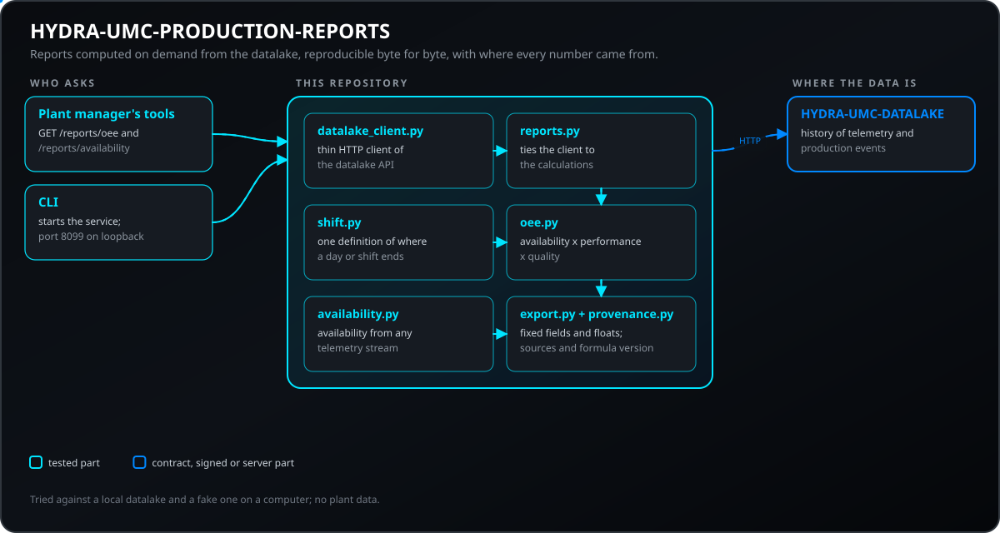
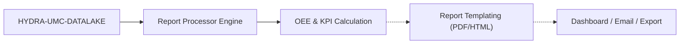
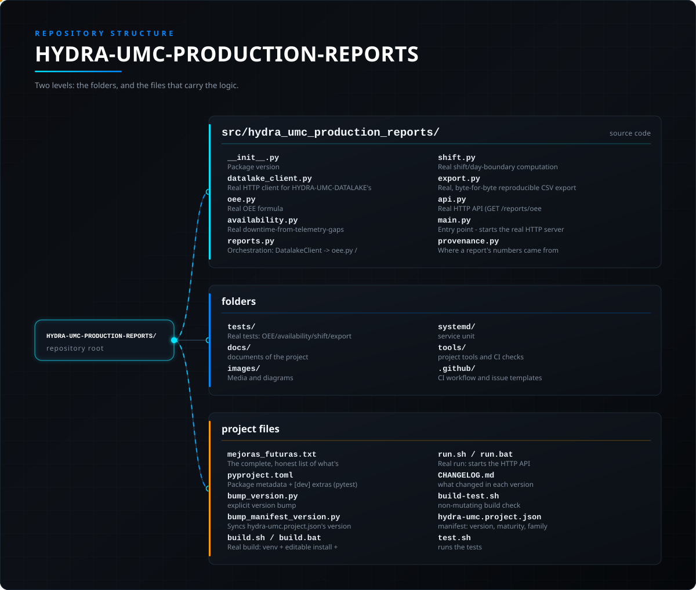

<!-- =============================================================================
HYDRA-UMC-PRODUCTION-REPORTS - KPI and OEE reports built from the datalake
Copyright (C) JuanenRac (Electro Hobby 3D) <electrohobby3d@gmail.com>
GPL-3.0-or-later - see LICENSE
============================================================================= -->

<p align="center">
  
</p>

# 📑 HYDRA-UMC-PRODUCTION-REPORTS

<p align="center"><a href="README.md">🇺🇸 English</a> | <a href="README_spa.md">🇪🇸 Español</a> | <a href="README_fra.md">🇫🇷 Français</a> | <a href="README_ita.md">🇮🇹 Italiano</a> | <a href="README_deu.md">🇩🇪 Deutsch</a> | 🇨🇳 <b>简体中文</b> | <a href="README_jpn.md">🇯🇵 日本語</a> | <a href="README_por.md">🇵🇹 Português</a></p>

### 📑 面向工厂管理者的自动化 KPI 与 OEE 报告引擎

<p align="center">
  
  
  
  
  
  
</p>

---

**诚实核查——今天真正能跑起来的部分：** 真实的 OEE 公式（`oee.py`）、基于遥测数据缺口的真实可用性计算（`availability.py`）、指向 HYDRA-UMC-DATALAKE 自身 `GET /query` 的真实 HTTP 客户端（`datalake_client.py`）、班次/自然日边界的唯一真实基准——包括真实的跨越午夜的夜班（`shift.py`）、逐字节可复现的 CSV 导出（`export.py`），以及把这一切都暴露出来的真实 HTTP API（`api.py`：`GET /reports/oee`、`/reports/availability`、`/reports/{oee,availability}/export`、`/stats`）都是真实且经过测试的（133 个测试，`pytest`）。下面"关键特性"中列出但实际上尚未实现的部分：本代码库中完全没有任何 PDF 导出（`export.py` 只会写 CSV 和一个自包含的 HTML 页面）、没有每日/每周/每月报告的调度机制，也没有向管理者"发送"任何内容的邮件/投递机制——每份报告都是按需实时计算的，每次 HTTP 调用恰好计算一次。目前也还没有真实的 `production_event` 数据源（本生态系统中今天没有任何项目写入该模式，见下面的"架构"），因此 OEE 从未在生产环境中针对真实运行的 HYDRA-UMC-JOB-DISPATCHER 做过验证——只在测试中针对一个伪造的 DATALAKE 以及手工构造的场景验证过。已交付的具体内容见 `CHANGELOG.md`，尚未完成的部分见下面的路线图。

---

> **安全与安防现状:**本生态系统不是经认证的安全系统。目前尚无硬件 E-STOP 通路,没有由固件强制执行的限位或联锁,也没有经过验证的运动指令;固件映像使用 CRC-32 和 Ed25519 签名校验,发布构建会拒绝已公开的开发密钥(中继之后的工具头和扩展板仍运行 URTC 的引导程序,它们使用共享密钥的 HMAC-SHA256 而不是签名);TLS 与双向 TLS 均为可选项,默认关闭;自制电路板尚未组装或测试。在依赖此处任何说法来保障人身安全之前,请先阅读[安全基线](https://github.com/JuanenRac/HYDRA-UMC-DOCS/blob/main/docs/SECURITY_BASELINE.md)和[威胁模型](https://github.com/JuanenRac/HYDRA-UMC-DOCS/blob/main/docs/THREAT_MODEL.md)。

---

## 📋 速览

| | |
|---|---|
| 版本 | `0.1.6` |
| 成熟度 | 可用 |
| 测试 | 133 (`python -m pytest -q tests`) |
| 技术栈 | Python / real OEE formula / http.server |
| 目标 | HYDRA-UMC 工作单元的 Raspberry Pi CM5 |
| 真实硬件 | 尚未：此版本没有在真实硬件上运行的记录 |

**跳转：** [概述](#-概述) · [架构](#-架构) · [配置](#-配置) · [快速开始](#-快速开始) · [测试](#-测试) · [故障排除](#-故障排除) · [仓库结构](#-仓库结构) · [相关项目](#-相关项目)

## 🚦 项目状态

每一行是本仓库的一个部分，灯号表示它今天做到了哪一步。内容依据仓库能够展示的证据（测试、构建、运行），而不是计划。

🟢 已完成并验证 · 🟡 可用，有已知限制 · 🟠 部分完成或尚未验证 · 🔴 未完成或不可用

| 领域 | 状态 | 在这里的含义 |
|---|---|---|
| 软件 | 🟡 | 主要用途可用；上面的诚实性检查列出了仍然缺少的内容 |
| 测试 | 🟢 | 133 项自动测试，每次变更都会运行 |
| 真实硬件 | 🔴 | 尚未：此版本没有在真实硬件上运行的记录 |
| 文档 | 🟢 | 八种语言的 README，每次变更都会与清单核对 |

## 🎯 概述

**HYDRA-UMC-PRODUCTION-REPORTS** 是工厂管理的分析大脑。它处理来自数据
湖的原始数据，生成关于生产效率、质量和机器可用性的自动化高层报告。

它计算整个集群的 **OEE（整体设备效率）**，识别生产线中的瓶颈，并为
制造的每一个组件提供可追溯性——从热焊剖面到抓取放置精度。

### 关键特性：
* 📈 **OEE 计算（已实现）：** 可用性 x 性能 x 质量，在每次通过 `GET /reports/oee` 请求时基于 DATALAKE 遥测数据实时计算。
* 📤 **按需 CSV/JSON 报告（已实现）：** `GET /reports/{oee,availability}` 返回 JSON；`GET /reports/{oee,availability}/export` 返回逐字节可复现的 CSV。目前没有任何 PDF 导出、没有每日/每周/每月的调度生成，也没有邮件/投递机制——见下面的路线图。
* 🛠️ **瓶颈分析（计划中）：** 识别哪些机器人或工具正在造成任务队列延迟，需要下面提到的真实 `production_event` 数据源——尚未实现。
* 🌡️ **质量可追溯性（计划中）：** 将最终产品与其特定的装配日志（热、视觉、机械）关联起来是未来的工作，要等到有不止一个项目向 DATALAKE 写入生产数据之后。
* 🕐 **班次/日边界：** `shift.py` 为每份报告提供了唯一的真实基准，用于确定班次或自然日的起止时间——包括真实的跨越午夜的夜班。*（已实现）*
* 🧾 **版本化公式 + 可追溯性：** 每份报告都携带其真实的 `formula_version`，以及基于产生该报告的确切数据计算的 sha256 `input_fingerprint`。*（已实现）*
* 📤 **可复现的 CSV 导出：** `GET /reports/{oee,availability}/export` —— 对相同输入产生逐字节完全一致的输出，而不仅仅是“足够接近”。*（已实现）* 以 `=`、`+`、`-` 或 `@` 开头的自由文本单元格（源 ID、过滤值）会被加上前导撇号，这样电子表格就不会把它当作公式执行。
* 🧱 **可安全暴露，并对输入保持诚实（v0）：** 除非另行指定，API 监听 `127.0.0.1`，其他地址需要 bearer 令牌（`--token` / `PRODUCTION_REPORTS_TOKEN`）或 `--allow-anonymous`；同一时间只构建少量报告（超出返回 `503`）；非有限数值以 `400` 拒绝；窗口为半开区间 `[start, end)`，因此边界上的样本只计入一份报告；`day=` 和 `shift=` 根据班次计划推导窗口；导出时使用 `format=html` 会返回自包含的 HTML 页面；报告会说明其输入何时不一致（`inconsistent_input`）以及丢弃了多少读数（`unmatched_count`，导出中也有）。*（已实现）*
* 🔑 **使用令牌读取数据湖：** 当 HYDRA-UMC-DATALAKE 要求 Bearer 令牌时，客户端发送 `HYDRA_UMC_DATALAKE_READ_TOKEN`，否则发送 `HYDRA_UMC_DATALAKE_TOKEN`（二者也可作为文件 `..._FILE` 给出，第一行即令牌）。都未设置时与以前一样不发送头部，被拒绝（401）会作为数据湖自身的应答报告。*（已实现）*
* 🏭 **整个机群的 OEE:** `GET /reports/oee/fleet` 在同一时间窗口内计算多个来源的 OEE，给出每个来源的报告、整组的合并数字(全部运行时间除以全部计划时间、全部良品除以全部产品)以及瓶颈(OEE 最低的来源和拉低它的因素)。没有数据的来源会连同原因一起列出，不会遮住其他来源。

## 🧩 在 HYDRA-UMC 中的角色

**HYDRA-UMC-PRODUCTION-REPORTS** 根据 `HYDRA-UMC-DATALAKE` 保存的历史数据，为工厂管理者生成 OEE 和可用率报告。它没有自己的存储：每个请求都会查询一个正在运行的数据湖，相同的范围和过滤条件总是得到相同的字节，数字旁边记录着来源、时间窗口和公式版本。

## 🏛️ 架构

<p align="center">
  
</p>

<details>
<summary>图表的文本版本（Mermaid）</summary>



</details>

### 报告流程

> 虚线箭头仅为计划，尚未实现：没有 PDF、报告模板、仪表板或电子邮件投递。导出格式为 CSV 和自包含的 HTML 页面。

### 架构与设计决策

* **为何这是 HYDRA-UMC-DATALAKE 的兄弟项目，而非子模块。** 报告生成是一项针对已存储遥测数据的周期性、只读的“查询+计算”任务——将其保持独立，意味着报告生成永远不会与 HYDRA-UMC-TELEMETRY-COLLECTOR 自身对同一存储资源的实时写入相竞争。本项目没有自己的数据库。
* **真实的 HTTP 集成，而非共享库。** `datalake_client.py` 通过纯 HTTP（`GET /query`）与一个真实运行中的 HYDRA-UMC-DATALAKE 实例通信，并且刻意不直接导入 DATALAKE 的 Python 包——尽管两者目前处于同一个开发环境中。真实的 HTTP 才是真正解耦的集成接口，符合生产环境中独立仓库/服务之间实际通信的方式。
* **`production_event` schema 是本项目自己的 v0 约定，并非生态系统标准。** OEE 需要知道每个完成周期的零件是否合格、周期耗时多久。本项目将其定义为每个周期一个 DATALAKE `Sample`，`kind="production_event"`，在同一个时间戳下一起写入两个字段：`"good"`（1.0/0.0）和 `"cycleTimeS"`。目前还没有其他项目写入这个 kind——天然的生产者是知道周期何时开始和结束的组件（编排器或机器人本身）：HYDRA-UMC-JOB-DISPATCHER 不保存时间戳，无法计算周期时间。
* **可用性计算故意针对任意已存在的遥测流生效。** 与 OEE 不同，`availability.py` 完全不需要 `production_event` 约定——它使用 DATALAKE 中已存在的任意时间戳序列（例如 HYDRA-UMC-TELEMETRY-COLLECTOR 已经写入的 `motor_temp` 样本），并将连续样本之间大于 `expected_interval_ms x gap_factor` 的间隔标记为真实的停机时间。这正是让本项目在任何项目写入真实 `production_event` 数据之前，就已经能与其遥测“兄弟项目”真正“对话”的原因。
* **Performance 和 Availability 都被限制在 `[0, 1]` 之间。** 真实周期可能比一个保守的“理想”数值更快，或者运行时间可能超出配置有误的计划窗口；报告 >100% 在算术上是站得住脚的，但在实践中具有误导性，因此两者都会被截断。
* **未匹配的 `production_event` 字段会被计数并报告，绝不会被静默地赋予默认值。** 如果某条 `"good"` 记录在完全相同的时间戳上没有对应的 `"cycleTimeS"`（一次部分/格式错误的写入），它会被排除在外，被排除的条数会包含在错误/响应中，而不是假设周期时间为 0 秒——那样会破坏 Performance 数值的准确性。
* **为何 `shift.py` 是一个独立模块，而不是 `oee.py`/`availability.py` 中的内联计算。** 两份报告若在班次或自然日的切分点上悄悄产生分歧，就会对同一个真实时间窗口给出两个不同、却又都能自圆其说的数字——这正是晋升审计所指出的矛盾。将班次/日边界做成一个独立的、真实的、经过测试的模块（包含真实的跨越午夜的夜班，以及真实的时间戳到班次的反向查找），可以让每份报告共享同一个真实基准，而不是让每个调用方各自重新推导。
* **为何 `formula_version` 和 `input_fingerprint` 在报告本身上，而不仅仅在 CSV 中。** 以 JSON 形式被消费的报告（被仪表盘、其他服务读取）应当享有与导出到文件的报告同等的可追溯性——这两个字段是对现有 `GET /reports/oee`/`GET /reports/availability` 响应的增量添加，而不是只在 `export.py` 输出中才能看到的东西。
* **为何 CSV 导出是一个新端点，而不是在现有路由上加一个 `?format=csv` 标志。** 保持 `GET /reports/oee`/`GET /reports/availability` 不变（依旧真实、依旧是 JSON、依旧完全符合 `tests/test_api.py` 已有的断言），意味着可以在不碰触任何已测试响应的前提下添加导出功能，并证明其可复现性。

## ⚙️ 配置

| 变量 | 默认值 | 设置内容 |
|---|---|---|
| `--addr` | `127.0.0.1` | API 绑定的地址；其他地址需要令牌或 `--allow-anonymous` |
| `--port` | `8099` | API 端口 |
| `--datalake-url` | `http://localhost:8095` | 每个请求所查询的数据湖 |
| `--token` / `PRODUCTION_REPORTS_TOKEN` | 无 | 除 `GET /health` 外所有路由都需要的 Bearer 令牌 |
| `--max-concurrent-reports` | `4` | 同时生成的报告数；超过后请求得到 503 |

## 🚀 快速开始

需要 Python 3.10 或更高版本。

```bash
./build.sh  # Linux, macOS (build.bat on Windows)
./run.sh --datalake-url http://localhost:8095
curl http://127.0.0.1:8099/reports/oee?...
```

## 🧪 测试

运行 `python -m pytest -q tests` 会执行 133 个自动测试。 不需要硬件，也不需要这台机器以外的任何东西。

CI 运行 `HYDRA_UMC_CI=1 python tools/ci_validate.py`，检查清单、文档、八个 README 和图片。

## 🏗️ 构建与发布

需要 Python >= 3.10。

```bash
# Linux/macOS
./build.sh && ./run.sh --datalake-url http://localhost:8095

# Windows
build.bat
run.bat --datalake-url http://localhost:8095
```

`build` 创建/激活本地 `.venv`，以可编辑模式安装该包（含开发 extras），
验证导入，并运行真实的 `pytest` 测试套件。`run` 启动真实的 HTTP API
（默认端口 `8099`），连接到 `--datalake-url` 指定的 HYDRA-UMC-DATALAKE
实例（默认 `http://localhost:8095`）。

```bash
# robot-1 在 5 秒窗口内的真实 OEE 报告
curl "http://localhost:8099/reports/oee?sourceId=robot-1&start=0&end=5000&plannedTimeS=10.0&idealCycleTimeS=2.0"

# 同一来源 motor_temp 数据流的真实可用性报告
curl "http://localhost:8099/reports/availability?sourceId=robot-1&kind=motor_temp&field=value&start=0&end=10000&expectedIntervalMs=1000"
```

## 🩺 故障排除

| 你看到 | 原因 | 处理 |
|---|---|---|
| HTTP 503 | 已有四份报告正在生成（每份最多可把两次各 200,000 点的查询载入内存） | 稍后重试，或在机器内存足够时调大 `--max-concurrent-reports` |
| exit status 2 at start | 地址不是回环，且既没有令牌也没有 `--allow-anonymous` | 设置 `PRODUCTION_REPORTS_TOKEN`（或 `--token`），或在实验室使用 `--allow-anonymous` |

## 📂 仓库结构

<p align="center">
  
</p>

<details>
<summary>目录树的文本版本</summary>

```text
HYDRA-UMC-PRODUCTION-REPORTS/
├── src/hydra_umc_production_reports/   源代码
│   ├── __init__.py                     包版本
│   ├── datalake_client.py              针对 HYDRA-UMC-DATALAKE 的 GET /query API 的真实 HTTP 客户端
│   ├── oee.py                          真实的 OEE 公式（可用性 x 性能 x 质量）
│   ├── availability.py                 基于遥测间隔的真实停机计算
│   ├── reports.py                      编排层：DatalakeClient -> oee.py / availability.py
│   ├── shift.py                        真实的班次/日边界计算（真实基准）
│   ├── export.py                       真实的、逐字节可复现的 CSV 导出
│   ├── api.py                          真实的 HTTP API（GET /reports/oee、/reports/availability、/stats、/export）
│   ├── main.py                         入口点——启动真实的 HTTP 服务器
│   └── provenance.py                   报告数字的来源: 数据源、序列、时间窗口、样本数和程序版本
├── tests/                              真实测试：OEE/可用性/班次/导出的计算逻辑，针对伪造 DATALAKE 的往返测试
├── docs/                               项目文档
├── images/                             媒体与图示
├── systemd/                            服务单元
├── tools/                              项目工具和 CI 检查
├── .github/                            CI 工作流和 Issue 模板
├── mejoras_futuras.txt                 完整、诚实地列出哪些内容被有意推迟及原因
├── pyproject.toml                      包元数据 + [dev] extras（pytest）
├── bump_version.py                     显式提升版本
├── bump_manifest_version.py            将 hydra-umc.project.json 的版本与原生版本同步（--sync）
├── build.sh / build.bat                真实构建：venv + 可编辑安装 + 真实测试套件
├── run.sh / run.bat                    真实运行：启动 HTTP API
├── CHANGELOG.md                        每个版本的变更
├── build-test.sh                       不修改内容的构建检查
├── hydra-umc.project.json              清单：版本、成熟度、系列
└── test.sh                             运行测试
```

</details>

## 🗺️ 路线图与已知限制

**当前已知限制**

* **已完成（v0）：** 真实的 OEE 与可用性计算、与 HYDRA-UMC-DATALAKE 的真实 HTTP 集成、真实的 HTTP API、真实的班次/日边界、版本化公式 + 输入指纹、逐字节可复现的 CSV 导出。
* **下一步：** 真实的 `production_event` 数据源——让编排器（或机器人）以此 schema 报告周期完成情况。
* **下一步：** 持久化/定时生成的报告（目前每份报告都是按需实时计算的）。
* **稍后：** PDF 导出、邮件/投递机制，以及仪表盘。
* 面向工具升级的 AI 驱动 ROI 分析，一旦存储了历史趋势数据，将与这些相同的 OEE 数据相连接。

## 🌍 语言

本 README 和仓库文档提供八种语言：英语、西班牙语、德语、法语、意大利语、日语、中文和葡萄牙语（葡萄牙）。它们同时编写，并由 CI 检查八个文件拥有相同的章节和相同的链接。 本仓库没有自己的界面或消息目录，因此没有需要翻译的界面文字。

## 🔗 相关项目

本项目是同一作者(JuanenRac / Electro Hobby 3D)打造的 HYDRA-UMC 机器人生态系统的一部分。值得了解,因为某个请求实际上可能是关于这些项目之一,而非本仓库本身。

**父项目**
- **[HYDRA-UMC-DATALAKE](https://github.com/JuanenRac/HYDRA-UMC-DATALAKE)** — 具备真实数据摄入/查询 HTTP API 的真实 sqlite3 时序数据存储;本仓库是其自身数据与分析层中一个具体分析服务所属的父项目。

**兄弟项目** —— HYDRA-UMC-DATALAKE 自身数据与分析层中的其他分析服务
- **[HYDRA-UMC-TELEMETRY-COLLECTOR](https://github.com/JuanenRac/HYDRA-UMC-TELEMETRY-COLLECTOR)** — 面向 DATALAKE 的真实 CAN/WebSocket 数据摄入管道，支持序列去重 —— 如今也是真实的数据来源:本报告自身的 `availability.py` 直接从 Datalake 读取其 `motor_temp` 样本(及其写入的其他任何序列),该报告无需 `production_event` 约定。
- **[HYDRA-UMC-ANOMALY-DETECTOR](https://github.com/JuanenRac/HYDRA-UMC-ANOMALY-DETECTOR)** — 具备漂移监测能力的真实 FFT + 统计基线异常检测器。

**直接相关**
- **[HYDRA-UMC-JOB-DISPATCHER](https://github.com/JuanenRac/HYDRA-UMC-JOB-DISPATCHER)** — 基于真实 HTTP API 的真实优先级任务队列，支持去重 —— 一旦任务完成事件被接入以写入数据,将成为 `production_event` 样本(OEE 自身的良品率/周期时间约定)的设想真实来源;目前尚无任何组件写入此类数据,诚实地作为未来工作跟踪,而非宣称已完成。

**生态系统中的其他项目**

*核心硬件与平台*
- **[HYDRA-UMC](https://github.com/JuanenRac/HYDRA-UMC)** — 机器人手臂主板设计——CM5 主机 + 双核 STM32H745,目标是通过 CAN-OTA/SPI-OTA 协调最多 8 条工具臂(固件处于早期阶段,尚无已组装的电路板)。
- **[HYDRA-UMC-OS](https://github.com/JuanenRac/HYDRA-UMC-OS)** — 面向 CM5 的可复现 Raspberry Pi OS 产品层——只读代理、经过验证的配置/配置文件、WiFi 首次配网。
- **[HYDRA-UMC-SDK](https://github.com/JuanenRac/HYDRA-UMC-SDK)** — 每个桥接都据此校验自身指令的共享 JSON-Schema 契约与软件作业门限边界(并非经认证的安全功能)。
- **[HYDRA-UMC-CONNECTOR-HUB](https://github.com/JuanenRac/HYDRA-UMC-CONNECTOR-HUB)** — 面向外部机器连接器的声明式适配器清单注册与校验工具；把 SDK 自身的契约理念扩展到外部机器，而不取代工业网关类项目。

*核心后端与客户端*
- **[HYDRA-UMC-SERVER](https://github.com/JuanenRac/HYDRA-UMC-SERVER)** — 每个控制客户端真正通信的真实无头后端(REST/WebSocket)。
- **[HYDRA-UMC-STUDIO](https://github.com/JuanenRac/HYDRA-UMC-STUDIO)** — 具有实时多机器人 3D 可视化的网页控制面板。
- **[HYDRA-UMC-SUITE](https://github.com/JuanenRac/HYDRA-UMC-SUITE)** — 面向多台服务器的桌面(PySide6)集群指挥中心，打包为独立可执行文件。
- **[HYDRA-UMC-ANDROID-CONTROL](https://github.com/JuanenRac/HYDRA-UMC-ANDROID-CONTROL)** — 具有生物识别登录和配对 Wear OS 伴侣应用的原生 Android 控制应用。
- **[HYDRA-UMC-IOS-CONTROL](https://github.com/JuanenRac/HYDRA-UMC-IOS-CONTROL)** — 具有实时 WebSocket 同步的 iOS/iPadOS 控制应用(Flutter)。
- **[HYDRA-UMC-DSI](https://github.com/JuanenRac/HYDRA-UMC-DSI)** — 面向机载 7 英寸 DSI 触摸屏的原生触控界面，直接嵌入 CM5 本体。
- **[HYDRA-UMC-EDITOR-URDF](https://github.com/JuanenRac/HYDRA-UMC-EDITOR-URDF)** — 将完成的模型推送到 STUDIO 自身目录的桌面版图形化 URDF 创建/编辑工具。
- **[HYDRA-UMC-EDITOR-STL](https://github.com/JuanenRac/HYDRA-UMC-EDITOR-STL)** — 桌面 STL 模型编辑器，在 HYDRA-UMC-EDITOR-URDF 编辑的同一模型目录中变换/替换/移除/添加真实部件。
- **[HYDRA-UMC-BRIDGE-AMR](https://github.com/JuanenRac/HYDRA-UMC-BRIDGE-AMR)** — 通过 VDA 5050 MQTT 发布者为 AGV/AMR 车队提供的协调边界(仅针对仿真车队测试)。
- **[HYDRA-UMC-BRIDGE-CNC](https://github.com/JuanenRac/HYDRA-UMC-BRIDGE-CNC)** — 具备 GRBL 状态/控制字节访问能力的高层 CNC 单元协调器(仅针对模拟器测试)。
- **[HYDRA-UMC-BRIDGE-DROIDS](https://github.com/JuanenRac/HYDRA-UMC-BRIDGE-DROIDS)** — 面向足式/人形机器人的协调边界,带有 Boston Dynamics Spot 指令发送器(仅针对模拟器测试)。
- **[HYDRA-UMC-BRIDGE-LASER](https://github.com/JuanenRac/HYDRA-UMC-BRIDGE-LASER)** — 读取 3 路钥匙/外壳/联锁 GPIO 信号的激光单元协调器(仅针对模拟芯片测试;无法使激光器上膛或发射)。
- **[HYDRA-UMC-BRIDGE-OPENPNP](https://github.com/JuanenRac/HYDRA-UMC-BRIDGE-OPENPNP)** — 面向 OpenPnP 贴片机板级流程的安全高层协调器。
- **[HYDRA-UMC-BRIDGE-PRINTER3D](https://github.com/JuanenRac/HYDRA-UMC-BRIDGE-PRINTER3D)** — 面向 Moonraker/Klipper 3D 打印机的安全协调边界，具备真实的受控作业指令。
- **[HYDRA-UMC-BRIDGE-ROS2](https://github.com/JuanenRac/HYDRA-UMC-BRIDGE-ROS2)** — 带有惰性导入 rclpy ROS 2 传输层的协调器(尚未在 ROS 2 环境中运行)。
- **[HYDRA-UMC-BRIDGE-UAV](https://github.com/JuanenRac/HYDRA-UMC-BRIDGE-UAV)** — 面向搭载摄像头的无人机的协调边界,带有 MAVLink 指令发送器(仅针对模拟器测试)。

*URTC 工具平台*
- **[URTC](https://github.com/JuanenRac/URTC)** — 面向实体 Universal Robot Tool Controller 板卡的固件，通过 CAN 总线支持 25 种以上工具配置。
- **[URTC-FLASHER](https://github.com/JuanenRac/URTC-FLASHER)** — 面向 URTC 板卡的桌面图形烧录工具，支持 CAN-OTA 以及全芯片 SWD/JTAG。
- **[URTC-TESTER](https://github.com/JuanenRac/URTC-TESTER)** — 面向 URTC 板卡的桌面实时 CAN 总线诊断工具，每种工具配置对应一个面板。
- **[URTC-WEB-STUDIO](https://github.com/JuanenRac/URTC-WEB-STUDIO)** — 通过 Web Serial API 实现的浏览器版 URTC-TESTER 替代方案，无需本地安装。
- **[URTC-GATEWAY](https://github.com/JuanenRac/URTC-GATEWAY)** — URTC CAN 总线前的网关：允许的标识符列表、速率限制和会话密钥；软件已在计算机上测试，尚未在真实总线上测试。

*视觉 AI 节点(Hailo-8)*
- **[HYDRA-UMC-VISION-NODE](https://github.com/JuanenRac/HYDRA-UMC-VISION-NODE)** — 面向 Hailo-8 视觉流水线的集成中枢，具备逐阶段的真实硬件就绪检测。
- **[HYDRA-UMC-DETECTION-HEF](https://github.com/JuanenRac/HYDRA-UMC-DETECTION-HEF)** — 具备 Hailo 架构/校验和安全加载验证的真实编译模型注册表。
- **[HYDRA-UMC-VISION-STREAMER](https://github.com/JuanenRac/HYDRA-UMC-VISION-STREAMER)** — 具备真实 HailoRT 集成边界的真实 GStreamer 流水线 + MediaMTX 配置生成器。
- **[HYDRA-UMC-VISUAL-SERVOING-API](https://github.com/JuanenRac/HYDRA-UMC-VISUAL-SERVOING-API)** — 以区域状态为授权条件的 Position-Based Visual Servoing 修正律;尚无摄像头位姿估计。
- **[HYDRA-UMC-SAFETY-ZONES](https://github.com/JuanenRac/HYDRA-UMC-SAFETY-ZONES)** — 从文件读取物体位置的 v0 区域入侵、校准新鲜度与 E-STOP 请求逻辑;没有检测器为其供数,也尚未连接任何物理 E-STOP。

*认知 AI 节点(Hailo-10)*
- **[HYDRA-UMC-COGNITIVE-NODE](https://github.com/JuanenRac/HYDRA-UMC-COGNITIVE-NODE)** — 面向 Hailo-10 认知流水线(LLM/VLA/语音编排)的集成中枢。
- **[HYDRA-UMC-VLA-ENGINE](https://github.com/JuanenRac/HYDRA-UMC-VLA-ENGINE)** — 面向 Vision-Language-Action 模型的真实动作 token 编解码与轨迹生成。
- **[HYDRA-UMC-VOICE-UI](https://github.com/JuanenRac/HYDRA-UMC-VOICE-UI)** — 具备受限、需确认的 Watch 中继的真实语音前端(VAD + 意图解析)。
- **[HYDRA-UMC-SEMANTIC-PLANNER](https://github.com/JuanenRac/HYDRA-UMC-SEMANTIC-PLANNER)** — 基于真实规则的任务分解，以及针对 MCU 错误码的语义化错误恢复。
- **[HYDRA-UMC-DOCS-QA](https://github.com/JuanenRac/HYDRA-UMC-DOCS-QA)** — 面向本生态系统自身 Markdown 文档的真实纯标准库 TF-IDF 文档检索。
- **[HYDRA-UMC-LOCAL-TECHNICIAN](https://github.com/JuanenRac/HYDRA-UMC-LOCAL-TECHNICIAN)** — 面向生态系统自身的本地、按策略门控的 AI 维护技师——观察、诊断并提出修复建议;两个最高风险等级目前特意尚未实现。

*编排与集群*
- **[HYDRA-UMC-ORCHESTRATOR](https://github.com/JuanenRac/HYDRA-UMC-ORCHESTRATOR)** — 具备真实 gRPC/Protobuf 健康报告契约与任务状态机的集成中枢。
- **[HYDRA-UMC-NODE-HEALING](https://github.com/JuanenRac/HYDRA-UMC-NODE-HEALING)** — 具备重试/退避与身份不匹配检测的真实基于 gRPC 的车队健康看门狗。
- **[HYDRA-UMC-PATH-PLANNER-3D](https://github.com/JuanenRac/HYDRA-UMC-PATH-PLANNER-3D)** — 具备真实障碍物/工作空间碰撞校验的真实基于 RRT 的三维路径规划器。
- **[HYDRA-UMC-SWARM-SYNC](https://github.com/JuanenRac/HYDRA-UMC-SWARM-SYNC)** — 经过多单元收敛属性测试的真实 CRDT LWW-Element-Map 状态同步。

*数字孪生与仿真*
- **[HYDRA-UMC-TWIN](https://github.com/JuanenRac/HYDRA-UMC-TWIN)** — 面向数字孪生引擎的集成中枢，具备真实的版本兼容性同步契约。
- **[HYDRA-UMC-HIL-BRIDGE](https://github.com/JuanenRac/HYDRA-UMC-HIL-BRIDGE)** — 在仿真与真实硬件之间带有软件碰撞联锁的硬件在环路由器(未在真实硬件上测试)。
- **[HYDRA-UMC-PHYSICS-REPLICA](https://github.com/JuanenRac/HYDRA-UMC-PHYSICS-REPLICA)** — 面向真实 URDF 子集的真实正向运动学与关节限位校验。
- **[HYDRA-UMC-SYNTHETIC-DATA-GEN](https://github.com/JuanenRac/HYDRA-UMC-SYNTHETIC-DATA-GEN)** — 具备 YOLO/COCO 标注导出功能的真实程序化 2D 场景生成器。

*工业网关*
- **[HYDRA-UMC-GATEWAY-INDUSTRIAL](https://github.com/JuanenRac/HYDRA-UMC-GATEWAY-INDUSTRIAL)** — 中继至工业协议的集成中枢，具备真实的指令白名单/背压控制层。
- **[HYDRA-UMC-OPCUA-SERVER](https://github.com/JuanenRac/HYDRA-UMC-OPCUA-SERVER)** — 经真实二进制协议客户端会话验证的真实 OPC-UA 地址空间。
- **[HYDRA-UMC-MQTT-BROKER](https://github.com/JuanenRac/HYDRA-UMC-MQTT-BROKER)** — 具备可选按客户端认证与主题 ACL 的真实 MQTT 代理。
- **[HYDRA-UMC-MTCONNECT-ADAPTER](https://github.com/JuanenRac/HYDRA-UMC-MTCONNECT-ADAPTER)** — 具备降级模式输出的真实 MTConnect `/probe` 与 `/current` XML 端点。

*辅助工具与生态系统运维*
- **[HYDRA-UMC-DASHBOARD-AI](https://github.com/JuanenRac/HYDRA-UMC-DASHBOARD-AI)** — 基于 DATALAKE/ANOMALY-DETECTOR 的智能摘要与异常高亮面板，具备诚实的统计回退机制。
- **[HYDRA-UMC-TOOL-CLI](https://github.com/JuanenRac/HYDRA-UMC-TOOL-CLI)** — 具备真实、稳定退出码契约的车队 CLI，是 HYDRA-UMC-SERVER 自身 API 的真实在线客户端。
- **[HYDRA-UMC-WATCH](https://github.com/JuanenRac/HYDRA-UMC-WATCH)** — 带有触觉提醒模式与配对手机语音中继的 WearOS 伴侣应用(尚未在实体手表上运行)。
- **[URTC-SMART-RACK](https://github.com/JuanenRac/URTC-SMART-RACK)** — 面向板卡安装机架的固件，具备真实的工具 ID 解码与 Smart Idle 预热逻辑。
- **[URTC-VISION-TOOL](https://github.com/JuanenRac/URTC-VISION-TOOL)** — 面向热成像/RGB 检测工具头的固件及真实 Python 视觉伴侣程序。
- **[HYDRA-UMC-UPDATER](https://github.com/JuanenRac/HYDRA-UMC-UPDATER)** — 发现、克隆并更新本生态系统中每个仓库的管理类桌面工具。
- **[HYDRA-UMC-OS-REBUILDER](https://github.com/JuanenRac/HYDRA-UMC-OS-REBUILDER)** —— 构建即刻可烧录、预装生态系统最新版本的 CM5 镜像的 Windows/Linux 桌面工具,具备类似 Raspberry Pi Imager 风格的首次启动 Wi-Fi/用户/SSH 配置。
- **[HYDRA-UMC-OPS-AGENT](https://github.com/JuanenRac/HYDRA-UMC-OPS-AGENT)** — 维护事件协调器：一个低权限的边缘角色采集经过脱敏的库存/健康快照，一个控制面角色以只读方式渲染它，并请求某个 AI 提供方给出诊断建议——从不应用补丁，也从不部署任何内容。
- **[HYDRA-UMC-DEV-SERVER](https://github.com/JuanenRac/HYDRA-UMC-DEV-SERVER)** — 可复现的开发主机（Raspberry Pi 5 / CM5），保存整个生态系统的源代码，并在持久队列下运行有界的构建/测试任务；这是专用的开发角色，明确区别于运行中的 CM5。

## 📚 文档

更多阅读：

* [生态系统的安全基线](https://github.com/JuanenRac/HYDRA-UMC-DOCS/blob/main/docs/SECURITY_BASELINE.md)
* [生态系统的威胁模型](https://github.com/JuanenRac/HYDRA-UMC-DOCS/blob/main/docs/THREAT_MODEL.md)
* [本仓库的更新日志](CHANGELOG.md)
* [本仓库的许可证](LICENSE.md)

## 🤝 参与贡献与社区

* 提交 pull request 之前，请运行 `HYDRA_UMC_CI=1 py -3 tools/ci_validate.py`（或 `HYDRA_UMC_CI=1 python3 tools/ci_validate.py`）：它必须输出 `CI_VALIDATION=PASS`。此检查不要运行 `build.sh` 或 `build.bat`；构建不是检查。
* 八个 README 由 HYDRA-UMC-DOCS 中的同一个源生成；请勿手工编辑。修改源文件，再用 `tools/make_readmes.py` 重新生成。
* 不要在 README 中声称尚未运行过的内容：属实时请写“仅模拟”或“尚未在硬件上试过”。
* 请参阅 [CONTRIBUTING.md](CONTRIBUTING.md)、[行为准则](CODE_OF_CONDUCT.md)、[SECURITY.md](SECURITY.md) 和 [SUPPORT.md](SUPPORT.md)。

## 👤 作者

**JuanenRac (Electro Hobby 3D)** · electrohobby3d@gmail.com

## 📜 许可证

GPL-3.0-or-later - [LICENSE](LICENSE).
